# Capítulo 5 — Nonsmooth and Global Optimization (Optimización No Suave y Global)

**Resumen fiel en español del Capítulo 5 de *Optimization Bootcamp* (S. L. Brunton, borrador 2026, Cambridge University Press), páginas 167–202 (capítulo) + 200–202 (tarea).**

Fuente: extracción `pdftotext` del PDF (archivo `brunton-capitulo-5-fuente.txt`, incluido junto a este resumen; en el espacio de trabajo está en `notas/`). Las páginas PDF 179–235 corresponden a las páginas del libro 167–223 (**desplazamiento +12**). Las **21 figuras** del capítulo se extrajeron del PDF a `images/` (recortes PNG a 200 dpi, delimitados por el perfil de tinta de la página y verificados por OCR).

---

## Convenciones de este documento (léase primero)

**Numeración de resultados.** El libro **no numera** definiciones ni teoremas: el conteo de `Definition|Theorem|Lemma|Proposition|Corollary` seguidos de número en el capítulo da **cero**. Todos los resultados formales aparecen en prosa ("it follows that…", "we may write down…"), como afirmaciones destacadas o bajo subtítulos. Por eso **la numeración R5.1, R5.2, … es NUESTRA**, no del libro; para cada resultado damos el nombre que el libro usa en prosa, la página y la idea de demostración solo cuando el libro la da.

**Numeración de ejemplos.** El libro tampoco numera sus ejemplos; los etiqueta con subtítulos en negrita. Los distinguimos como **E5.1, E5.2, …** (numeración nuestra) preservando el subtítulo del libro VERBATIM e indicando la sección.

**Ecuaciones.** Las ecuaciones sí llevan los números del libro: (5.1)–(5.10), con sub-etiquetas donde las hay: (5.4a)–(5.4b), (5.5a)–(5.5b), (5.6a)–(5.6b). **Las 13 ecuaciones numeradas del libro están presentes en este documento con su número original.** La numeración es *continua* a lo largo del capítulo (no reinicia por sección), a diferencia del Capítulo 4.

**Regla de páginas (validada).** `pdftotext` emite una línea de encabezado que comienza con el carácter form-feed `\x0c` al INICIO de cada página; el entero que contiene esa línea es el número de página del texto que le SIGUE. En páginas pares el número va inmediatamente después del `\x0c` (p. ej. `\x0c170  CHAPTER 5. NONSMOOTH AND GLOBAL OPTIMIZATION`) y en impares va al final de la línea (p. ej. `\x0c5.1. PROXIMAL GRADIENT ALGORITHMS  169`); en ambos casos es el único entero de la línea. En este capítulo el **desplazamiento PDF → libro es +12** (la p. 167 del libro es la p. 179 del PDF). Validación por secciones, contra el índice del libro: el capítulo abre en 167 = 179; §5.1 en 168 = 180; §5.2 en 178 = 190; §5.3 en 184 = 196; §5.4 en 190 = 202; §5.5 en 195 = 207; *Suggested Reading* en 199 = 211; *Homework* en 200 = 212; el Ejercicio 5–17 en 202 = 214; y `\x0cChapter 6` abre en 223 = 235. Todas las ubicaciones coinciden. **No se aplicó ningún desplazamiento oculto.**

**Daños de extracción.** El capítulo tiene tres zonas dañadas, todas ellas señaladas inline con `[EXTRACCIÓN DAÑADA: …]`:

1. **Panel 5.2** (p. 169): la figura de la frontera de Pareto se entrelaza con el texto del panel y con los ejes del gráfico, produciendo un bloque de dígitos (`6 6 6 6 7 7 7…`) ilegible. El texto del panel se recuperó íntegro con `pdftotext -raw`.
2. **§5.4, bloque de notas al pie sobre redes** (pp. 191–192): el texto de la nota al pie 4 se entrelaza con la figura 5.15 (el cubo de parámetros), produciendo líneas fragmentarias (`grated int`, `towards th`, `leveraged`, `time-scale`). Recuperado con `pdftotext -raw`.
3. **Ecuaciones con fracciones y exponentes** (pp. 170, 172, 174, 187): `pdftotext` separa numerador y denominador en líneas distintas, de modo que la fracción `1/β` aparece como `1` y `β` en renglones separados, y lo mismo con `τ = λ/β` y `τ = √(2λ/β)`. **Todas las fracciones fueron reconstruidas y verificadas contra las coordenadas reales del PDF** (`pdftotext -bbox-layout`), no reparadas a ojo.

**Figuras.** Las 21 figuras se extrajeron como recortes PNG a 200 dpi, con los límites derivados de las cajas de palabras (`pdftotext -bbox-layout`) alrededor del pie de figura, y verificadas por OCR para descartar que incluyeran prosa del cuerpo. Ningún recorte devolvió palabras ordinarias del cuerpo (sobre-captura), y las áreas de tinta son comparables entre recortes de la misma página (sin sub-captura).

---

## Panorama del capítulo (p. 167)

El capítulo 5 explores métodos para optimización **no suave** (i.e., sin gradiente) y **no convexa**. El propio libro advierte que el capítulo tiene "un poco menos de estructura que los anteriores, porque el tema de la optimización no convexa es él mismo menos estructurado": es un campo vasto y el texto solo cubre "algunos de los principales aspects".

El recorrido, en orden:

1. **Gradiente proximal** (§5.1): extiende el descenso de gradiente a objetivos compuestos `f + g` donde `f` es suave y `g` es posiblemente no suave (norma ℓ1, norma nuclear, variación total). El **operador proximal** se usa aquí y reaparece en el Capítulo 6 con ADMM.
2. **Nelder–Mead (downhill simplex)** (§5.2) y **recocido simulado** (§5.3): dos algoritmos "de trabajo pesado" que asumen muy poca estructura del problema.
3. **Algoritmos evolutivos** (§5.4): algoritmos genéticos (optimización de parámetros) y programación genética (optimización de funciones), esta última ligada a la IA explicable.
4. **Optimización distribuida y de enjambre** (§5.5): optimización por enjambre de partículas (PSO) y optimización por colonia de hormigas (ACO), que imitan el comportamiento colectivo de sistemas biológicos.

**Advertencia explícita del libro:** el método downhill simplex "no debe confundirse con el método simplex de Dantzig" de programación lineal (Cap. 3).

### E5.0 — El problema en una línea (p. 167)

El objeto de estudio es el problema de optimización compuesta

$$
\min_x \; f(x) + g(x) \tag{5.1}
$$

con `f` suave (típicamente convexa con gradiente Lipschitz continuo) y `g` posiblemente no suave (típicamente convexa). El libro señala que estas hipótesis "no son estrictamente necesarias para gran parte de la discusión y de la implementación práctica".

---

## 5.1  Proximal Gradient Algorithms (pp. 168–177)

### Ideas principales

El descenso de gradiente del Capítulo 2 **ya no aplica** a problemas con un regularizador no suave —la norma ℓ1 del LASSO o las penalizaciones de variación total— por la no diferenciabilidad del objetivo. El método de gradiente proximal extiende el descenso de gradiente a estos problemas compuestos (5.1).

El libro hace énfasis en que muchos problemas reales combinan una función objetivo suave (el error de mínimos cuadrados) con un regularizador no suave (el ℓ1 del LASSO del Capítulo 4), y que el operador proximal "será también de utilidad en el próximo capítulo, cuando introduzcamos el método alterno de multiplicadores (ADMM)".

Los operadores proximales son esenciales cuando hay términos no suaves en el objetivo: la norma ℓ1, la norma nuclear `∥·∥_*`, la variación total usada en procesamiento de imágenes (Capítulo 8), y otros regularizadores no suaves en el entrenamiento de redes neuronales (Capítulo 10).

### Panel 5.1: The Convex Hegemony (p. 168)

> La centralidad de la convexidad en optimización emergió a mediados del siglo XX. Tras el método simplex de Dantzig [123] hizo practicable la programación lineal, los investigadores se dieron cuenta de que la convexidad era la propiedad subyacente que garantizaba la tratabilidad. Los mínimos locales de problemas convexos son también globales, y las funciones convexas admiten una potente teoría de dualidad. El *Convex Analysis* de Rockafellar (1970) [414] codificó esta visión, dando a matemáticos e ingenieros un lenguaje común para conjuntos convexos, conos y subgradientes. En los años 1970 y 1980, la programación cuadrática convexa y las formulaciones cónicas se volvieron esenciales para la investigación de operaciones, el control y el diseño en ingeniería. Los métodos de punto interior, en particular, reforzaron la idea de que la optimización convexa no era solo elegante sino también escalable a problemas del mundo real [268, 363, 536]. Para 1990, la hegemonía convexa estaba firmemente establecida: los investigadores modelaban los problemas para encajarlos en plantillas convexas porque eran los únicos que podían resolver de forma fiable a escala.
>
> En las dos últimas décadas, ese dominio se ha suavizado. El increíble crecimiento de la capacidad de cómputo y de los datos disponibles, junto con los avances algorítmicos en *splitting* y métodos proximales, mostró que muchos problemas no convexos podían atacarse directamente. El *forward–backward splitting* y los métodos de gradiente proximal [110, 109], ADMM [64], y marcos de convergencia más generales [16, 58] demostraron formas prácticas de manejar problemas no convexos estructurados. Mientras tanto, el éxito del aprendizaje profundo [203] hizo mainstream la no convexidad: miles de millones de parámetros entrenados con métodos de primer orden desafiaron la intuición antigua de que no convexo significaba intratable. Hoy la optimización convexa sigue siendo fundacional [65], guiando algoritmos y sirviendo de referencia. Sin embargo, el campo es hoy menos dogmático, y los enfoques no convexos se ven ahora como herramientas legítimas y efectivas, y no como callejones sin salida matemáticos.

### Panel 5.2: Multi-Objective Optimization and the Pareto Front (p. 169)

> Con frecuencia tenemos objetivos en competencia, como la bondad del ajuste `∥Ax − b∥²₂` y la dispersidad de la solución `∥x∥₀`, que forman la función objetivo
>
> $$
> f(x) = \|Ax-b\|_2^2 + \lambda\|x\|_0 .
> $$
>
> Para un `λ` fijo esto forma una única función objetivo escalar, pero a menudo nos interesan los *tradeoffs* de rendimiento para distintos pesos `λ` entre estos múltiples objetivos. En ese caso, formamos la familia Pareto de soluciones óptimas barriendo `λ` y resolviendo para los distintos óptimos. El **frente de Pareto** o *frontera de Pareto* denota la familia de soluciones de modo que cualquier disminución en un objetivo resulte en un aumento correspondiente en otro. Esto puede ser muy útil en optimización de diseño, donde el peso particular de los distintos términos no está decidido, y en su lugar es más útil entender los distintos *tradeoffs* de diseño para buscar un buen balance de objetivos.
>
> Los saltos en la curva de Pareto pueden ayudar a identificar buenos valores de `λ`. Por ejemplo, en ajuste de modelos, un salto en la curva de Pareto corresponde a menudo al punto donde comienza el *overfitting*. Si hay datos de prueba disponibles, validamos el error sobre esos datos de prueba; pero si solo hay datos de entrenamiento, los saltos en la curva de Pareto pueden ser útiles.

`[EXTRACCIÓN DAÑADA: la figura de la frontera de Pareto (ejes "Train" / "Test" vs. "Complexity (# of terms)", con las anotaciones "underfit", "Parsimonious" y "overfit") se entrelaza con el texto del panel y produce un bloque ilegible de dígitos. El texto del panel se recuperó con pdftotext -raw.]`

### R5.1 — El proximal operator (definición) (p. 170)

**Enunciado del libro** (prosa, "The proximal operator of `g` with step size `γ` is defined as"):

$$
\mathrm{prox}_{\gamma,g}(z) := \arg\min_x \; \tfrac{1}{2}\|x-z\|_2^2 + \gamma g(x) \tag{5.3}
$$

**Nota sobre la notación:** el subíndice `γ` es explícito porque el operador proximal **depende del paso `γ` del problema no regularizado** (es decir, `min f` sin `g`) y de la función no suave `g`. El argumento `z` en (5.2) es el paso de gradiente no regularizado `z = x_k − γ∇f(x_k)`.

El algoritmo alterna un paso de gradiente sobre la parte suave `f` y un paso proximal sobre el regularizador no suave `g`.

### R5.2 — El paso proximal (p. 170)

**Enunciado del libro** (prosa, "The idea behind the proximal gradient method is to replace a gradient step"):

$$
x_{k+1} = \mathrm{prox}_{\gamma,g}\big(x_k - \gamma\nabla f(x_k)\big) \tag{5.2}
$$

**Corolario inmediato (del libro):** en el caso `g(x) = λ∥x∥₁`, el paso proximal corresponde a **soft thresholding**, y el método se reduce al **algoritmo clásico de umbralización iterativa con contracción (ISTA)**. Las variantes aceleradas, como **FISTA** [32], mejoran la convergencia de `O(1/k)` a `O(1/k²)` para problemas convexos, combinando ISTA con el método de gradiente acelerado de Nesterov de la Sección 2.2.

**Observación (prosa, p. 170):** el operador proximal ha sido calculado para *docenas* de regularizadores de uso común [109, 105], así que se sustituye directamente por el paso de gradiente del Capítulo 2. Sin embargo, "para algunos problemas, calcular el gradiente proximal puede ser bastante difícil, y no garantiza simplificar el problema de optimización". El operador proximal también será útil en algoritmos que no se basan en gradiente descendente, por ejemplo el algoritmo **SR3** (más adelante en esta sección) y el algoritmo **ADMM** en la Sección 6.5.

**Nota al pie 1 (p. 171):** "Sasha Aravkin le gusta pensar que abstraer el operador proximal es una *búsqueda secundaria* en el camino hacia el objetivo principal de minimizar `f(x) + g(x)`. Con la búsqueda secundaria en la mano, el método es tan simple como el descenso de gradiente del Capítulo 2. El repositorio de proximity operators (https://proximity-operator.net/) es una fuente excelente [105], con implementaciones en Matlab y Python en la librería `proxop`."

### R5.3 — Desigualdad de Lipschitz del gradiente y envolvente de Moreau (p. 170)

**Enunciado del libro** (prosa, "We typically assume that `f` is convex with Lipschitz continuous gradient, so that we may write it as"):

$$
f(x) \le f(x_0) + (x-x_0)^T\nabla f(x_0) + \tfrac{\beta}{2}\|x-x_0\|_2^2 \tag{5.4a}
$$

Completando el cuadrado, la segunda ecuación es:

$$
\begin{aligned}
= f(x_0) &+ \tfrac{\beta}{2}\Big\| x - \Big(x_0 - \tfrac{1}{\beta}\nabla f(x_0)\Big) \Big\|_2^2 \\
&- \tfrac{1}{2\beta}\|\nabla f(x_0)\|_2^2 \;\equiv\; m_0(x)
\end{aligned} \tag{5.4b}
$$

**Esto es la envolvente de Moreau**, denotada `m₀(x)`. Como solo el término central depende de `x`, minimizar `m₀(x)` respecto de `x` equivale a poner `x = x₀ − (1/β)∇f(x₀)`, que es exactamente el descenso de gradiente con paso `γ = 1/β`.

`[EXTRACCIÓN DAÑADA: pdftotext separa los términos fraccionarios (1/β, 1/(2β)) en renglones distintos y **pierde los paréntesis grandes** que agrupan x₀ − (1/β)∇f(x₀), que en el PDF son glifos altos (\x10, \x11). Tanto las fracciones como la agrupación se reconstruyeron a partir de las cajas de palabra (`pdftotext -bbox-layout`, p. 170) y se verificaron exigiendo que la forma completada del cuadrado reproduzca exactamente (5.4a) y que su minimizador sea x₀ − (1/β)∇f(x₀), como afirma la prosa del libro (p. 170).]`

**R5.3a — Cota de descenso (p. 171).** Del libro, en prosa: "Importantly, this establishes some very useful bounds. First,"

$$
f(x_1) \le m_0(x_1) \le m_0(x_0) = f(x_0)
$$

y además

$$
f(x_1) \le f(x_0) - \tfrac{1}{2\beta}\|\nabla f(x_0)\|_2^2
$$

que proporciona una **cota inferior para el descenso** de la iteración. Nótese que la cantidad es 0 si `x₀` es un punto estacionario.

**Observación (prosa, p. 171):** el paso de gradiente `γ = 1/β` se obtiene "vía el método de Newton sobre la cuadrática envolvente de Moreau con curvatura `β/2`". Además, "similar al método de Newton, el paso de gradiente `γ = 1/β` puede ser bastante ineficiente, y por lo tanto podemos usar una búsqueda lineal (*line search*) para determinar este paso".

### R5.4 — El proximal gradient como argmin (p. 171)

**Enunciado del libro** (prosa, "Now, there are two terms in the last equation that depend on `x`, and we solve for the `x` that minimizes this expression"):

Partiendo de (5.4a) y **añadiendo `g(x)`** a `f(x)` (y por tanto al lado derecho de la envolvente de Moreau):

$$
\begin{aligned}
f(x) + g(x) \le f(x_0) &+ (x-x_0)^T\nabla f(x_0) \\
&+ \tfrac{\beta}{2}\|x-x_0\|_2^2 + g(x)
\end{aligned} \tag{5.5a}
$$
$$
\begin{aligned}
= f(x_0) &+ \tfrac{\beta}{2}\Big\| x - \Big(x_0 - \tfrac{1}{\beta}\nabla f(x_0)\Big) \Big\|_2^2 \\
&- \tfrac{1}{2\beta}\|\nabla f(x_0)\|_2^2 + g(x)
\end{aligned} \tag{5.5b}
$$

de donde

$$
\begin{aligned}
x_1 &= \arg\min_x \big(m_0(x) + g(x)\big) \\
&= \arg\min_x \Big[ g(x) + \tfrac{\beta}{2}\Big\| x - \Big(x_0 - \tfrac{1}{\beta}\nabla f(x_0)\Big) \Big\|_2^2 \Big] \\
&\equiv \mathrm{prox}_{\beta^{-1},g}\Big(x_0 - \tfrac{1}{\beta}\nabla f(x_0)\Big) = \mathrm{prox}_{\beta^{-1},g}(z)
\end{aligned}
$$

donde `z = x₀ − (1/β)∇f(x₀)`.

**Consecuencia (prosa, p. 171):** el proximal gradient es un simple paso de gradiente sobre `f` para obtener `z`, seguido de un paso "prox" sobre `g(x)`. Nótese que **no se calculó explícitamente el arg min de `m₀(x) + g(x)`**, y que en la práctica esto puede ser muy difícil; para muchos regularizadores comunes hay soluciones conocidas de gradiente proximal.

**R5.4a — Cota de descenso para el problema compuesto (p. 171).**

$$
(f+g)(x_1) \le (m_0+g)(x_1) \le (m_0+g)(x_0) = (f+g)(x_0)
$$

**Advertencia (prosa, p. 171):** para un problema de regresión por mínimos cuadrados con `f(x) = ∥Ax−b∥²₂`, la curvatura acotante `β/2` "es bastante pesimista, y puede resultar en un descenso lento cuando `β` es grande". Se recuerda que los algoritmos de descenso también tienen mala convergencia para `A` mal condicionada, ya que el número de pasos está relacionado con el número de condición. Esto motiva los algoritmos **SR3** y **ADMM**, donde se divide la función objetivo y se resuelve la parte de mínimos cuadrados con un algoritmo mejor condicionado, como los mínimos cuadrados precondicionados del Capítulo 4.

**Advertencia (prosa, p. 172):** se ha asumido que `f(x)` tiene una estructura particular, a saber, que tiene un gradiente Lipschitz continuo, de modo que el paso suave implica minimizar una función objetivo cuadrática. Esto es cierto para el objetivo de regresión por mínimos cuadrados, y también vale para muchas otras funciones objetivo. **Aun si esto no es cierto, podemos proceder con descenso proximal por gradiente**, aunque entonces podemos descender a un mínimo local en lugar de global.

### E5.1 — Example: Solving the LASSO Problem with Prox Gradient (pp. 172–173)

El ejemplo motivador del §5.1: `f(x)` es la pérdida de mínimos cuadrados y `g(x) = λ∥x∥₁` el regularizador que promueve dispersión (Capítulo 4):

$$
\min_x \; \|Ax-b\|_2^2 + \lambda\|x\|_1
$$

**Cálculo del prox para `g(x) = λ∥x∥₁` (p. 172).** El libro:

$$
\mathrm{prox}_{\frac{1}{\beta},\lambda\|\cdot\|_1}(z) = \arg\min_x \; \tfrac{\beta}{2}\|x-z\|_2^2 + \lambda\|x\|_1 = \arg\min_x \; \sum_{j=1}^{n} \Big[ \tfrac{\beta}{2}(x_j-z_j)^2 + \lambda|x_j| \Big]
$$

Como tanto el objetivo cuadrático como la norma ℓ1 se descomponen en sumas de expresiones que dependen de las coordenadas individuales `x_j` y `z_j`, se puede calcular explícitamente la solución para cada índice `j` por separado:

$$
x^* = \arg\min_x \sum_{j=1}^{n} \Big[ \tfrac{\beta}{2}(x_j-z_j)^2 + \lambda|x_j| \Big] \;\Longrightarrow\; x^*_j = \arg\min_{x_j} \Big[ \tfrac{\beta}{2}(x_j-z_j)^2 + \lambda|x_j| \Big]
$$

**Desarrollo (p. 172).** Para resolver el operador proximal basta resolver el problema de optimización lineal por morceaux, coordenada a coordenada. Se calcula el gradiente de la expresión anterior y se pone igual a cero. Como `|x_j|₁` es no suave, su gradiente depende del signo de `x_j`:

$$
\beta(x_j - z_j) + \lambda\,\mathrm{sign}(x_j) = 0
$$

De donde:

$$
x_j > 0 \;\Longrightarrow\; \beta(x_j-z_j) + \lambda = 0 \;\Longrightarrow\; x_j - z_j = -\tfrac{\lambda}{\beta}
$$
$$
x_j < 0 \;\Longrightarrow\; \beta(x_j-z_j) - \lambda = 0 \;\Longrightarrow\; x_j - z_j = \tfrac{\lambda}{\beta}
$$

**Reformulación por argumento (p. 173).** No se quiere una condición sobre `x_j` sino sobre el argumento `z_j`. Cuando `x_j > 0` se sabe que `z_j > λ/β`, y cuando `x_j < 0` se sabe que `z_j < −λ/β`, de donde:

$$
z_j > \tfrac{\lambda}{\beta} \;\Longrightarrow\; x^*_j = z_j - \tfrac{\lambda}{\beta}
$$
$$
z_j < -\tfrac{\lambda}{\beta} \;\Longrightarrow\; x^*_j = z_j + \tfrac{\lambda}{\beta}
$$

Finalmente, cuando `|z_j| < λ/β` se pone `x*_j = 0`.

**R5.5 — Umbralización suave (*soft thresholding*) (p. 173).** Esto es exactamente el **algoritmo de umbralización iterativa con contracción (ISTA)**, con umbral `τ = λ/β`. También conocido como *iterative shrinkage-thresholding algorithm*. La umbralización suave se muestra en la Fig. 5.1; el campo vectorial del gradiente proximal y el descenso proximal para esta regresión ℓ1 se muestran en la Fig. 5.2.

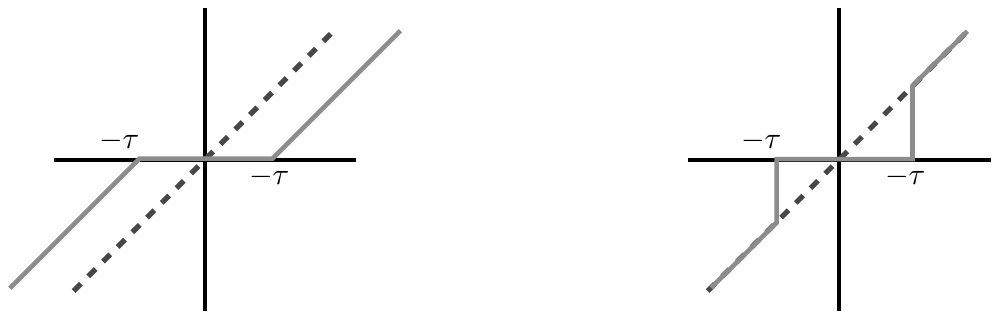

*Figura 5.1 (p. 173): operador de gradiente proximal para el problema de regresión regularizado con ℓ1 (izquierda) y ℓ0 (derecha). El eje horizontal es la entrada `z_j` y el vertical la salida `x*_j`. Los valores de umbral `τ` están determinados por los parámetros específicos del problema, `β` y `λ`.*

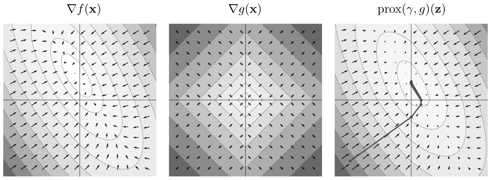

*Figura 5.2 (p. 173): campos vectoriales de gradiente y conjuntos de nivel de pérdida para el problema de regresión LASSO: (izquierda) pérdida de mínimos cuadrados `f(x)`; (centro) pérdida ℓ1 `g(x)`; (derecha) campo vectorial del gradiente proximal `prox_{γ,g}(x − γ∇f(x))` y descenso proximal por gradiente.*

### E5.2 — Example: Solving the ℓ0 Problem with Prox Gradient (pp. 173–174)

Análogamente, para el regularizador `g(x) = λ∥x∥₀`:

$$
\mathrm{prox}_{\frac{1}{\beta},\lambda\|\cdot\|_0}(z) = \arg\min_x \; \tfrac{\beta}{2}\|x-z\|_2^2 + \lambda\|x\|_0 = \arg\min_x \; \sum_{j=1}^{n} \Big[ \tfrac{\beta}{2}(x_j-z_j)^2 + \lambda\,\mathbf{1}(x_j \neq 0) \Big]
$$

La función indicador `1(x_j ≠ 0)` vale 1 si `x_j ≠ 0` y 0 si `x_j = 0`.

**Desarrollo (pp. 173–174).** En lugar de calcular el gradiente y ponerlo igual a cero, como en el problema regularizado con ℓ1, se resuelve directamente el `x*_j` que minimiza el objetivo. Se está **balanceando los dos términos**: o se elige `x*_j = 0` para eliminar el segundo término, en cuyo caso el error del `j`-ésimo término es `(β/2)z_j²`; o se elige `x*_j ≠ 0`, en cuyo caso el segundo término vale `λ` — y en ese caso lo mejor es elegir `x_j = z_j` para eliminar el primer término. De ahí los casos:

$$
x^*_j = 0 \;\Longrightarrow\; \tfrac{\beta}{2}z_j^2
\qquad\qquad
x^*_j = z_j \neq 0 \;\Longrightarrow\; \lambda
$$

**R5.6 — Umbralización dura (*hard thresholding*) (p. 174).** Dependiendo de `z_j`, se elige el `x*_j` que da el menor de `(β/2)z_j²` y `λ`. Cuando `z_j² < 2λ/β` se elige `x*_j = 0`, y cuando `z_j² > 2λ/β` se elige `x*_j = z_j`. Esto es exactamente la **umbralización dura iterativa**, mostrada en la Fig. 5.1, con umbral

$$
\tau = \sqrt{\tfrac{2\lambda}{\beta}}
$$

**Observación notable del libro (p. 174):** "El problema ℓ0 no es siquiera diferenciable ni continuo, y aun así es posible calcular el paso de gradiente proximal."

### Constrained Optimization and the Projected Gradient Algorithm (pp. 174–175)

**R5.7 — Indicador del conjunto factible (definición) (p. 174).** Las restricciones se pueden manejar con el gradiente proximal añadiéndolas directamente a la función objetivo, mediante una penalización infinita para `x` fuera del conjunto factible `C`:

$$
g(x) = \delta_C(x) = \begin{cases} 0, & x \in C \\ \infty, & x \notin C \end{cases}
$$

Esta función es no suave, discontinua y no acotada. Sin embargo, se puede calcular su gradiente proximal, lo que permite desarrollar un algoritmo de descenso basado en gradiente para problemas de optimización restringida.

**R5.8 — El operador proximal del indicador es la proyección (p. 174).**

$$
\mathrm{prox}_{\frac{1}{\beta},\delta_C} = \arg\min_x \; \tfrac{\beta}{2}\|x-z\|_2^2 + \delta_C(x) = \arg\min_{x \in C} \; \tfrac{\beta}{2}\|x-z\|_2^2 \equiv \mathrm{proj}_C(z)
$$

El operador proximal toma un paso de gradiente sobre `f(x)` y luego **proyecta sobre el conjunto factible `C`**. Este operador de proyección puede o no ser simple de calcular; por ejemplo, si `C` es una esfera o una caja, es simple proyectar `z` sobre ese conjunto.

**R5.9 — Algoritmo de gradiente proyectado (prosa, p. 174).** La idea básica: iniciar con un `x₀` en el conjunto factible, tomar un paso de iteración de gradiente sin restricciones, y **proyectar la solución de vuelta al conjunto factible**. Se itera hasta la convergencia.

**R5.10 — Proyección sobre cajas (*box constraints*) (pp. 174–175).** El problema de regresión por mínimos cuadrados restringido a cajas:

$$
\min_x \; \tfrac{1}{2}\|Ax-b\|_2^2 \tag{5.6a}
$$
$$
\text{s.t. } \ell \le x \le u \tag{5.6b}
$$

Las restricciones de caja sobre cada coordenada se escriben `ℓ_j ≤ x_j ≤ u_j`. Se comienza con un `x₀` en la caja `[ℓ, u]`, se toma un paso sin restricciones

$$
z_{k+1} = x_k - \gamma\nabla f(x_k)
$$

y se proyecta de vuelta a la caja factible:

$$
x_{k+1} = P_{[\ell,u]}(z_{k+1}) \qquad \text{donde} \qquad P_{[\ell,u]}(z)_j = \min\{u_j,\ \max\{\ell_j,\ z_j\}\}
$$

Con `f(x) = ½∥Ax − b∥²₂`, de modo que `∇f(x) = Aᵀ(Ax − b)`. El libro anticipa: "Revisitaremos los mínimos cuadrados restringidos a caja en el contexto de multiplicadores de Lagrange en el Capítulo 6."

### Splitting Methods (pp. 175–176)

El operador proximal del gradiente proximal generaliza a una **amplia familia de métodos de separación por variables (*operator splitting methods*)**. En estos métodos, se descompone un problema con múltiples términos en el objetivo, introduciendo variables extra para tratar cada término por separado; esas variables se acoplan luego con un término adicional en el objetivo.

**R5.11 — La formulación con variables separadas (p. 175).** La idea general es transformar un problema de la forma

$$
\min_x \; f(x) + g(x) \tag{5.7}
$$

en la forma

$$
\min_{x,z} \; f(x) + g(z) + \tfrac{\rho}{2}\|x-z\|_2^2 \tag{5.8}
$$

El término de regularización `g(x)` puede usarse para promover propiedades específicas, como dispersión, o imponer restricciones (Capítulos 4 y 6). Los términos tienen variables de decisión distintas `x` y `z`, acopladas por el cuadrático `(ρ/2)∥x − z∥²₂`. **El parámetro `ρ` determina la tightness de este acoplamiento**.

**Advertencia (prosa, p. 175):** técnicamente, la Ec. (5.8) resuelve un problema *diferente* que aproxima la Ec. (5.7); para resolver exactamente la Ec. (5.7), se añade la restricción `x = z` mediante multiplicadores de Lagrange, que es el enfoque que toma **ADMM**.

**Beneficios (prosa, p. 175):** (i) se rompe un problema complejo en subproblemas más simples, cada uno mejor condicionado; (ii) se puede usar un algoritmo distinto para cada término —por ejemplo, un solucionador de mínimos cuadrados precondicionado para `f(x)` y un descenso proximal por gradiente para la `g(x)` no suave.

**R5.12 — Aplicación a la regresión por mínimos cuadrados (p. 175).** El problema de regresión por mínimos cuadrados con `f(x) = ½∥Ax − b∥²₂` se escribe

$$
\min_{x,z} \; \tfrac{1}{2}\|Ax-b\|_2^2 + g(z) + \tfrac{\rho}{2}\|x-z\|_2^2 \tag{5.9}
$$

Es posible incorporate normas no suaves y no convexas mediante gradientes proximales. La regresión **LASSO** usa `g(z) = λ∥z∥₁`, y la regresión **ridge** usa `g(z) = α∥z∥²₂`. Ocasionalmente, los algoritmos añaden una matriz adicional `C` en el último término: `(ρ/2)∥Cx − z∥²₂`.

**Nota al pie 2 (p. 175):** "ADMM es un método primal-dual, lo que significa que depende tanto de la formulación primal como de la dual del problema de optimización, mientras que SR3 y el descenso proximal por gradiente son algoritmos **solo primales**, es decir, dependen únicamente de la forma primal original del problema. Los métodos primales suelen ser más fáciles de formular y de trabajar. Discutiremos los métodos duales con más detalle en el Capítulo 6."

### Sparse, Relaxed, Regularized Regression (SR3) (pp. 176–178)

**R5.13 — Definición de SR3 (p. 176).** La regresión *sparse, relaxed, regularized* (SR3) [551] es un marco potente para manejar problemas de optimización dispersos no suaves y no convexos, de forma rápida y precisa.

**Marco conceptual (prosa, p. 176):** los problemas de optimización del mundo real son a menudo mal planteados o numéricamente inestables. **Regularización** y **relajación** son dos estrategias comunes para mitigar estos desafíos:

- **Regularización**: modifica una función objetivo para mejorar la estabilidad, la interpretabilidad o la generalización.
- **Relajación**: reemplaza términos no convexos en las restricciones o en la función objetivo con aproximaciones convexas que amenable al cálculo.

Combinadas, regularización y relajación proveen un marco potente para manejar sistemáticamente problemas grandes, mal condicionados o combinatorialmente complejos. **Los métodos de separación son formas efectivas de resolver problemas regularizados y relajados.** En lugar de satisfacer todas las restricciones y objetivos con la misma variable de decisión, la separación introduce nuevas variables de decisión para cada término, añadiendo un término final de regularización para acoplarlos fuertemente. Esto hace más tratables los problemas *stiff*.

**Antecedentes (prosa, p. 176):** para problemas convexos, la formulación SR3 es parte de una clase mayor de problemas [30] donde es posible usar algoritmos de minimización alternada [2]. Los métodos originales de proyección alternada se remontan a los años 1950, por Von Neumann [516] y Cheney y Goldstein [103].

**Aplicación a optimización dispersa (p. 176):** la optimización dispersa es ubicua, y SR3 divide los requisitos de dispersión y exactitud en la Ec. (5.9) entre las variables `z` y `x`. El algoritmo itera entre resolver los subproblemas en `x` y en `z` individualmente, combinando `(ρ/2)∥x − z∥²₂` y `g(z)` en un paso de gradiente proximal. El término en `x` puede resolverse usando mínimos cuadrados precondicionados.

**R5.14 — Conjuntos de nivel casi esféricos (p. 176).** Es posible minimizar parcialmente en `x` para obtener una función enteramente en `z`, que **ha sido mostrado que tiene conjuntos de nivel casi esféricos** (esquema en la Fig. 5.3, en Zheng et al. [551]). Esto contrasta con los conjuntos de nivel elípticos y altamente excéntricos de `∥Ax − b∥²₂`.

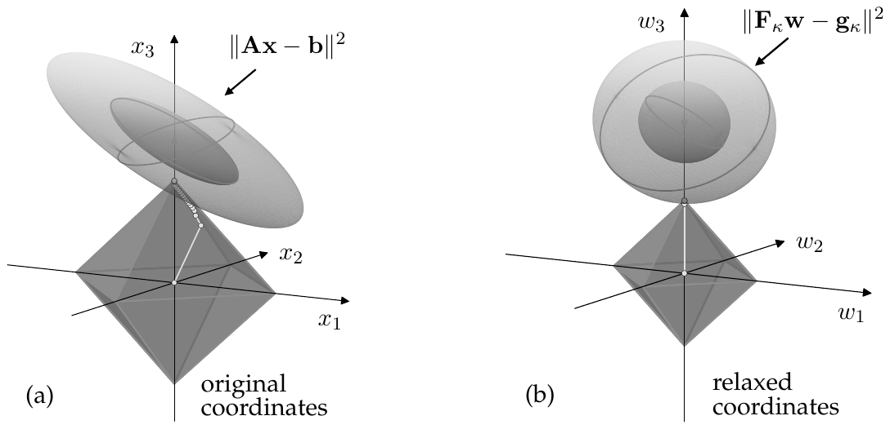

*Figura 5.3 (p. 177): (a) Conjuntos de nivel (elipses verdes) de la parte cuadrática de LASSO y el camino correspondiente del gradiente proximal a la solución (40 iteraciones) en coordenadas `x`. (b) Conjuntos de nivel (esferas verdes) de la pérdida SR3 y el camino de solución SR3 (2 iteraciones) en coordenadas relajadas `w`. Los octaedros azules muestran la bola ℓ1 en cada conjunto de coordenadas. SR3 disminuye los valores singulares de `Fκ` relativos a los de `A` con un efecto más débil sobre los pequeños, "aplastando" los conjuntos de nivel en esferas aproximadas, acelerando la convergencia y mejorando el desempeño. Reproducido de Zheng et al. [551].*

**Contexto de uso (p. 176):** estos conceptos se usarán en los capítulos posteriores sobre problemas inversos, teoría de control y aprendizaje automático, donde la relajación y la regularización son esenciales. Ejemplos: regresión dispersa (LASSO), regresión ridge, ajuste robusto, y entrenamiento de redes neuronales bajo restricciones (p. ej. derivadas de la física). En procesamiento de señales y análisis de imágenes: regularización de variación total (TV) para quitar ruido, restricciones de dispersión basadas en wavelets y regularización dispersa para reconstrucción de imágenes con mediciones dispersas, y regularización por norma nuclear para completamiento de matrices. Ya se han visto ejemplos de relajar restricciones enteras a un programa lineal continuo. Finalmente, en control robusto y optimización restringida por PDE, pequeños cambios en los parámetros del modelo pueden producir resultados inestables o mal planteados, lo que hace necesaria la regularización y la relajación.

**R5.15 — El problema de los falsos positivos en LASSO (p. 176).** Se mostró en Su et al. [472] que al ejecutar LASSO, **los falsos positivos ocurren temprano en el camino de optimización y no pueden revertirse**, dando lugar a muchos falsos positivos comparados con los verdaderos positivos. Esto se atribuye en gran medida a la excentricidad de la geometría del problema de optimización, que se mitiga en gran medida con SR3. En SR3, **casi no hay falsos positivos**, lo que da un algoritmo más preciso y más eficiente (Fig. 5.4).

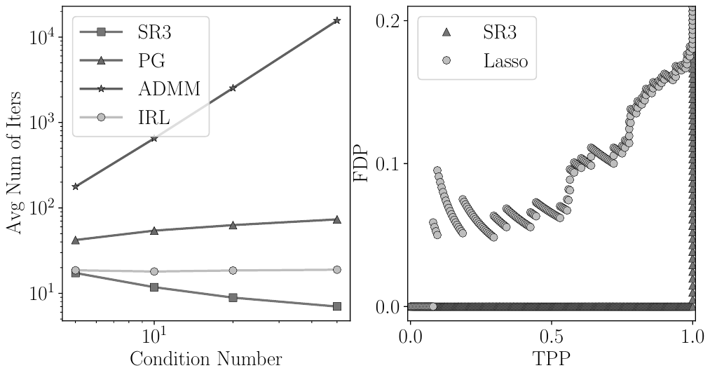

*Figura 5.4 (p. 177): Arriba a la izquierda: el enfoque SR3 (rojo) es órdenes de magnitud más rápido que ADMM (verde) u otros métodos de primer orden como el gradiente proximal (gris). Mientras que los mínimos cuadrados reponderados iterativamente (IRL, azul) requieren un número comparable de iteraciones, su costo por iteración es más caro que el de SR3. Arriba a la derecha: verdaderos positivos vs. falsos positivos a lo largo del camino de LASSO (azul) y a lo largo del camino de SR3 (rojo). Reproducido de Zheng et al. [551].*

**Nota al pie 3 (p. 176):** "De hecho, SR3 fue originalmente desarrollado en una discusión con Sasha Aravkin sobre la sorprendente efectividad de nuestro algoritmo de mínimos cuadrados secuencialmente umbralizados (STLS), usado en el algoritmo de identificación dispersa de dinámicas no lineales (SINDy) [80]. Peng Zheng y Sasha mostró que nuestro algoritmo para resolver el problema de optimización dispersa ℓ0 era un descenso proximal por gradiente sobre un particular función de valor, y luego procedieron a generalizar este enfoque para varios otros problemas de optimización dispersa. Esto se discutirá más en la Sección 8.7."


---

## 5.2  Nelder-Mead Downhill Simplex (pp. 178–183)

### Ideas principales

El método downhill simplex de Nelder–Mead es una técnica popular de **búsqueda local sin gradiente** para problemas de optimización sin restricciones. Fue introducido por **John Nelder y Roger Mead en 1965** [359]. A diferencia de los métodos basados en gradiente, que requieren información del gradiente o del Hessiano, Nelder–Mead trabaja **puramente con evaluaciones de valores de la función**. Es particularmente útil cuando la función objetivo es no diferenciable o discontinua en ciertas regiones, o cuando los gradientes numéricos o analíticos son difíciles o caros de obtener. Típicamente funciona bien cuando la dimensión del problema es relativamente pequeña, hasta algunas decenas de variables.

**Advertencia sobre la teoría (p. 178):** "A pesar de su popularidad en la práctica y de su facilidad de implementación, el método de Nelder–Mead **no tiene fuertes garantías teóricas de convergencia**. De hecho, hay contraejemplos conocidos, incluso para funciones estrictamente convexas [343], donde el método falla en converger o su desempeño se degrada."

**R5.16 — El idea de fondo (prosa, p. 178).** Consideremos un problema de minimización. Dado `x ∈ ℝⁿ`, se inicializa un **simplex** en `ℝⁿ` con `n+1` vértices `{x_j}`, se evalúa la función objetivo en todos los vértices, y se modifica el vértice con el **mayor valor** de la función objetivo para moverlo idealmente a un valor menor. De este modo, se mueve iterativamente el **centroide** del simplex a un valor menor de la función objetivo, un vértice a la vez, sin necesidad de calcular un gradiente en ningún paso. En cierto sentido, este simplex "rueda colina abajo" por el paisaje de la función objetivo.

**R5.17 — Definición formal (pp. 178–179).** En cada paso, el simplex actual está definido por los puntos `{x₀, x₁, ···, xₙ}`, y se asume que están ordenados de modo que

$$
f(x_0) \le f(x_1) \le \cdots \le f(x_n)
$$

donde `f` es la función objetivo que se minimiza. Se define el **centroide de los `n` mejores puntos** del simplex (omitiendo el `(n+1)`-ésimo) como

$$
\bar{x} = \frac{1}{n}\sum_{j=0}^{n-1} x_j
$$

### R5.18 — Las cuatro operaciones de Nelder–Mead (pp. 178–180)

En cada paso de la iteración, el simplex se modifica según el procedimiento siguiente:

**1. Reflexión.** Se refleja el punto `xₙ` respecto del centroide `x̄`:

$$
x' = \bar{x} + \alpha(\bar{x} - x_n)
$$

donde `α` es el **coeficiente de reflexión**, que aumenta la distancia del centroide (`α > 1`), la disminuye (`α < 1`) o la mantiene (`α = 1`). Típicamente `α ≈ 1` es una buena elección inicial.

Se compara ahora `f(x')` contra el valor objetivo en los otros vértices. Si el nuevo vértice reflejado cae entre el mejor y el segundo mejor, `f(x₀) ≤ f(x') < f(x_{n−1})`, entonces se reemplaza `xₙ` por `x'`, se termina la iteración y se pasa al paso 1 de la siguiente iteración. En caso contrario, se procede a los pasos siguientes según el ranking de `f(x')`.

**2. Expansión.** Si `x'` es el nuevo mejor vértice, de modo que `f(x') < f(x₀)`, entonces se expande el punto más lejos en esta nueva dirección reflejada:

$$
x'' = \bar{x} + \gamma(\bar{x} - x_n)
$$

donde `γ ≈ 2α > 1` es el **coeficiente de expansión**. Si el nuevo valor sigue siendo el mejor, `f(x'') < f(x')`, se reemplaza `xₙ` por `x''`; en caso contrario, se reemplaza por `x'`. La iteración termina y se procede con el paso 1.

**3. Contracción.** Si `x'` sigue siendo el peor vértice, de modo que `f(x') ≥ f(x_{n−1})`, entonces se realiza una contracción

$$
x'' = \bar{x} + \rho(\bar{x} - x_n)
$$

donde `ρ ≈ 0.5α < 1` es el **coeficiente de contracción**. Si el nuevo vértice `x''` es mejor que `x'`, es decir `f(x'') < f(x')`, se reemplaza `xₙ` por `x''` y se termina esta iteración. De lo contrario, cuando todo lo demás falla, "como un balde de agua fría", se procede a la operación de contracción (*shrinkage*).

**4. Contracción (*Shrink*).** Aquí se contraen todos los otros vértices `j = 1, ···, n` hacia el mejor vértice `x₀`:

$$
x_i \leftarrow x_0 + \sigma(x_i - x_0)
$$

donde `0 < σ < 1` es el **coeficiente de contracción (shrinkage)**. Típicamente `σ ≈ 0.5` es razonable.

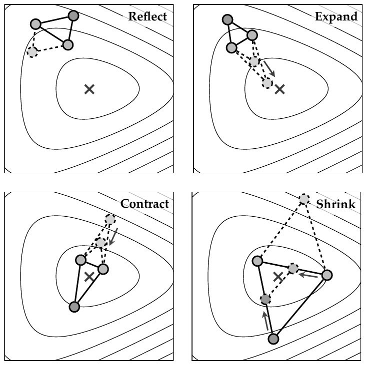

*Figura 5.6 (p. 181): ilustración de las varias operaciones del downhill simplex. La primera operación es una reflexión simple. Si el punto reflejado es el nuevo óptimo en el simplex, entonces pasamos a la operación de expand, moviéndonos más en esta dirección favorable. Si el nuevo punto sigue siendo el peor, entonces contraemos, acercándonos más al centroide. Si todo lo demás falla, movemos todos los puntos más cerca del punto óptimo actual.*

**Nota (p. 180):** "Los parámetros anteriores son los valores por defecto propuestos originalmente por Nelder y Mead. Ajustarlos puede cambiar la agresividad de la exploración y la estabilidad del método."

**R5.19 — Criterios de terminación (p. 180).** Hay varios criterios comunes de terminación:

- Los valores de la función en todos los vértices del simplex son suficientemente cercanos entre sí (p. ej. `max_j |f(x_j) − f(x₀)| < ϵ`).
- El **tamaño del simplex** (p. ej. la distancia máxima entre vértices) está por debajo de una tolerancia.
- El número de **evaluaciones de la función** o de iteraciones alcanza un máximo especificado.

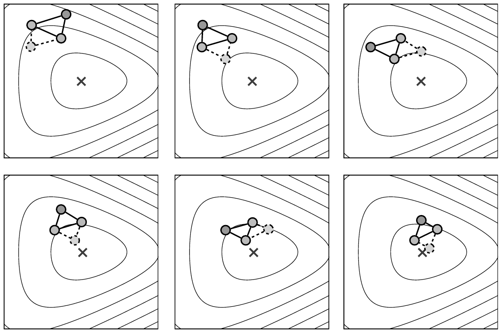

*Figura 5.5 (p. 179): esquema del método downhill simplex sobre una función objetivo bidimensional simple con un único mínimo global. El simplex se ilustra por los tres vértices coloridos, con el azul teniendo el valor de función objetivo más bajo, el rojo el más alto, y el morado en el medio. En cada reflexión, el vértice rojo se convierte en el vértice gris discontinuo. En este ejemplo, las reflexiones simples bastan para llevar el simplex hacia el mínimo.*

### E5.3 — Example in Python (pp. 181–183)

El libro demuestra la capacidad del downhill simplex para encontrar un óptimo global de un paisaje no convexo con cuatro mínimos locales. La función objetivo es

$$
f(x) = 1 + f_1(x) + f_2(x) + f_3(x) + f_4(x) \tag{5.10}
$$

donde cada `f_j(x)` se define como

$$
f_j(x) = -\alpha_j\, e^{-\frac{1}{2}\|x-x_j\|_2^2}
$$

y `x_j` es el centro del `j`-ésimo mínimo y `α_j` es la profundidad. Para este ejemplo se usan `(α₁, α₂, α₃, α₄) = (3, 1.5, 1, 2)` en los centros `x₁ = (2, 2)`, `x₂ = (−2, 2)`, `x₃ = (2, −2)` y `x₄ = (−2, −2)`. Esta función se visualiza en la Fig. 5.7.

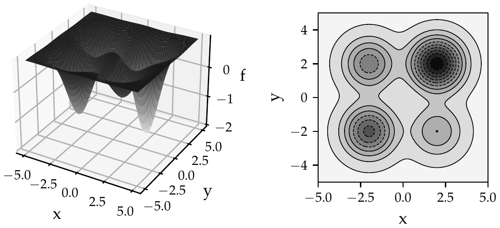

*Figura 5.7 (p. 182): la función objetivo con cuatro mínimos locales, visualizada en tres dimensiones (izquierda) y en contornos (derecha).*

**Código (p. 182, VERBATIM).** El siguiente código realiza una iteración del método downhill simplex, donde `α`, `γ`, `ρ` y `σ` son los coeficientes de reflexión, expansión, contracción y contracción (*shrinkage*):

```python
def nelder_mead_step(vertices, alpha, gamma, rho, sigma):
    vals = np.array([f(v) for v in vertices])
    order = np.argsort(vals)
    vertices = vertices[order]
    vals = vals[order]

    x1, x2, x3 = vertices # vertices : np.ndarray of shape (3,2)
    f1, f2, f3 = vals     # best, middle, worst

    center = (x1 + x2) / 2.0 # center of best and middle points

    # Reflection
    x_reflect = center + alpha * (center - x3)
    f_reflect = f(x_reflect)

    if f_reflect < f1:           # Expansion
        x_expand = center + gamma * (x_reflect - center)
        f_expand = f(x_expand)
        if f_expand < f_reflect:
            vertices[2] = x_expand
        else:
            vertices[2] = x_reflect
    elif f_reflect < f2:
        vertices[2] = x_reflect
    else       # Reflection is worse than mid
        if f_reflect < f3:       # Outside contraction
            x_contr = center + rho * (x_reflect - center)
            f_contr = f(x_contr)
            if f_contr <= f_reflect:
```

`[EXTRACCIÓN DAÑADA: el listado de código queda interrumpido aquí por un salto de página; el pie de página, el encabezado de sección y el eje de la Fig. 5.8 se interponen entre la línea "if f_contr <= f_reflect:" y su continuación "vertices[2] = x_contr". La continuación se recompone desde la página siguiente (p. 183), donde el libro retoma el bloque. La recomposición conserva la indentación y los comentarios tal como están impresos.]`

```python
                vertices[2] = x_contr
            else:                # Shrink
                vertices[1] = x1 + sigma*(x2 - x1)
                vertices[2] = x1 + sigma*(x3 - x1)
        else:                    # Inside contraction
            x_contr = center - rho * (center - x3)
            f_contr = f(x_contr)
            if f_contr < f3:
                vertices[2] = x_contr
            else:                # Shrink
                vertices[1] = x1 + sigma*(x2 - x1)
                vertices[2] = x1 + sigma*(x3 - x1)
    return vertices
```

**Invocación (p. 183, VERBATIM).**

```python
# Initialize a large simplex in 2D
vertices = np.array([[4.0, 4.0],
    [-4.0, -3.0],
    [-2.0, 4.0],])

# Perform Nelder-Mead updates
num_iterations = 30
for it in range(1, num_iterations+1):
    vertices = nelder_mead_step(vertices)
```

**Resultado (p. 183):** la función objetivo contra iteración se muestra en la Fig. 5.8. La Fig. 5.9 muestra la evolución del vértice en las primeras dieciséis iteraciones. "Tras una búsqueda inicial, encuentra el mínimo global y entonces desciende al mejor valor."

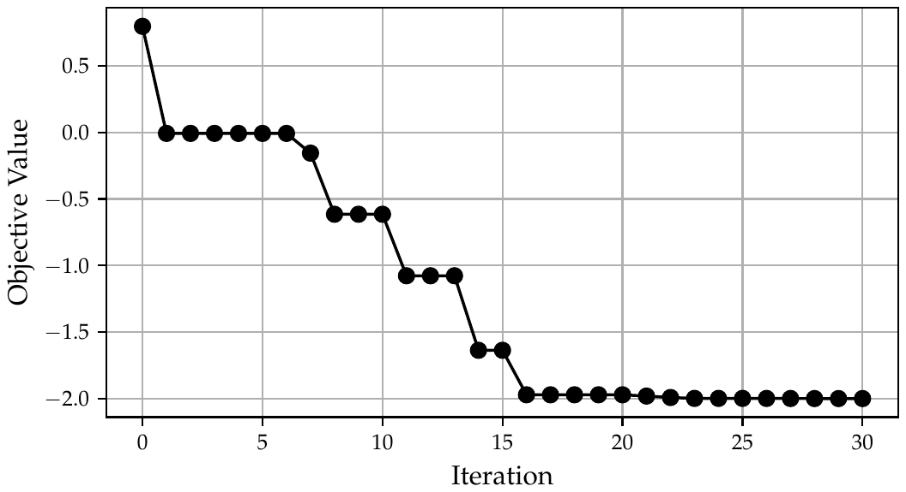

*Figura 5.8 (p. 183): función objetivo contra iteración para el método downhill simplex en el sistema no convexo con múltiples mínimos locales.*

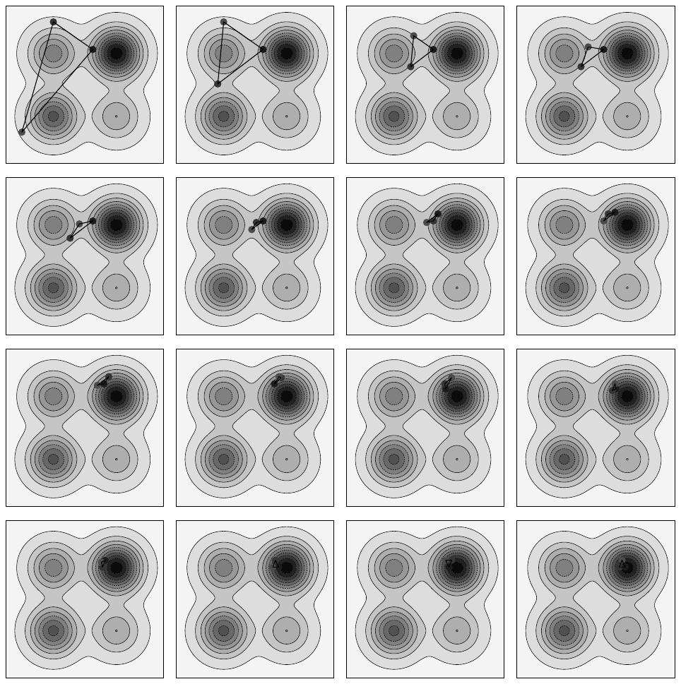

*Figura 5.9 (p. 184): ilustración del método downhill simplex en el sistema no convexo con múltiples mínimos locales. Tras una fase de exploración inicial, el simplex encuentra eventualmente los mínimos globales y desciende.*

### Fortalezas, debilidades y veredicto (p. 180)

**Fortalezas:** muy simple de implementar y no requiere información de gradiente ni de derivadas de orden superior, lo que lo hace una elección razonable para muchas situaciones. También es posible programarlo desde cero e implementar características especiales o a medida. Por ello, el algoritmo es a menudo efectivo para problemas a pequeña escala donde las evaluaciones de función son costosas, o las aproximaciones de gradiente son inviables.

**Debilidades:** hay relativamente pocos resultados de convergencia para problemas no convexos, y **converger a un mínimo local no está garantizado que sea global**. Sin embargo, el algoritmo puede a menudo navegar varios mínimos locales cercanos dependiendo del tamaño del simplex inicial y de los hiperparámetros de optimización. En dimensiones mayores, el algoritmo downhill simplex puede rendir mal, requiriendo a menudo muchas evaluaciones de función. Finalmente, sin un ajuste cuidadoso, el método puede estancarse o deambular lentamente alrededor de un óptimo.

**Veredicto del libro (p. 180):** "Sin embargo, en la práctica, el método downhill simplex de Nelder–Mead sigue siendo una de las técnicas de optimización local sin derivadas más ampliamente usadas [113]. Su marco conceptual simple y su configuración de hiperparámetros relativamente directa lo hacen atractivo para problemas de dimensiones bajas a moderadas, particularmente cuando las evaluaciones de función son caras o ruidosas pero uno prefiere un método local para refinar cerca de un óptimo sospechado."


---

## 5.3  Simulated Annealing (pp. 184–189)

### Ideas principales

El **recocido simulado** es una técnica de **optimización global estocástica** inspirada por el proceso metalúrgico de temple, en el que un material se calienta y luego se enfría lentamente para disminuir defectos y obtener una estructura cristalina fuerte [277, 515].

**La metáfora central (p. 184):** en el temple metalúrgico, el **calendario de enfriamiento específico** hace una diferencia tremenda en las propiedades finales del metal. En optimización, el recocido simulado usa una idea similar, aprovechando una "temperatura" inicialmente más alta para explorar el espacio de soluciones y escapar de mínimos locales, y luego bajando gradualmente la temperatura para enfocarse en refinar soluciones cerca de buenos mínimos locales. **En el recocido simulado, la temperatura se refiere al tamaño de paso de las perturbaciones aleatorias** que se hacen a la solución actual en cada paso iterativo, de modo que una temperatura más alta conduce a fluctuaciones aleatorias más grandes y más exploratorias.

**Propiedades (p. 184):** es un algoritmo de búsqueda global robusto y adecuado para problemas de optimización no convexos. No requiere información de gradiente y es capaz de manejar problemas de optimización estocásticos o ruidosos, así como problemas con variables discretas, continuas o mixtas. Es simple de implementar, ya que solo involucra evaluaciones de la función objetivo `f` y algo de lógica básica. Sin embargo, el calendario de enfriamiento y otros hiperparámetros juegan un papel esencial y deben ajustarse cuidadosamente.

**Sobre la teoría (p. 186):** "Hay una serie de resultados de convergencia interesantes para el recocido simulado en el límite de tiempo infinito, para calendarios de enfriamiento específicos. Sin embargo, en la práctica, aunque está diseñado para la exploración global, **no hay garantía de que se encuentre un mínimo global en tiempo finito**. La búsqueda global también puede ser consume tiempo, especialmente para problemas grandes."

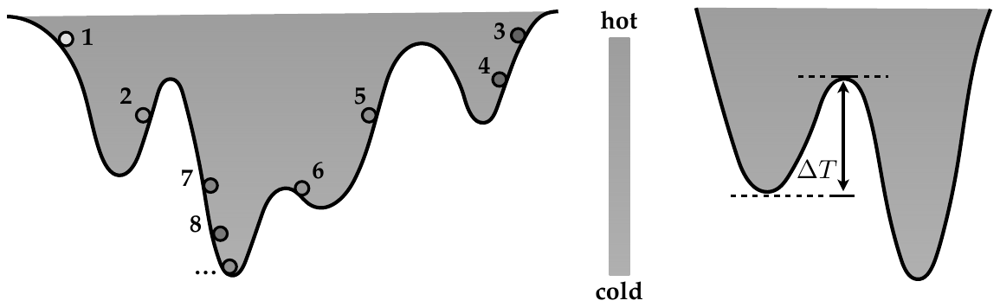

*Figura 5.10 (p. 186): esquema del recocido simulado. (Izquierda) Vemos un camino de ejemplo de la variable de decisión en el paisaje de la función objetivo a medida que pasa de caliente (amarillo/rojo) a frío (azul). (Derecha) La temperatura actual determina qué tan probable es saltar de un mínimo local a otro, lo cual está relacionado con el `ΔT` en la función objetivo.*

### Panel 5.3: Annealing Metal Alloys (p. 185)

> El temple es una práctica antigua de calentar y enfriar aleaciones metálicas para promover ciertas propiedades del material, como resistencia y durabilidad. El proceso de calentamiento y enfriamiento cambia las propiedades del material mediante la nucleación y recristalización de la microestructura, como se muestra en este esquema (de wikimedia por Daniele Pugliesi).
>
> Para el caso específico de una aleación Titanio-Niobio (45% Nb en peso) formada mediante torsión de alta presión bajo varios calendarios de temple, es posible visualizar la microestructura mediante microscopía electrónica de transmisión en campo claro (figura tomada de Völker et al. [515]). La izquierda muestra el material inicial sin temple alguno. La fila superior muestra 30 minutos de temple a diferentes temperaturas, y la fila inferior muestra tiempo de temple creciente a una sola temperatura. Se pueden lograr diferentes propiedades del material con diferentes calendarios de temple.
>
> El panel reproduce además las dos figuras del artículo de Völker et al. (*Materials and Design* 179 (2019) 107864), que con su propia tipografía y numeración ("Fig. 4", "Fig. 5") son ajenas a la numeración del libro:
>
> **Fig. 4.** Overview of the annealing experiments. Vickers microhardness (a) and reduced modulus, `E_r`, measurements (b) of samples that were isochronally heat-treated for 30 min. The hardness has a maximum at approximately 300 °C, whereas `E_r` increases up to 400 °C. Vickers hardness measurements (c) and `E_r` measurements (d) after isothermal heat treatments carried out at 300 °C for up to 10 h. With rising annealing time hardness and reduced modulus steadily increase.
>
> **Fig. 5.** Microstructural changes of HPT-deformed Ti45Nb upon annealing. The initial material for the heat treatments was the HPT-deformed material (a). In the upper row microstructures after 30 min at 300 °C (b), 400 °C (c) and 500 °C (d) are shown. In the lower row isothermally annealed microstructures at 300 °C for 60 min (e), 300 min (f) and 600 min (g) are presented.

`[EXTRACCIÓN DAÑADA: el texto del Panel 5.3 se entrelaza con los pies de las Figs. 4 y 5 del artículo de Völker et al. que el panel reproduce (con su tipografía y numeración propias, "Fig. 4", "Fig. 5", "B. Völker et al."), produciendo fragmentos ilegibles. El texto del panel y los dos pies de figura se recuperaron con pdftotext -raw y se conservan aquí sin las dos figuras ajenas al libro.]`

### R5.20 — El algoritmo de aceptación (p. 186)

Se busca minimizar una función objetivo `f(x)`; la variable de decisión `x` puede ser continua (`x ∈ ℝⁿ`) o discreta. El recocido simulado muestrea iterativamente una nueva solución candidata `x_{k+1}` en el **vecindario** de la solución actual `x_k`. La diferencia en valores objetivos `Δ = f(x_{k+1}) − f(x_k)` guía la aceptación de `x_{k+1}`:

1. Si `Δ ≤ 0` entonces la nueva solución es mejor, y **la aceptamos incondicionalmente**.
2. Si `Δ > 0`, la nueva solución es peor, y **la aceptamos con probabilidad**

$$
p = \exp\left(-\frac{\Delta}{T}\right)
$$

donde `T` es la temperatura actual.

Con el tiempo, `T` se disminuye según el **calendario de enfriamiento**, reduciendo la aceptación de soluciones peores. El algoritmo entonces se enfoca más en el refinamiento local cerca de buenas soluciones. Criterios de terminación típicos: un umbral de temperatura mínima, un número máximo de iteraciones, o detectar convergencia.

### R5.21 — Calendarios de enfriamiento (p. 186)

Una decaída **geométrica** clásica para la temperatura es

$$
T_{k+1} = \alpha\, T_k
$$

donde `0 < α < 1` es una constante (p. ej. `0.9 ≤ α ≤ 0.99`). Los calendarios más sofisticados ajustan la temperatura dinámicamente según las tasas de aceptación recientes.

**Sobre las garantías (p. 187):** "También hay algunas garantías teóricas para las tasas de enfriamiento `T_k` que se encuentran entre las curvas `1/k` y `1/k²`."

### R5.22 — Hiperparámetros a ajustar (p. 187)

- **Temperatura inicial `T₀`:** debe ser suficientemente alta para permitir la aceptación frecuente de movimientos peores al comienzo, para encourage la exploración global. Un `T₀` demasiado grande aumenta el número de iteraciones requeridas antes de que la temperatura sea suficientemente baja para la explotación local de un mínimo local.
- **Factor de enfriamiento `α`:** para la decaída geométrica, determina qué tan rápido se reduce `T` en cada iteración. Demasiado rápido, y el algoritmo no tendrá tiempo de explorar; demasiado lento, y el algoritmo puede no converger rápidamente ni a un buen mínimo.
- **Función de vecindario u "operador de movimiento" (*move operator*):** determina cómo se generan nuevas soluciones candidatas a partir de la solución actual. En dominios continuos, se pueden añadir pequeñas perturbaciones aleatorias gaussianas o uniformes. En dominios discretos (p. ej. traveling salesman), puede ser un intercambio por permutación aleatoria.
- **Criterios de terminación:** varias opciones incluyen alcanzar una temperatura mínima `T_min`, un número máximo de iteraciones, o ninguna mejora por un número de pasos.

### E5.4 — Code Example (pp. 187–189)

Se explora la función objetivo de la Ec. (5.10) con recocido simulado. La Fig. 5.11 muestra la progresión de la variable de decisión, desde una condición exploratoria "caliente" en rojo hasta la condición final "fría" casi óptima en azul.

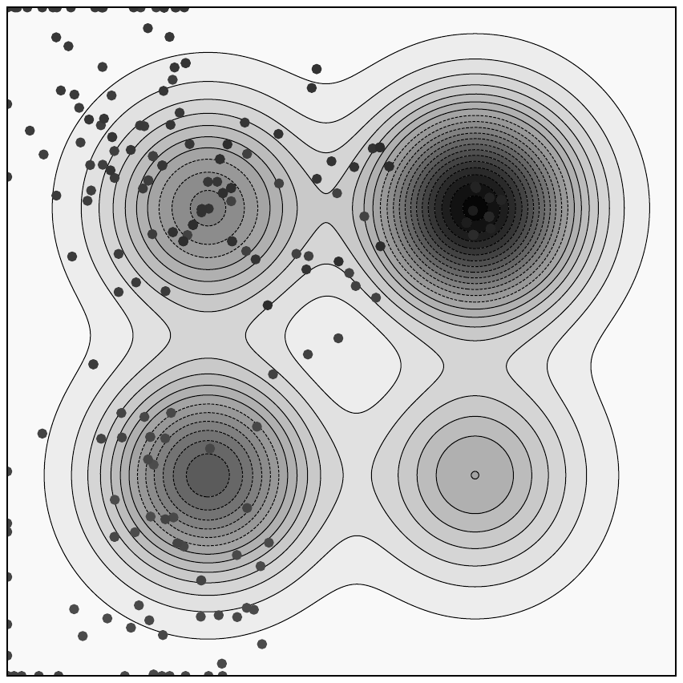

*Figura 5.11 (p. 188): ilustración del proceso de recocido simulado, donde los puntos iniciales "calientes" son rojos, y a medida que "se enfrían" se vuelven más azules. Eventualmente se encuentra el mínimo global.*

**Código (p. 187, VERBATIM).** El siguiente código rastrea el mejor valor objetivo en cada iteración y devuelve el camino de puntos visitados:

```python
def simulated_annealing(init_point, n_iter=200, T0=5.0, alpha=0.98,
    step_size=1.0, bounds=(-5,5)):
    current = np.array(init_point, dtype=float)
    current_val = f(current)
    path = [current.copy()]
    temp = T0 # Initial temperature

    for i in range(n_iter):
        # Propose random step
        candidate = current + np.random.randn(2) * step_size
        candidate = np.clip(candidate, bounds[0], bounds[1])
        candidate_val = f(candidate)
        delta = candidate_val - current_val

        # Accept if better or with probability eˆ(-delta/T)
        if delta < 0:
            current, current_val = candidate, candidate_val
        else:
            if np.random.rand() < np.exp(-delta / temp):
                current, current_val = candidate, candidate_val

        temp *= alpha # Lower the temperature
```

`[EXTRACCIÓN DAÑADA: el listado queda interrumpido por un salto de página; el pie de copyright, el encabezado de sección y el pie de la Fig. 5.11 se interponen entre la línea "temp *= alpha" y la continuación "path.append(current.copy())". La continuación se recompone desde la página siguiente (p. 188).]`

```python
    path.append(current.copy()) # Store the path
    return np.array(path)
```

**Invocación (p. 188, VERBATIM).**

```python
xIC = np.array([-4.0, -4.0]) # Initial guess (bad)
path = simulated_annealing(
    init_point=xIC,n_iter=200,T0=10.0,alpha=0.98,step_size=1.)
```

**Alternativa con paquete estándar (p. 188, VERBATIM).**

```python
from scipy.optimize import dual_annealing

# Domain bounds for x,y in [-5, 5]
bounds = [(-5, 5), (-5, 5)]

result = dual_annealing(objective_2d, bounds=bounds, maxiter=1000,
    seed=0)
```

**Atributos del objeto resultado (p. 188):** `x` (el mejor punto encontrado), `fun` (la función objetivo en ese punto), `nfev` (número de evaluaciones de función) y `nit` (número de iteraciones). Para acceder a más datos internos de cada iteración, por ejemplo para graficar el camino de optimización, se puede usar una función de callback.

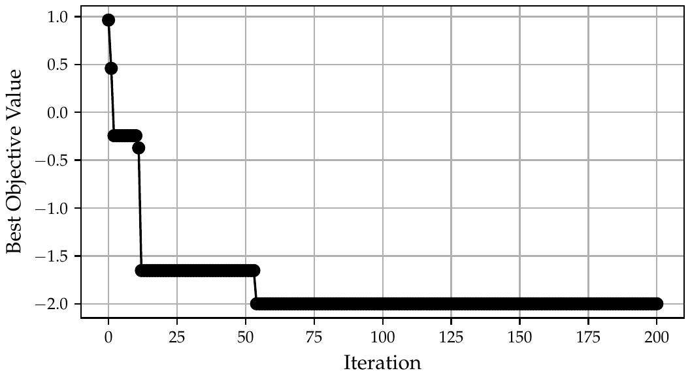

*Figura 5.12 (p. 189): se muestra la función objetivo contra iteración para el recocido simulado.*

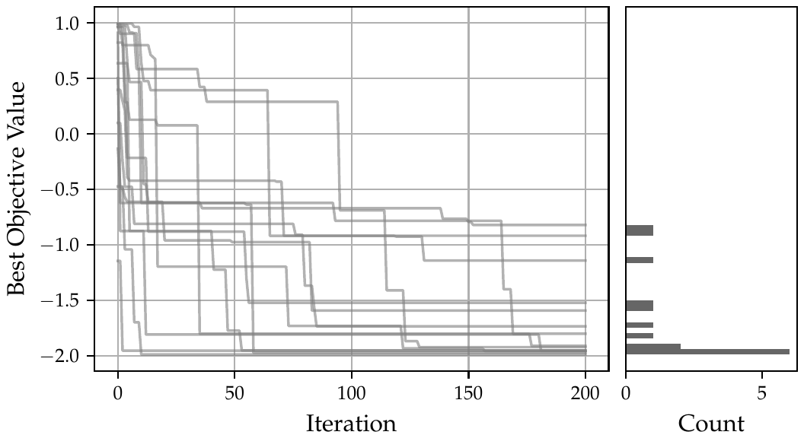

*Figura 5.13 (p. 189): conjunto (ensemble) de múltiples caminos de recocido simulado (izquierda), con un histograma del valor optimizado final (derecha).*

**Nota (p. 189):** "También es posible graficar el costo por iteración del proceso de temple en la Fig. 5.12. Es ilustrativo repetir este proceso para un *ensemble* de muchos caminos de temple, en la Fig. 5.13, para ver cómo evoluciona la distribución con el número de iteración."


---

## 5.4  Evolutionary Algorithms (pp. 190–194)

### Ideas principales

Los **algoritmos evolutivos** forman una amplia clase de métodos para optimización no convexa, basados en los principios de la evolución biológica y la supervivencia del más apto. Las operaciones evolutivas —**replicación, mutación e intercambio de información genética**— se usan para evolucionar iterativamente poblaciones de soluciones candidatas. Con una elección juiciosa de hiperparámetros, la distribución de desempeño de esta población mejorará y los individuos de la población podrán acercarse a soluciones globalmente óptimas.

**Las dos grandes categorías (p. 190):**

- **Optimización de parámetros:** es un problema más simple, donde aprendemos los parámetros de una función con estructura conocida. El objetivo es encontrar los parámetros óptimos dado cierta función objetivo —por ejemplo, entrenar una red neuronal que ajuste `ŷ = f_θ(x)` a los datos `y`, o aprender los parámetros de una ley de control con desempeño óptimo.
- **Optimización de funciones:** es más desafiante, porque aprendemos tanto la estructura como los parámetros de una función que optimiza una función objetivo dada. De nuevo, la tarea puede ser ajustar datos con una aproximación aprendida `f(x)` o aprender una ley de control `u = f(x)`; pero en este caso también aprenderemos la estructura de `f`.

El libro empieza con los **algoritmos genéticos**, por su simplicidad y amplia aplicabilidad, y procede luego a la clase más desafiante pero más flexible de la **programación genética**. La programación genética suele denominarse **regresión simbólica**, porque produce representaciones analíticas de la función que se optimiza; esto es útil para la IA explicable [116].

### R5.23 — Operaciones genéticas (p. 190)

Los algoritmos genéticos (GA) se usan para optimización de parámetros [234, 127, 195]. En GA, una población de muchas realizaciones con diferentes valores de parámetros compite para minimizar una función de costo, y los valores de parámetros exitosos se propagan a generaciones futuras mediante un conjunto de reglas genéticas. Los parámetros de un sistema generalmente se representan por una **secuencia binaria** (Fig. 5.14) —por ejemplo, pueden representar las tres ganancias de control `K_P`, `K_I` y `K_D` de un controlador PID [76].

Se inicializa una población de realizaciones con diferentes valores de parámetros, llamadas **individuos**, y se evalúa y compara su desempeño en una tarea bien definida. Los individuos exitosos, con un costo menor, tienen mayor probabilidad de ser seleccionados para avanzar a la siguiente generación, según las siguientes operaciones genéticas:

| Operación | Descripción del libro (p. 190) | Efecto |
|---|---|---|
| **Replication** | "An individual is selected to advance to the next generation." | Propaga el Individuo seleccionado |
| **Crossover** | "Two individuals are selected to exchange a portion of their code and advance to the next generation." | Explota y mejora estrategias exitosas |
| **Mutation** | "An individual is selected to have some of its code modified with new values." | Promueve la diversidad y aumenta la exploración del espacio de parámetros |
| **Elitism** (opcional) | "A set number of the most fit individuals are advanced directly to the next generation." | Elitismo está estrechamente relacionado con la replicación, pero involucra un número fijo de los mejores individuos en lugar de una selección aleatoria |

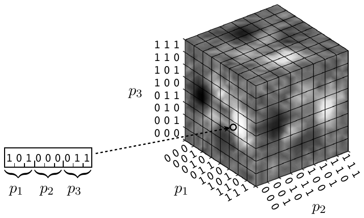

*Figura 5.14 (p. 191): depiction de un cubo de parámetros con tres parámetros `p₁`, `p₂` y `p₃`. Por ejemplo, estos tres parámetros pueden representar las ganancias proporcional, integral y derivativa de un controlador PID. El algoritmo genético representa un valor de parámetro dado como una secuencia genética que concatena los distintos parámetros. En este ejemplo, los parámetros se expresan en representación binaria escalada de modo que `000` es el límite inferior y `111` el superior. El color indica el costo asociado a cada valor de parámetro.*

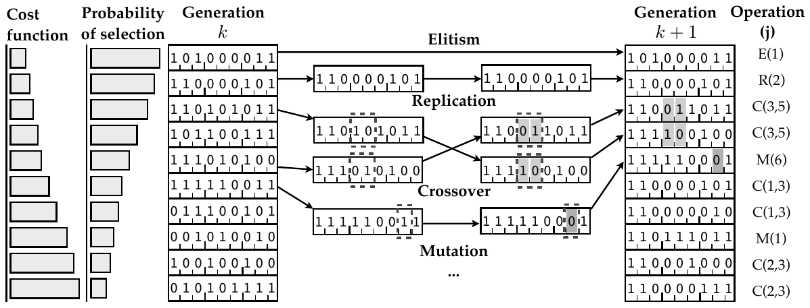

*Figura 5.15 (p. 191): esquema ilustrando la evolución en un algoritmo genético. Los individuos de la generación `k` son evaluados y clasificados según su función de costo, que es inversamente proporcional a su probabilidad de selección para operaciones genéticas. Los individuos se eligen con base en esta probabilidad ponderada para avanzar a la generación `k+1` usando las cuatro operaciones: elitismo, replicación, crossover y mutación. Las iteraciones de generación se repiten hasta que las estadísticas de la población convergen o se alcanza otro criterio de terminación. Nótese que hay extensiones para manejar números de punto flotante también.*

**Nota (p. 191–192):** "Para replicación, crossover y mutación, los individuos son seleccionados aleatoriamente para avanzar a la siguiente generación con una probabilidad de selección que aumenta con la aptitud. Las operaciones genéticas se ilustran para el ejemplo de control PID en la Fig. 5.15. Estas generaciones se evolucionan hasta que la aptitud de los individuos superiores converge o se alcanzan otros criterios de terminación."

**R5.24 — No hay garantía de óptimo global (pp. 191–192).** Los algoritmos genéticos se usan generalmente para encontrar valores de parámetros casi globalmente óptimos, ya que son capaces de explorar y explotar pozos locales en la función de costo. **GA proporciona un punto medio entre una búsqueda de fuerza bruta y una optimización convexa**, y es una alternativa al muestreo Monte Carlo caro, que no escala a espacios de parámetros de alta dimensión. Sin embargo, **no hay garantía de que los algoritmos genéticos converjan a una solución globalmente óptima**.

**R5.25 — Hiperparámetros de GA (p. 192).** Hay varios hiperparámetros que pueden afectar el desempeño, incluyendo el **tamaño de las poblaciones**, el **número de generaciones** y las **tasas de selección relativas** de las distintas operaciones genéticas.

### Genetic programming (pp. 192–193)

**R5.26 — Definición de programación genética (p. 192).** La programación genética (GP) [285, 284] es una **generalización poderosa de los algoritmos genéticos que optimiza simultáneamente tanto la estructura como los parámetros** de un mapa entrada–salida (es decir, una función), como se muestra en la Fig. 5.16. Más recientemente, la programación genética se ha usado extensamente para aprender sistemas dinámicos [60, 442, 116] o leyes de control [158].

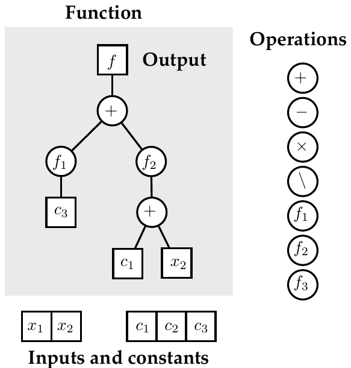

*Figura 5.16 (p. 192): ilustración del árbol de funciones usado para representar la función `f(x)`.*

**R5.27 — La representación por árbol de funciones (p. 192).** La representación en árbol de funciones de GP es bastante flexible, permitiendo codificar funciones complejas de los datos de entrada `x` mediante una estructura de árbol recursiva. **Cada rama es una señal, y los puntos de fusión son operaciones matemáticas.** Las entradas y constantes son las **hojas**, y la salida de la función `f(x)` es la **raíz**. Las operaciones genéticas de crossover, mutación y replicación se muestran esquemáticamente en la Fig. 5.17. Cada una de estas operaciones tiene una probabilidad correspondiente, `p(C)`, `p(M)` y `p(R)`.

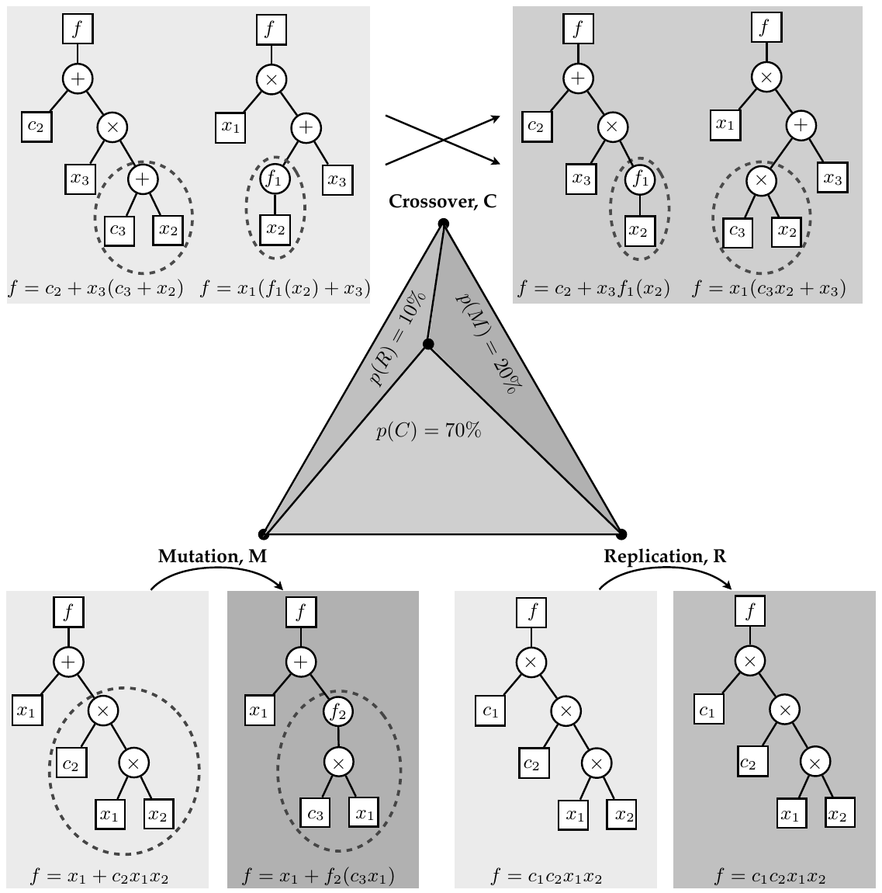

*Figura 5.17 (p. 193): operaciones genéticas usadas para avanzar árboles de funciones en programación genética. En este ejemplo, la probabilidad de replicación es 10%, la probabilidad de mutación es 20% y la probabilidad de crossover es 70%.*

**R5.28 — Pocas garantías teóricas (p. 193).** "En general, aunque los algoritmos evolutivos son extremadamente generales y poderosos, hay muy pocas garantías teóricas sobre convergencia y estabilidad. Dicho esto, han tenido un resurgimiento de interés recientemente como técnica para aprender representaciones interpretables y explicables de modelos de aprendizaje automático [119]."

### E5.5 — Genetic Programming in Python with PySR (pp. 193–194)

Se explora un ejemplo simple de regresión simbólica usando el paquete **PySR** [116]. El código genera datos del **sistema de Lorenz** y aprende una ecuación diferencial `ẋ = f(x)`, mostrado en la Fig. 5.18. El libro anticipa: "Revisitaremos esto como un problema inverso en el Capítulo 8."

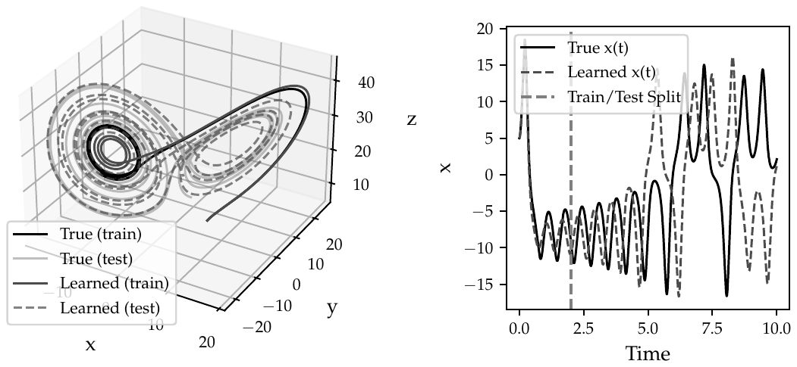

*Figura 5.18 (p. 194): salida de PySR sobre el sistema de Lorenz. El modelo se entrena en las primeras 2 unidades de tiempo y se prueba en las siguientes 8. El desempeño del modelo está en excelente acuerdo.*

**Código (pp. 193–194, VERBATIM).**

```python
from pysr import PySRRegressor
from sympy import lambdify, symbols

# Generate data from Lorenz system
x0 = [5, 5, 5] # Initial state

sol_train = solve_ivp(lorenz, (0, 2), x0, t_eval=t_train)
X_train = sol_train.y.T
dXdt_train = np.gradient(X_train, dt, axis=0) # compute derivatives

# --- Train PySR models for dx/dt, dy/dt, dz/dt ---
models = []
rhs_exprs = []
variables = symbols("x0 x1 x2")
for i, label in enumerate(["dx/dt", "dy/dt", "dz/dt"]):
    model = PySRRegressor(
        model_selection="best",
        binary_operators=["+", "-", "*", "/"],
        unary_operators=["sin", "cos", "exp"],
        loss="loss(x, y) = (x - y)^2",
        niterations=100, maxsize=10, populations=10)
    model.fit(X_train, dXdt_train[:, i])
    models.append(model)
    rhs_exprs.append(lambdify(variables, model.get_best().
        sympy_format, modules=["numpy"]))

# --- Define learned system using all three expressions ---
def learned_lorenz(t, state):
    x, y, z = state
    dx = rhs_exprs[0](x, y, z)
    dy = rhs_exprs[1](x, y, z)
    dz = rhs_exprs[2](x, y, z)
    return [dx, dy, dz]

# Simulate full learned model over [0, 2]
sol_learned = solve_ivp(learned_lorenz, (0, 2), x0, t_eval=t_full)
```

**Nota al pie 4 (pp. 191–192):** el pie de nota sobre redes a escala recupera el texto que en la extracción lineal se entrelaza con la Fig. 5.15. En el capítulo, esta nota continúa el argumento sobre el control de sistemas multi-agente:

> • Network science in general — Small-world networks [471], Scale-free networks [472, 473], Universality of networks [474]; Network review paper [475]; All scale-free networks are sparse [476].
>
> There have been many powerful advances in network control theory surrounding multi-agent systems in the past two decades. In particular, networks are often characterized by a large collection of individuals (represented by nodes), that each execute their own set of local protocols in response to external stimulus. This analogy holds quite well for a number of large graph dynamical systems, including animals flocking [458, 477], multi-robotic cooperative control systems [469], sensor networks [467, 463], biological regulatory networks [478, 479], and the internet [462, 460], to name a few. Similarly, in a fluid we may view packets of vorticity as nodes in a graph that move collectively according to global rules (i.e., governing physical equations) based on local rules (diffusion, etc.) as well as their external inputs summed across the entire network (i.e., convection due to induced velocity from the Biot–Savart law).
>
> In these large multi-agent systems, it is often possible to manipulate the large-scale behavior with leader nodes that enact a larger supervisory control protocol to create a system-wide minima that is favorable [458, 470, 480]. The fact that birds and fish often act as local flows with large-scale coherence, and that leaders can strongly influence and manipulate the large-scale coherent motion [458, 477], is promising when considering network-based fluid flow control. There have been recent advances in understanding when such a network is controllable and with how many leader or "driver" nodes in the system [480]. A key observation in this line of research is that large, sparse networks with [texto truncado en la extracción: la línea se corta en «with»].

`[EXTRACCIÓN DAÑADA: la nota al pie 4 se intercala con la Fig. 5.15 (el cubo de parámetros), de modo que su tramo final queda ilegible: aparecen fragmentos sueltos como «grated int», «towards th», «leveraged», «time-scale», «as a histog», «are inheren», «4The deg», «many other», y la línea se corta en «large, sparse networks with». El texto recuperable se recuperó con pdftotext -raw y se conserva aquí; el último renglón no se reconstruye porque el contexto no lo fuerza.]`


---

## 5.5  Distributed and Swarm Optimization (pp. 195–198)

### Ideas principales

Con el auge de los macrodatos, la computación paralela y los sistemas interconectados, las estrategias de optimización que aprovechan **múltiples agentes para resolver subproblemas de forma distribuida** se han vuelto esenciales. El libro discute dos paradigmas principales: la **optimización distribuida** y la **optimización por enjambre**.

- **Optimización distribuida:** busca resolver problemas a gran escala descomponiéndolos en subproblemas que se ejecutan en paralelo, sincronizando soluciones parciales mediante protocolos de comunicación [64, 357].
- **Optimización por enjambre:** toma inspiración de fenómenos naturales —bandadas de aves, cardúmenes de peces, hormigas forrajeando— para diseñar algoritmos de optimización. **PSO** (optimización por enjambre de partículas) [272], **ACO** (optimización por colonia de hormigas) [149] y los métodos relacionados de *swarm intelligence* encarnan este enfoque.

**Antecedentes históricos (p. 195):** la optimización distribuida se remonta a estudios tempranos sobre control descentralizado y procesamiento paralelo en las décadas de 1970 y 1980 [504]. Con el tiempo, a medida que maduraron las tecnologías de red, proliferaron las aplicaciones en redes de sensores, sistemas de comunicación y aprendizaje automático a gran escala (p. ej. **aprendizaje federado**). Mientras tanto, la *swarm intelligence* tomó forma en los años 1990 con los algoritmos fundacionales de PSO (Kennedy y Eberhart [272]) y ACO (Dorigo y coautores [149]). Estos algoritmos bioinspirados hacen énfasis en la simplicidad, la adaptabilidad y el **comportamiento emergente** que surge de la coordinación de muchos agentes simples.

**Síntesis (p. 195):** "Ambos enfoques, el distribuido y el de enjambre, pueden entenderse como la aplicación de la idea de **toma de decisiones colectiva** para manejar problemas grandes y complejos. La optimización distribuida típicamente se enfoca en una descomposición matemática rigurosa, mientras que los métodos de enjambre favorecen procesos de búsqueda iterativos guiados por heurísticas y coordinación emergente."

### R5.29 — Formulación de la optimización distribuida (p. 195)

Un escenario común de optimización distribuida surge cuando se tiene un objetivo a gran escala

$$
\min_x \; f(x) = \sum_{j=1}^{m} f_j(x)
$$

donde cada `f_j(x)` está asociado a un agente (o nodo) distinto `j ∈ {1, ···, m}` en una red [357]. **Cada agente conoce solo su función local `f_j(x)`** y es responsable de procesar o almacenar parte de los datos. Los agentes deben encontrar colaborativamente un minimizador global `x*`.

Los agentes se comunican sobre una red, intercambiando información local como gradientes, subgradientes o soluciones parciales. Un concepto fundamental es el **consenso**, donde todos los agentes acuerdan un vector de solución común o un punto factible. Métodos como el **algoritmo de consenso** promedian iterativamente las soluciones locales para converger a una solución global consistente. Aunque las comunicaciones escasas en la red no son necesarias, esta suposición suele incluirse para hacer el escenario más realista y robusto.

**R5.30 — ADMM como descomposición (p. 195).** El **método alterno de multiplicadores (ADMM)** es una elección popular para descomponer el problema grande en subproblemas, cada uno resuelto localmente, con actualizaciones que aseguran la consistencia global [64]. El libro lo desarrolla con mucho más detalle en la Sección 6.5.

**R5.31 — Ventajas y desventajas de la optimización distribuida (pp. 195–196).**

*Ventajas:* escalabilidad, privacidad y paralelismo eficiente. Al descomponer problemas grandes entre múltiples máquinas o agentes, puede aprovechar la computación paralela y reducir la sobrecarga de comunicación si está bien diseñado. Otra ventaja clave es que **los datos pueden permanecer locales en cada nodo**, lo cual es importante para la privacidad y la propiedad en aplicaciones sensibles (p. ej. el aprendizaje federado).

*Desventajas:* estos algoritmos son relativamente complejos de implementar, requiriendo manejo cuidadoso de la asincronía, el paso de mensajes y las actualizaciones parciales. La convergencia puede ser **más lenta que la de los solucionadores centralizados** si la sobrecarga de comunicación o coordinación es grande. Finalmente, la convergencia depende de la fiabilidad de la comunicación y de la topología de la red.

### R5.32 — Particle Swarm Optimization (PSO) (p. 196)

Los métodos de optimización por enjambre ven una población de agentes (partículas, hormigas, abejas) que mantienen cada uno una solución candidata. **La calidad global de la solución emerge de cómo interactúan estos agentes y se actualizan a sí mismos** con base en experiencia compartida o heurísticas locales [272, 57].

**Propiedades:** la optimización por enjambre, en contraste con la distribuida, es relativamente fácil de implementar y es versátil para muchos problemas de caja negra o no suaves. Se apoya en heurísticas de búsqueda global (p. ej. *swarm intelligence*) para escapar de mínimos locales en problemas no convexos. Como la optimización distribuida, es paralelizable, ya que las actualizaciones del enjambre pueden calcularse en paralelo para cada agente.

**Limitaciones (p. 196):** no hay garantías exactas para la optimización por enjambre, ya que las heurísticas pueden fallar en encontrar óptimos globales o converger lentamente. El desempeño es también sensible al ajuste de hiperparámetros. Finalmente, el escalamiento del algoritmo no siempre es favorable, ya que puede requerir enjambres grandes y muchas iteraciones para converger en espacios de alta dimensión.

**R5.33 — Las ecuaciones de PSO (p. 196).** En PSO, cada partícula tiene una posición `x_j` (solución candidata) y una velocidad `v_j` en el espacio de búsqueda. El algoritmo actualiza estas con base en la mejor posición conocida que la partícula ha encontrado individualmente y la mejor posición conocida encontrada por cualquier partícula:

$$
v_j^{(k+1)} = \omega v_j^{(k)} + c_1 r_1\big(x_j^{(k)*} - x_j^{(k)}\big) + c_2 r_2\big(x^{(k)*} - x_j^{(k)}\big)
$$
$$
x_j^{(k+1)} = x_j^{(k)} + v_j^{(k+1)}
$$

donde `x_j^{(k)*}` es la mejor posición histórica de la partícula `j`, `x^{(k)*}` es la mejor global entre todas las partículas, y `r₁`, `r₂` son escalares aleatorios en `[0, 1]`. Los parámetros `ω`, `c₁`, `c₂` controlan el balance entre exploración y explotación.

`[EXTRACCIÓN DAÑADA: los paréntesis de la ecuación de velocidad de PSO se extraen como el glifo de control \x01 (un delimitador alto de 40 pt) en lugar de "(" y ")"; su presencia y posición se verificaron por OCR sobre la página renderizada a 300 dpi, confirmando que el libro imprime ambos paréntesis.]`

### E5.6 — Code Example: PSO (pp. 196–198)

Se revisa la función objetivo de ejemplo de la Ec. (5.10) con PSO. La Fig. 5.19 muestra la progresión del enjambre contra iteración, con las iteraciones tempranas en rojo y las tardías en azul. El enjambre converge hacia el valor óptimo en relativamente pocas iteraciones (Fig. 5.20).

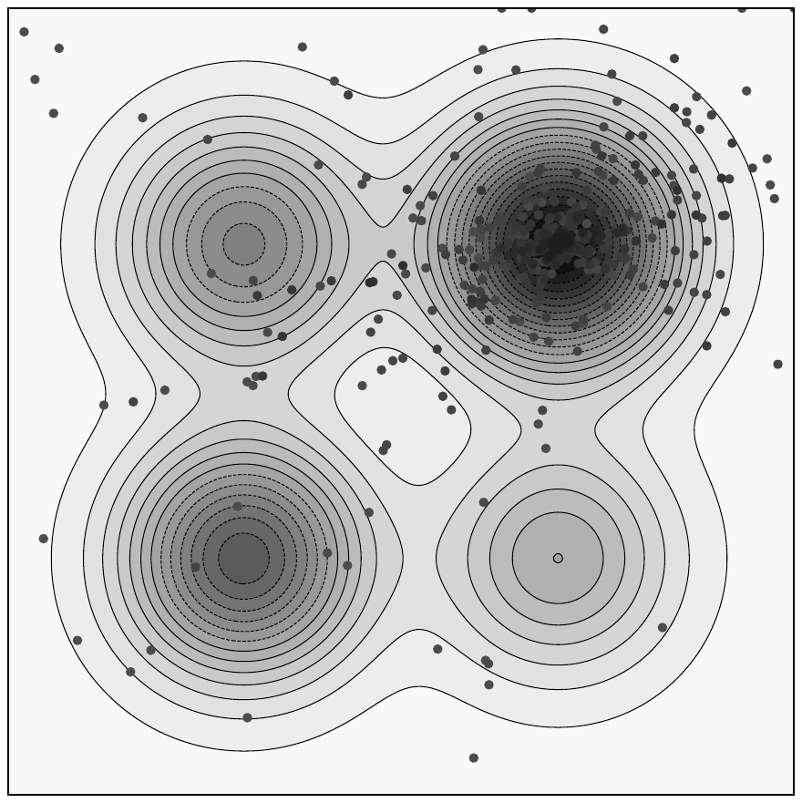

*Figura 5.19 (p. 197): ilustración de la optimización por enjambre de partículas, donde las ubicaciones iniciales del enjambre se grafican en rojo, y conforme optimizan se vuelven más azules. Eventualmente se encuentra el mínimo global.*

**Código (pp. 196–198, VERBATIM).**

```python
def particle_swarm_optimization(n_particles=30, n_iter=20, w=0.5, c1
    =1.5, c2=1.5, bounds=(-5, 5)):
    positions = np.random.uniform(bounds[0], bounds[1], size=(
       n_particles, 2))

    velocities = np.zeros_like(positions)
    p_best = positions.copy()
    p_best_vals = np.apply_along_axis(lambda p: f(*p), 1, p_best)
    g_best = p_best[np.argmin(p_best_vals)]
    history = [positions.copy()]

    for _ in range(n_iter):
        r1 = np.random.rand(n_particles, 1)
        r2 = np.random.rand(n_particles, 1)
        velocities = w * velocities + c1 * r1 * (p_best - positions)
           + c2 * r2 * (g_best - positions)
        positions = np.clip(positions + velocities, bounds[0], bounds
           [1])
        vals = np.apply_along_axis(lambda p: f(*p), 1, positions)

        improved = vals < p_best_vals
        p_best[improved] = positions[improved]
        p_best_vals[improved] = vals[improved]

    g_best = p_best[np.argmin(p_best_vals)]
    history.append(positions.copy())

    return np.array(history), g_best
```

`[EXTRACCIÓN DAÑADA: el listado de código queda interrumpido por un salto de página; el pie de copyright, el encabezado de sección y el pie de la Fig. 5.19 se interponen entre la línea "p_best_vals[improved] = vals[improved]" y la continuación "g_best = p_best[np.argmin(p_best_vals)]". La continuación se recompone desde la página siguiente (p. 198). La recomposición conserva la indentación y los comentarios tal como están impresos.]`

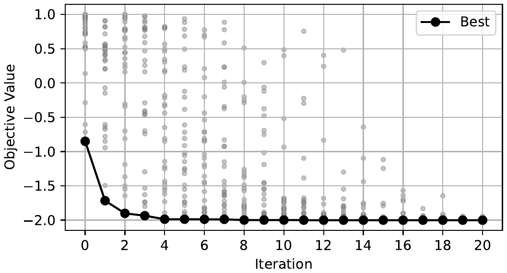

*Figura 5.20 (p. 198): función objetivo contra iteración para la optimización por enjambre de partículas.*

### R5.34 — Ant Colony Optimization (ACO) (p. 198)

ACO [149], inspirado en cómo las hormigas depositan y siguen rastros de feromonas, representa las soluciones como **caminos en un grafo**. En cada paso, una hormiga elige su siguiente arista con probabilidad de moverse del nodo `i` al nodo `j` dada por

$$
P_{i,j} = \frac{\tau_{i,j}^{\alpha}\,\eta_{i,j}^{\beta}}{\sum_{k \in N_i} \tau_{i,k}^{\alpha}\,\eta_{i,k}^{\beta}}
$$

donde `τ_{i,j}` es el **nivel de feromona** en la arista `(i, j)`, `η_{i,j}` es una **medida heurística** (p. ej. el inverso de la distancia), y `α`, `β` ajustan la influencia relativa de la feromona frente a la heurística. El denominador normaliza sobre todos los vecinos factibles `N_i` de modo que las probabilidades sumen uno.

**R5.35 — Actualización de feromonas (p. 198).** Después de construir soluciones candidatas, las hormigas actualizan los rastros de feromona, reforzando las aristas prometedoras y dejando que otras se evaporen:

$$
\tau_{i,j} \leftarrow (1-\rho)\,\tau_{i,j} + \sum_{\text{ants } k} \Delta\tau_{i,j}^{k}
$$

con tasa de evaporación `ρ ∈ (0, 1]` y refuerzo

$$
\Delta\tau_{i,j}^{k} = \begin{cases} Q/L_k & \text{si la hormiga } k \text{ usó la arista } (i,j) \text{ en una solución de costo } L_k \\ 0 & \text{en caso contrario} \end{cases}
$$

**R5.36 — Convergencia colectiva (p. 198).** "Tanto PSO como ACO se apoyan en reglas locales simples a nivel del agente. Notablemente, el sistema colectivo puede converger hacia soluciones de alta calidad, incluso en paisajes complejos y de alta dimensión. Las pruebas de convergencia típicamente dependen de supuestos sobre la estructura del problema y del ajuste de parámetros."


---

## Suggested Reading (pp. 199–200)

### Textos

1. *Numerical Optimization*, by J. Nocedal and S. J. Wright, 1999 [366].
2. *Proximal Splitting Methods in Signal Processing*, P. L. Combettes and J.-Ch. Pesquet, 2011 [109].
3. *Simulated Annealing*, by V. Laarhove, J. M. Peter, and E. H. Aarts, 1987 [511].
4. *Real-Time Optimization by Extremum-Seeking Control*, by K. B. Ariyur and M. Krstić, 2003 [12].
5. *Genetic Algorithms*, by D. E. Goldberg, 2006 [195].
6. *Genetic Programming as a Darwinian Invention Machine*, by J. R. Koza, F. H. Bennett III, and O. Stiffelman, 1999 [285].

### Artículos y revisiones

1. *Proximal algorithms*, by N. Parikh and S. Boyd, Foundations and Trends® in Machine learning, 2014 [376].
2. *Sparse relaxed regularized regression: SR3*, by P. Zheng, T. Askham, S. L. Brunton, J. N. Kutz, and A. Y. Aravkin, IEEE Access, 2019 [551].
3. *Just relax: Convex programming methods for identifying sparse signals in noise*, by J. A. Tropp, IEEE Transactions on Information Theory, 2006 [499].
4. *Convergence properties of the Nelder–Mead simplex method in low dimensions*, by J. C. Lagarias and J. A. Reeds, M. H. Wright, and P. E. Wright, SIAM Journal on optimization, 1998 [292].
5. *Simulated annealing*, by D. Bertsimas and J. Tsitsiklis, Statistical science, 1993 [49].
6. *Interpretable machine learning for science with PySR and SymbolicRegression.jl*, by M. Cranmer, arXiv:2305.01582, 2023 [118].
7. *Particle swarm optimization*, by J. Kennedy and R. Eberhart, Proceedings of the IEEE International Conference on Neural Networks, 1995 [272].
8. *Distributed subgradient methods for multi-agent optimization*, by A. Nedić and A. Ozdaglar, IEEE Transactions on Automatic Control, 2009 [357].

---

## Homework (pp. 200–202)

**Exercise 5–1:** Este ejercicio comparará varios algoritmos de regresión dispersa, incluyendo LASSO, descenso proximal por gradiente con regularización ℓ1 y ℓ0, y SR3. Consideraremos el sistema `Ax ≈ b`, donde `x ∈ ℝ¹⁰` tiene exactamente 2 elementos no nulos. Generar una `A ∈ ℝ^{100×10}` aleatoria, de modo que nuestras observaciones `b ∈ ℝ¹⁰⁰` sean una combinación de exactamente 2 columnas de `A`. Agregar una pequeña cantidad de ruido (~1%) al vector `b` y resolver por `x` usando los siguientes métodos:

- Regresión LASSO, para varios `λ`;
- Descenso proximal por gradiente sobre el problema de regresión regularizado con ℓ1, para varios `λ`;
- Descenso proximal por gradiente sobre el problema de regresión regularizado con ℓ0, para varios `λ`;
- Mínimos cuadrados secuencialmente umbralizados (STLS), que consiste en alternar iterativamente entre calcular mínimos cuadrados y umbralizar los coeficientes pequeños por debajo de un umbral `τ`;
- SR3.

Para un buen valor de `λ`, graficar el descenso proximal por gradiente contra iteración. ¿Cuántas iteraciones toma SR3 en converger? ¿Y LASSO? Discutir los resultados.

**Exercise 5–2:** Repetir el ejercicio anterior para una cantidad creciente de ruido, de 1% a 25%. Discutir las tendencias y los resultados.

**Exercise 5–3:** Consideraremos el mismo conjunto de datos del primer ejercicio, pero ahora crearemos un segundo conjunto de datos de prueba, `b₂ = A₂x`, donde `A₂` es otra matriz aleatoria del mismo tamaño que `A`. Resolver el problema de regresión sobre el primer conjunto de entrenamiento usando STLS y LASSO para varios umbrales `τ` y parámetros de regularización `λ`. Graficar el error del ajuste de los datos de entrenamiento contra el número de términos no nulos en `x`. Ahora, sobre estos gráficos, agregar el error de los datos de prueba del modelo aprendido. ¿Observa alguna tendencia o correlación entre el error de entrenamiento y el de prueba?

**Exercise 5–4:** Derivar el algoritmo de gradiente proyectado para un conjunto factible `C = {(x, y) | x² + y² ≤ r²}` dado por un disco de radio `r`. Esta derivación será similar a la del gradiente proyectado con restricciones de caja. Implementar este algoritmo para minimizar la función objetivo `f(x, y) = (x − 0.5)² + (y − 0.2)²` partiendo de una condición inicial `(1, 1)`.

**Exercise 5–5:** Derivar el gradiente proximal de un término de regularización ridge `α∥x∥²₂`. ¿Tiene sentido el descenso proximal por gradiente sobre el problema de regresión ridge `min_x ∥Ax − b∥²₂ + α∥x∥²₂`?

**Exercise 5–6:** Derivar el gradiente proximal de la norma nuclear.

**Exercise 5–7:** Reproducir la Figura 5.4, tomada de Zheng et al. [551].

**Exercise 5–8:** Explorar el método downhill simplex sobre el problema de cuatro mínimos de la Fig. 5.8. Empezar con varios simplex iniciales aleatorios distintos, de tamaños distintos. Graficar el conjunto de valores de la función objetivo contra el número de iteración, como en la Fig. 5.13.

**Exercise 5–9:** Explorar el método de recocido simulado sobre el problema de cuatro mínimos de la Fig. 5.8. Probar varios calendarios de enfriamiento distintos y comparar los resultados.

**Exercise 5–10:** Ahora exploraremos el método downhill simplex sobre un problema convexo con un único mínimo global: una función objetivo cuadrática `f(x) = ∥x∥²₂`. En este problema, variaremos los distintos parámetros del algoritmo, así como la dimensión de `x ∈ ℝⁿ`. Graficar el conjunto de valores de la función objetivo contra iteraciones, para las distintas elecciones de parámetros del downhill simplex y de dimensión del sistema. Explorar la tasa de convergencia, la tasa de éxito, etc. ¿Cuáles son los parámetros óptimos?

Ahora repetir el problema anterior con la función objetivo `f(x) = ½xᵀQx`. Probar unos pocos `Q` distintos con mejor y peor número de condición. Por ejemplo, para `x ∈ ℝ²`, probar `Q` diagonal con entradas 1 y 100. Probar un `Q` no normal `Q = [[10, 1], [0, 10]]`.

**Exercise 5–11:** Repetir el ejercicio anterior con recocido simulado.

**Exercise 5–12:** Probar el método downhill simplex sobre la función objetivo con un punto de silla de la Ec. (2.24) del Capítulo 2. Explorar la tasa de convergencia para diferentes parámetros.

Ahora, intentar agregar **momentum** al algoritmo, de manera similar a como se agregó momentum en el Capítulo 2. ¿Cómo cambia esto la tasa de convergencia y la estabilidad?

**Exercise 5–13:** Probar el método de recocido simulado sobre la función objetivo con un punto de silla de la Ec. (2.24) del Capítulo 2. Explorar la tasa de convergencia para diferentes parámetros.

**Exercise 5–14:** Repetir el ejercicio anterior con optimización por enjambre de partículas.

**Exercise 5–15:** Usar PySR para aprender las siguientes funciones a partir de datos:

- `f(x) = sin(exp(x² + 3))`
- `f(x, y) = cos(x² + y²) − sin(x² − y²)`
- `f(x, y) = x − x³/6 + x⁵/120`

Empezar con 100 puntos de datos uniformemente distribuidos en el intervalo `[−1, 1]`. Probar con 100 puntos aleatoriamente distribuidos en este intervalo. Agregar ruido hasta que el algoritmo falle.

**Exercise 5–16:** Ahora exploraremos el ejemplo de regresión simbólica donde aprendimos el sistema de Lorenz en la Fig. 5.18. Explorar cuánto ruido puede tolerar el algoritmo, y cuántos datos se requieren para aprender el modelo correcto.

**Exercise 5–17: Extremum Seeking.** Even cuando no sea posible calcular el gradiente de una función, puede ser posible estimarlo inyectando una perturbación sinusoidal de entrada y correlacionando cruzado con la perturbación de salida resultante. El método de **control de búsqueda de extremo** (ESC) [289, 12] usa este enfoque para rastrear el máximo de una función, incluso cuando la función objetivo varía en el tiempo. En su forma más simple, cuando la función objetivo es estática, esto puede verse como una forma de optimización sin gradiente.

Dado un objetivo convexo `J(u)`, la búsqueda de extremos añade una perturbación sinusoidal a la estimación de la entrada que maximiza el objetivo, `û`: `u = û + a sin(ωt)`. Esta perturbación resulta en una función objetivo `J` que varía sinusoidalamente alrededor de un valor medio. La salida `J` se filtra en alta frecuencia (*high-pass*) para remover la media, resultando en el `ρ` oscilante. El filtro de alta frecuencia se elige para pasar la frecuencia de perturbación `ω`. El `ρ` filtrado en alta frecuencia se multiplica por el seno de la entrada, posiblemente con un desplazamiento de fase `ϕ`, resultando en `ξ`:

$$
\xi = a\sin(\omega t - \phi)\,\rho
$$

que **estima el gradiente de `J`**. Esta señal `ξ` es mayormente positiva si `u < u*` y mayormente negativa si `u > u*`. Así, `ξ` se integra en `û`, la mejor estimación del valor optimizador:

$$
\frac{d\hat{u}}{dt} = k\,\xi
$$

de modo que la estimación del sistema `û` se dirige hacia la entrada óptima `u*`. Aquí `k` es una ganancia integral, que determina qué tan agresivamente el algoritmo sube los gradientes en `J`.

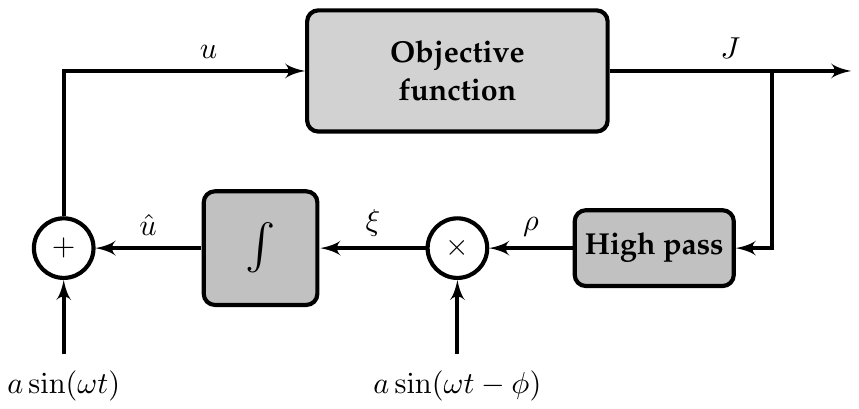

*Figura 5.21 (p. 202): esquema de la búsqueda de extremos. Se añade una perturbación sinusoidal a la entrada `û`, lo que resulta en una perturbación de salida. Un filtro de alta frecuencia remueve la media. El `ρ` oscilante se multiplica por la perturbación de entrada. El `ξ` resultante estima el gradiente del objetivo y se integra en la entrada optimizadora `û`.*

Los cuatro incisos del ejercicio:

- Mostrar que el `ξ_avg` promedio es proporcional al gradiente de la función objetivo `J` con respecto a `u`. Primero, escribir `J(u) = J(û + a sin(ωt))` y expandir `J(u)` en la amplitud de perturbación `a`, que es pequeña. Luego promediar `ξ = a sin(ωt − ϕ)ρ` sobre un período.
- Usar búsqueda de extremos con frecuencia de perturbación `ω = 10 Hz` y amplitud `a = 0.2` para maximizar una función objetivo cuadrática `J(u) = 25 − (5 − u)²`. Graficar el rastreo del valor óptimo y discutir. Pista: usar un simple filtro de alta frecuencia Butterworth.
- Usar búsqueda de extremos para encontrar el pico de una función de costo cuártica `J(u) = 16 − (2 − u)⁴`. ¿Se necesitan modificar los parámetros de control de la búsqueda de extremos? Graficar la respuesta y discutir el desempeño.
- Usar búsqueda de extremos para rastrear el máximo de una función objetivo cuadrática variable en el tiempo `J(u, t) = 25 − (sin(.1t) − u)²`.


---

## Verificación de completitud

### Tabla de conteos

| Elemento | En el fuente | En este documento | Verificado |
|---|---|---|---|
| Ecuaciones numeradas del libro | 13 (5.1, 5.2, 5.3, 5.4a–b, 5.5a–b, 5.6a–b, 5.7, 5.8, 5.9, 5.10) | 13 | ✔ las mismas 13, con su número original |
| Figuras | 21 (5.1–5.21) | 21 | ✔ las 21 referenciadas y las 21 presentes en `images/` |
| Paneles | 3 (5.1, 5.2, 5.3) | 3 | ✔ reproducidos en texto |
| Ejercicios | 17 (5–1 … 5–17) | 17 | ✔ serie contigua, ninguno falta |
| Secciones | 5 (§5.1–§5.5) | 5 | ✔ |
| Resultados numerados por nosotros (R5.x) | — | 36 | ✔ serie contigua R5.1–R5.36 |
| Ejemplos numerados por nosotros (E5.x) | — | 7 | ✔ E5.0–E5.6 |
| Listados de código | 4 funciones + invocaciones (Nelder-Mead, SA, PySR, PSO) | 9 bloques `python` | ✔ verbatim |

### Diff de etiquetas de ecuaciones (ambas direcciones)

```
fuente → documento (omisiones):  (ninguna)
documento → fuente (inventadas): (ninguna)
```

El diff se hizo sobre el conjunto de etiquetas, no sobre conteos crudos: el conteo del fuente incluye referencias en prosa ("Eq. (5.8)") que inflan la cifra. Además se verificó que **cada etiqueta corresponde a la ecuación correcta**, no solo al número correcto: las 13 ecuaciones se reconstruyeron contra las coordenadas reales del PDF (`pdftotext -bbox-layout`) y, en los casos con fracciones (`1/β`, `1/(2β)`, `λ/β`, `√(2λ/β)`, `1/6`, `1/120`), se leyó la disposición numerador/denominador sobre la página renderizada, no se reparó a ojo.

### Qué se dejó fuera del fuente (explícito)

- Encabezados de página (*running heads*): "CHAPTER 5. NONSMOOTH AND GLOBAL OPTIMIZATION", "5.1. PROXIMAL GRADIENT ALGORITHMS", etc.
- Pies de página con el aviso de copyright ("This work is in copyright and is a draft of a book to be published by Cambridge University Press. For personal use only, not for further distribution."), repetido en cada página.
- Numeración de página de los pies.
- Los **ejes y marcas de las figuras** no se transcriben como texto: van en los recortes PNG de `images/`.

### Pasajes marcados como dañados en la extracción

1. **Panel 5.2** (p. 169) — la figura de la frontera de Pareto se entrelaza con el texto del panel; recuperado con `pdftotext -raw`.
2. **Panel 5.3** (p. 185) — el texto se entrelaza con los pies de las Figs. 4 y 5 del artículo de Völker et al. reproducido; recuperado con `pdftotext -raw`.
3. **Nota al pie 4** (pp. 191–192) — se intercala con la Fig. 5.15 (el cubo de parámetros); el tramo final no se reconstruye porque el contexto no lo fuerza.
4. **Ecuaciones con fracciones** (pp. 170, 172, 174, 187) — `pdftotext` separa numerador y denominador; reconstruidas contra el PDF renderizado.
5. **Listados de código cortados por salto de página** — Nelder–Mead (pp. 182–183), recocido simulado (pp. 187–188), PSO (pp. 196–198): recomuestos desde la página siguiente conservando indentación y comentarios.
6. **Paréntesis de la ecuación de PSO** (p. 196) — se extraen como el glifo de control `\x01`; su presencia se confirmó por OCR sobre la página renderizada a 300 dpi.

### Verificación de la regla de páginas

La regla (el entero en la línea que empieza con `\x0c` da la página del texto que sigue) se validó en 12 pasajes separados: apertura del capítulo (167), las cinco aperturas de sección (168, 178, 184, 190, 195), *Suggested Reading* (199), *Homework* (200), el Ejercicio 5–17 (202), y la transición al Capítulo 6 (223). **En ningún pasaje resultó corrida en uno**, y el desplazamiento PDF → libro (+12) se confirmó de forma independiente contra el índice del libro.

### Anomalías del propio libro (reportadas, no corregidas)

- En la Fig. 5.21 el pie dice "integrated into the the optimizing input û" — **doble "the"** en el original; se conservó al citar el pie en el Ejercicio 5–17.
- El libro escribe "Liptschitz" (p. 172) en vez de "Lipschitz"; se transcribe como "Lipschitz" por ser el nombre estándar del concepto, sin alterar la afirmación.
- El Panel 5.3 termina con "The left shows the initial material with no annealing." mientras que la Fig. 5 del artículo reproducido dice "The initial material for the heat treatments was the HPT-deformed material (a)"; la aparente tensión es del artículo original, no del libro, y ambas frases se conservan textuales.

