# Capítulo 6 — Constraints and Duality (Restricciones y Dualidad)

**Resumen fiel en español del Capítulo 6 de *Optimization Bootcamp* (S. L. Brunton, borrador 2026, Cambridge University Press), páginas 203–267.**

Fuente: extracción `pdftotext` del PDF (`brunton-capitulo-6-fuente.txt`, versionado junto a este resumen). Las páginas PDF 215–279 corresponden a las páginas del libro 203–267 (**desplazamiento +12**, el mismo del Capítulo 5). Las **21 figuras** del capítulo se extrajeron del PDF a `images/` (recortes PNG a 200 dpi, delimitados por el perfil de tinta de la página y verificados por OCR).

---

## Convenciones de este documento (léase primero)

**Numeración de resultados.** El libro **no numera** definiciones ni teoremas: en el capítulo no aparece ningún `Definition N` / `Theorem N` / `Lemma N` / `Proposition N`. Todos los resultados formales están en prosa, en cursiva o bajo subtítulo. Por eso **la numeración R6.1, R6.2, … es NUESTRA**; para cada resultado se da el nombre que el libro usa y la página.

**Numeración de ejemplos.** El libro tampoco numera sus ejemplos; los etiqueta con subtítulos ("Simple Example", "Example: Least Squares with Box Constraints", "Code Example: LASSO"). Los distinguimos como **E6.1, E6.2, …** preservando el subtítulo VERBATIM.

**Ecuaciones.** Sí llevan los números del libro: **6.1–6.80**, numeración continua a lo largo del capítulo, con sub-etiquetas donde las hay (6.1a–b, 6.4a–b, 6.13a–c, 6.14a–b, 6.16a–d, 6.17a–b, 6.19a–c, 6.25a–b, 6.26a–b, 6.32a–b, 6.33a–b, 6.54a–c, 6.56a–b, 6.59a–b, 6.60a–c, 6.61a–b). Todas las ecuaciones numeradas del capítulo aparecen aquí con su número original.

**Regla de páginas (validada).** `pdftotext` emite el número de página del libro al inicio de cada página (tras el `\x0c`), en el encabezado corriente. En este capítulo el desplazamiento PDF → libro es **+12**. Validación por secciones contra el índice del libro: §6.1 abre en 205 (=217), §6.2 en 214 (=226), §6.3 en 220 (=232), §6.4 en 234 (=246), §6.5 en 239 (=251), §6.6 en 245 (=257), *Suggested Reading* en 260 (=272), *Homework* en 261 (=273), y el Ejercicio 6–39 en 267 (=279), que es la última página del capítulo.

**Figuras.** Las 21 figuras se extrajeron como recortes PNG a 200 dpi. El límite inferior se ancló en la línea del pie de figura y el superior por debajo del encabezado corriente; se verificó por OCR que ningún recorte contuviera prosa del cuerpo ni el encabezado de página.

---

## Panorama del capítulo (p. 203)

Las restricciones son parte esencial de casi todo problema real (recursos, tiempo, propiedades de materiales, costo). Hasta aquí el libro trató problemas sin restricciones (mínimos cuadrados, descenso de gradiente) o con las restricciones más simples (programación lineal del Cap. 3, regresión con restricciones del Cap. 4). El capítulo persigue **tres objetivos explícitos**:

1. **Manejar restricciones** y optimizarlas de forma tratable mediante **multiplicadores de Lagrange** y **condiciones KKT**.
2. **Introducir la dualidad**, que sostiene los algoritmos avanzados: métodos de punto interior (§6.4) y ADMM (§6.5).
3. **Discutir problemas de dimensión infinita**, donde el objetivo es un **funcional** de una función a optimizar.

Orden del recorrido: Lagrange para igualdades (§6.1) → KKT para desigualdades (§6.2) → dualidad (§6.3) → punto interior (§6.4) → ADMM (§6.5) → cálculo de variaciones y Euler–Lagrange (§6.6).

**Interpretación geométrica central (enunciada en la p. 203 y usada en todo el capítulo):** un óptimo local es un punto donde **el gradiente del objetivo no tiene ninguna dirección tangente a las restricciones**. Por tanto el gradiente del objetivo debe estar en el espacio generado por las normales de las restricciones, y **los coeficientes de esa combinación lineal son los multiplicadores de Lagrange**.

---

## 6.1  Lagrange Multipliers (pp. 205–213)

### Ideas principales

Las restricciones de igualdad `h(x) = 0` son la clase más simple. El método de los multiplicadores **mueve las restricciones dentro del objetivo**, introduciendo variables de decisión adicionales `λ` que actúan como pesos de regularización que fuerzan la restricción.

### R6.1 — El Lagrangiano como problema minimax (pp. 205–206)

El problema restringido —Ec. (6.13) en el libro— es

$$
\min_x f(x) \quad \text{s.t.} \quad h(x) = 0 \qquad (6.1a), (6.1b)
$$

y su forma lagrangiana, con `L(x,λ) = f(x) + λᵀh(x)`, es

$$
\min_x \ \sup_{\lambda} \ f(x) + \lambda^{T} h(x). \qquad (6.2)
$$

**Derivación del libro (infinitas penalizaciones).** Se parte de la función de penalización infinita `δ₀(h(x))` de la §1.4: vale 0 si el argumento es 0 e ∞ si no. Entonces `min_x f(x) + δ₀(h(x))` tiene la misma solución que el problema restringido. Al reemplazar el término no suave por `λᵀh(x)` y tomar el supremo sobre `λ`, **cuando la restricción se viola el supremo interior es infinito**, y cuando se satisface el problema se reduce a (6.1). El libro subraya que `sup` (y no `max`) garantiza que la expresión esté bien definida aunque el máximo no se alcance, y trae como ejemplo `sup_{λ} λx`, que es ∞ si `x ≠ 0` y 0 si `x = 0`; de ahí `min_x sup_λ λx = 0`.

A (6.1) se le llama **problema primal**; a (6.2), su **forma lagrangiana**. Intercambiar el orden de `min` y `max` da el **problema dual**, que es una cota inferior del primal:

$$
\min_x \max_{\lambda} \ f(x)+\lambda^{T}h(x) \ \ge\ \max_{\lambda}\min_x \ f(x)+\lambda^{T}h(x). \qquad (6.3)
$$

**Costo conceptual del cambio:** se pasa de un problema restringido de dimensión menor a un problema **sin restricciones de dimensión mayor con estructura minimax**. El libro anota que las condiciones de optimalidad serán las ecuaciones KKT, que se resuelven con técnicas estándar como Newton; y que **ADMM es una iteración de punto fijo sobre las ecuaciones KKT**, mientras que el gradiente proximal se aplica directamente al primal.

### Panel 6.1: Minimax Inequality (p. 206)

> Para cualquier `f : X × Y → ℝ`, `min_{x∈X} max_{y∈Y} f(x,y) ≥ max_{y∈Y} min_{x∈X} f(x,y)`. La desigualdad **vale siempre**, sin continuidad ni convexidad: refleja que `min` y `max` no conmutan. Demostración por la desigualdad puntual `min_{x'} f(x',y) ≤ f(x,y) ≤ max_{y'} f(x,y')`, tomando `max_y` a la izquierda y `min_x` a la derecha. Es el marco de los **juegos de suma cero**: `min_x max_y f` es el mejor resultado garantizado del jugador A (peor caso), `max_y min_x f` el del jugador B; la desigualdad dice que **el primer jugador está en desventaja**, porque se compromete a una estrategia sin conocer la del otro.

### R6.2 — Geometría: el gradiente debe ser normal a la restricción (pp. 207–208)

Una dirección `d` es **tangente** a `h(x)=0` si `∇h(x)·d = 0`; esas son las **direcciones factibles** en las que se puede mover `x` sin salir de la restricción. Si `∇f` mejora en alguna de ellas, el punto no es óptimo. Por tanto, en un óptimo `∇f` no puede tener componente tangente: **`∇f` debe estar en el espacio de las normales `∇hⱼ`**. Para una restricción única en 2D (Fig. 6.1) esto significa que `∇f` es **ortogonal a la tangente** y por tanto paralelo a `∇h`.

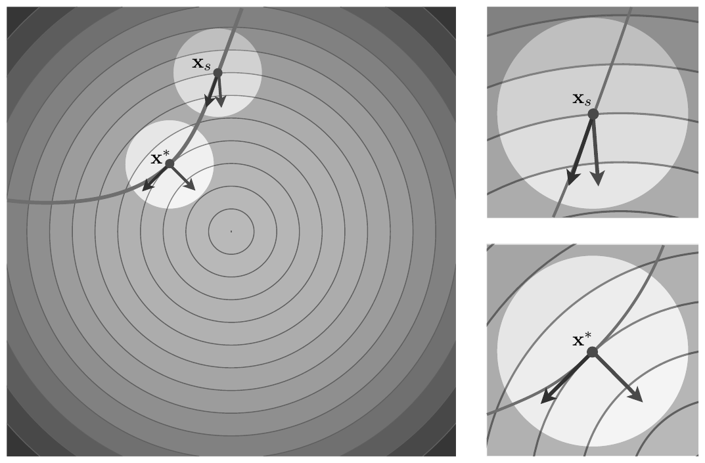

*Figura 6.1 (p. 207):* en `x_s` (subóptimo) la tangente a la restricción y la normal del objetivo no son ortogonales, así que se puede mejorar moviéndose en la dirección tangente factible; en `x*` sí lo son.

### R6.3 — Condiciones de primer orden (estacionariedad) (p. 208)

Las condiciones para que `(x*, λ*)` sea óptimo son

$$
\nabla_x L(x^{*},\lambda^{*}) = 0, \qquad \nabla_\lambda L(x^{*},\lambda^{*}) = 0. \qquad (6.4a), (6.4b)
$$

Son las **condiciones de optimalidad de primer orden** (o de estacionariedad) y son un subconjunto de las KKT. La segunda equivale a que **la restricción se cumple**:

$$
\nabla_\lambda L(x^{*},\lambda^{*}) = 0 \ \Longrightarrow\ h(x^{*}) = 0, \qquad (6.5)
$$

y la primera da

$$
\nabla_x L(x^{*},\lambda^{*}) = 0 \ \Longrightarrow\ \nabla_x f(x^{*}) + \lambda^{*T}\nabla_x h(x^{*}) = 0 \qquad (6.6)
$$

es decir

$$
\nabla_x f(x^{*}) = -\,\lambda^{*T}\nabla_x h(x^{*}), \qquad (6.7)
$$

que con una sola restricción se reduce a

$$
\nabla_x f(x^{*}) = -\,\lambda^{*}\nabla_x h(x^{*}). \qquad (6.8)
$$

La lectura: `∇f` apunta en la **dirección normal** a la superficie `h(x)=0`; si no, se puede mejorar localmente en una dirección factible. El escalar `λ` es el **reescalamiento exacto de las normales**.

### E6.1 — Simple Example: lineal sobre el círculo unitario (pp. 209–210)

$$
\min_{x,y} \ x+2y \quad \text{s.t.} \quad x^{2}+y^{2}=1 .
$$

El problema es **no convexo por la restricción**. Con `L = x+2y+λ(x²+y²−1)`, minimizar en `(x,y)` da `x* = −1/(2λ)`, `y* = −1/λ`; sustituyendo y maximizando en `λ`:

$$
\max_{\lambda}\ -\frac{1}{2\lambda}-\frac{2}{\lambda}+\lambda\left(\frac{1}{4\lambda^{2}}+\frac{1}{\lambda^{2}}-1\right) = \max_{\lambda}\ \frac{-5}{4\lambda}-\lambda \ \Longrightarrow\ \lambda^{*}=\frac{\sqrt{5}}{2}. \qquad (6.9)
$$

El valor del dual es `−√5` y el del primal también `−√5`: **la brecha de dualidad es cero**, así que el punto es el óptimo global aunque el problema sea no convexo. El libro explica por qué: el dual es cóncavo en la rama `λ>0` y `x,y` son únicos para cada `λ`, de modo que la restricción circular es "suficientemente bien portada".

**Fig. 6.2 (p. 210)** visualiza `L(x,y,λ)` para `λ = 0, 0.75λ*, λ*, 2λ*`: con `λ < λ*` el óptimo del Lagrangiano cae **fuera** del círculo; en `λ*` cae **exactamente sobre** la frontera (y entonces `λ*h(x)=0`, el valor coincide con el del objetivo original y la restricción se satisface); con `λ > λ*` cae **dentro**. Es decir, **el multiplicador pesa la restricción hasta que el óptimo del Lagrangiano aterriza en la frontera**.

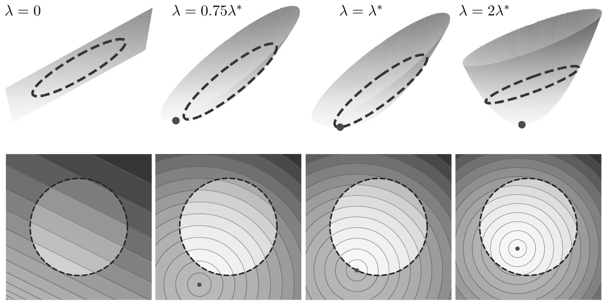

### R6.4 — Muchas restricciones: espacio tangente y espacio normal (p. 211)

Con varias restricciones, `h(x)=0` define una **variedad** (o un subespacio, si las restricciones son convexas, pues entonces son afines `Ax−b`). El **espacio tangente** en `x` es

$$
T_x = \{\, d \mid \nabla h_j(x)\cdot d = 0 \ \ \forall j \,\}, \qquad (6.10)
$$

y el espacio de normales es `N_x = span{∇h_j(x)}`. Son **complementarios**: `ℝⁿ = T_x ⊕ N_x`. Para que `∇f` no tenga componente tangente, tiene que ser combinación lineal de las normales:

$$
\nabla f(x^{*}) = -\,\lambda_j \nabla h_j(x^{*}), \qquad (6.11)
$$

de donde

$$
\nabla f \cdot \nabla h_j \ne 0, \qquad (6.12)
$$

es decir `∇f ∉ T_{x*}`. Los multiplicadores `λⱼ` son **las coordenadas de `∇f` en la base de normales de las restricciones**. Fig. 6.3 lo dibuja con dos restricciones `h₁, h₂` y sus tangentes `T₁, T₂` y normales `n₁, n₂`.

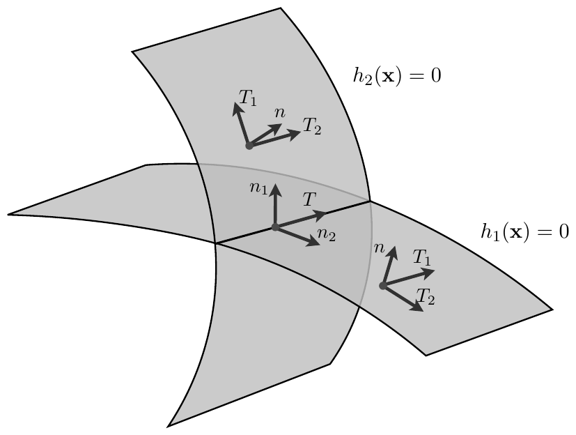

### R6.5 — Interpretación "tilt and match" (p. 211)

`λ` define una **familia de objetivos inclinados** `f_λ(x) = f(x) + λᵀh(x)`; se varía `λ` hasta que un conjunto de nivel `f_{λ*}` sea **tangente** a la superficie `h(x)=0`. En ese `λ*` crítico se cumple la condición de primer orden `∇f + λᵀ∇h = 0`.

### R6.6 — Convexidad y condiciones de suficiencia (p. 212)

Las condiciones anteriores son **necesarias**. Son **suficientes** si el problema es convexo, lo que exige que `h(x)=0` sea afín (`Ax=b`). Si `f` o el conjunto factible no son convexos, las condiciones solo identifican un **punto estacionario**: mínimo local, máximo local o silla. De ahí las **condiciones de segundo orden**: con `T_x = {d | ∇h(x)·d = 0}`, `x*` es mínimo local estricto si

$$
d^{T}\nabla_{xx}^{2}L(x^{*},\lambda^{*})\,d > 0 \qquad \forall d \in T_x,\ d \ne 0 .
$$

La **Fig. 6.4 (p. 212)** muestra una restricción no convexa con **tres** puntos que satisfacen la condición de primer orden: `x₁` mínimo local, `x₂` máximo local y `x*` mínimo global.

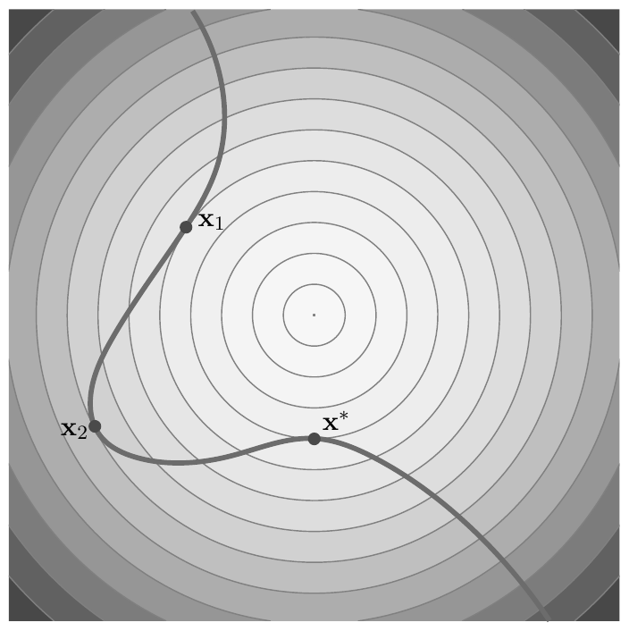

### R6.7 — Condiciones de regularidad (constraint qualifications) (p. 213)

Los multiplicadores exigen condiciones leves de regularidad que descartan casos patológicos (restricciones activas linealmente dependientes, región factible sin interior). Para igualdades, la condición clave es que **los gradientes de las restricciones activas sean linealmente independientes** en `x*`, esto es, que el jacobiano tenga rango completo:

$$
\operatorname{rank}\big[\nabla h_1(x^{*})\ \cdots\ \nabla h_m(x^{*})\big] = m .
$$

Esto garantiza que el conjunto de direcciones factibles tenga la dimensión esperada. Si los gradientes son dependientes, las restricciones pueden definir una región **degenerada** y **puede no existir ningún multiplicador** que satisfaga la estacionariedad, incluso en un punto que minimiza y satisface las restricciones (p. ej. dos restricciones en 2D con gradientes en la misma dirección: rectas paralelas, región vacía o mal definida).

### Historia (p. 213)

Lagrange introdujo el método para **eliminar las fuerzas de restricción en mecánica holonómica**. La **Fig. 6.5 (p. 213)** muestra un bloque deslizando por un plano inclinado sin fricción: la gravedad tira hacia abajo con fuerza constante `−gm` y la rampa aplica una **fuerza normal** que mantiene el bloque sobre la superficie; **esa fuerza normal es el multiplicador de Lagrange** que impone la restricción. Casi doscientos años después, Karush generalizó el enfoque a desigualdades y Kuhn–Tucker lo popularizó: el nacimiento de la programación no lineal moderna.

*Nota del libro (nota 3):* una restricción **holonómica** se escribe como ecuación explícita entre coordenadas generalizadas, `h(q₁,…,qₙ,t)=0`, y restringe el espacio de configuración pero no las velocidades; las **no holonómicas** involucran velocidades y no se integran a restricciones posicionales (una moneda que rueda sin deslizar es no holonómica; un bloque en un plano inclinado es holonómico).

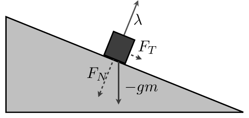

---

## 6.2  Karush–Kuhn–Tucker (KKT) Conditions (pp. 214–219)

### Ideas principales

Las KKT generalizan Lagrange a **desigualdades** `g(x) ≤ 0`.

### R6.8 — Forma lagrangiana con igualdades y desigualdades (p. 214)

$$
\min_x f(x) \quad \text{s.t.} \quad h(x)=0, \quad g(x)\le 0 \qquad (6.13a), (6.13b), (6.13c)
$$

$$
L(x,\lambda,\mu) = f(x) + \lambda^{T}h(x) + \mu^{T}g(x) = f(x)+\sum_{j=1}^{m}\lambda_j h_j(x)+\sum_{j=1}^{p}\mu_j g_j(x) \qquad (6.14a), (6.14b)
$$

con `λ ∈ ℝᵐ` y **`µ ∈ ℝ₊ᵖ`**, es decir `µ ≥ 0` (Ec. (6.14) en forma compacta). El primal se reescribe como

$$
\min_x \ \sup_{\lambda;\,\mu\ge 0} \ f(x)+\lambda^{T}h(x)+\mu^{T}g(x), \qquad (6.15)
$$

obtenido igual que antes añadiendo las penalizaciones infinitas `δ₀(h(x))` y `δ_{ℝ₋}(g(x))`. **`µ` debe ser no negativo**, porque de lo contrario el supremo sería infinito aun con la restricción satisfecha.

### Panel 6.2: Infinite Penalty Function δ_C (p. 214)

> Generaliza la notación: `δ_C(x) = 0` si `x ∈ C`, `∞` si `x ∉ C`. Así, `δ₀(h(x))` sirve para igualdades y `δ_{ℝ₋}(g(x))` para desigualdades, donde `ℝ₋` denota el conjunto `x ≤ 0`.

### R6.9 — Las cuatro condiciones KKT (p. 215)

$$
\begin{aligned}
\text{(stationarity)}\quad & \nabla f(x^{*})+\lambda^{*T}\nabla h(x^{*})+\mu^{*T}\nabla g(x^{*}) = 0 &\qquad (6.16a)\\
\text{(primal feasibility)}\quad & h(x^{*})=0,\ \ g(x^{*})\le 0 &\qquad (6.16b)\\
\text{(dual feasibility)}\quad & \mu^{*}\ge 0 &\qquad (6.16c)\\
\text{(complementary slackness)}\quad & \mu^{*T}g(x^{*})=0. &\qquad (6.16d)
\end{aligned}
$$

**Si `f` y `g` son convexas y `h` es afín** (problema convexo), las KKT son **necesarias y suficientes** para el óptimo global. En problemas no convexos dan condiciones **necesarias de primer orden** (solo primeras derivadas).

Lectura de cada condición, según el libro:

- **Estacionariedad**: es `∇_x L = 0`, generaliza `∇f(x*)=0`. Dice que el gradiente del objetivo está en el span de las **normales de las restricciones activas** (las inactivas tienen `µⱼ=0` y no contribuyen).
- **Factibilidad primal**: `x*` está en el conjunto factible.
- **Factibilidad dual**: `µⱼ ≥ 0`. Si fueran negativas, el supremo de (6.15) sería infinito aun satisfaciendo las restricciones; en la forma dual (§6.3), un `µⱼ<0` multiplicado por una restricción inactiva `gⱼ(x)<0` llevaría la maximización a infinito.
- **Holgura complementaria**: `µⱼgⱼ(x*) = 0` para cada `j`: **o `µⱼ = 0` o `gⱼ(x*) = 0`**. Si la restricción está activa actúa como igualdad y `µⱼ>0` es un multiplicador ordinario; si es inactiva, `µⱼ=0` y **esa restricción no puede empujar el óptimo** vía el gradiente. El libro señala el parentesco con las **variables de holgura** del simplex de Dantzig (Cap. 3).

### R6.10 — Geometría de la holgura complementaria y las direcciones factibles (pp. 215–216)

Para una restricción `gⱼ(x) ≤ 0`, la frontera tiene normal **saliente** `∇gⱼ`. En la frontera solo se puede mover en direcciones `d` con `∇gⱼ(x)·d ≤ 0` (factibilidad). Si la restricción está activa, la estacionariedad incluye `µⱼ∇gⱼ(x)` con `µⱼ ≥ 0`, un multiplicador que **empuja contra la frontera**; si está inactiva, el término desaparece porque `µⱼ=0`. La holgura complementaria `µⱼgⱼ(x)=0` garantiza exactamente eso: **el término `µⱼ∇gⱼ(x)` aparece si y solo si la restricción está activa**.

**Fig. 6.6 (p. 216)**: a la izquierda el óptimo cae en el borde del conjunto factible (restricción **activa**); a la derecha en el interior (**inactiva**). En ambos casos se cumple `µᵀg(x)=0`.

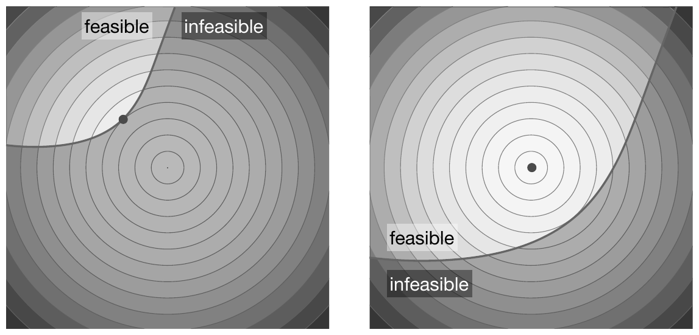

### R6.11 — Perspectiva algorítmica: tres familias KKT (pp. 216–217)

El sistema KKT sostiene los algoritmos más potentes de optimización restringida:

**(a) Active-Set Methods (ASM) y Sequential Quadratic Programming (SQP).** Se **adivina** qué desigualdades están activas y se convierten en igualdades; se resuelve el Lagrangiano sin restricciones (p. ej. con Newton) y luego se **prueba** si alguna restricción entra o sale. En SQP se aproxima `f(x)` con una **cuadrática**.

**(b) Interior-Point Methods (IPM).** Se resuelve iterativamente para un `(x*,λ*,µ*)` que satisfaga KKT, reemplazando cada `gⱼ(x) ≤ 0` por una **barrera logarítmica** `−t log(−gⱼ(x))`; una iteración de Newton sobre el objetivo aumentado impone `gⱼ ≤ 0`, y **cuando `t → 0` la solución converge a un punto KKT** (detalle en §6.4).

**(c) Augmented Lagrangian Methods (ALM).** Se convierten las desigualdades en igualdades con **variables de holgura** (`g(x)+s = 0`, `s ≥ 0`) y se añade el término de penalización `(ρ/2)‖g(x)+s‖²`. Un **bucle externo** actualiza los multiplicadores `(λ,µ)` y un **bucle interno** minimiza el Lagrangiano aumentado en `(x,s)`, a menudo con solvers sin restricciones (mínimos cuadrados si `f` es cuadrática). Es la puerta a §6.5.

### R6.12 — Cualificaciones de restricción: Slater, LICQ, MFCQ (p. 217)

- **Condición de Slater.** Para problemas **convexos**: basta que exista un punto **estrictamente factible** `x₀` con `h(x₀)=0` y `g(x₀)<0`. Basta con que valga en **un solo** `x₀` y da un resultado **global**: garantiza **dualidad fuerte** y que KKT sea necesaria y suficiente. En LP se cumple automáticamente si el conjunto factible tiene interior no vacío. **En problemas no convexos no garantiza dualidad fuerte ni suficiencia**; puede seguir dando necesidad si se cumplen además LICQ o MFCQ.
- **LICQ (Linear Independence Constraint Qualification).** Los gradientes de **todas** las restricciones activas (igualdades y desigualdades activas en `x*`) deben ser linealmente independientes. Garantiza que si `x*` es minimizador local **existen multiplicadores `(λ,µ) únicos`** que satisfacen KKT. **LICQ por sí sola no asegura la existencia de un optimizador ni la suficiencia de KKT**; en el caso convexo es más fuerte que Slater para existencia y **no se necesita para suficiencia**.
- **MFCQ (Mangasarian–Fromovitz).** Más débil que LICQ: los `∇h(x*)` son linealmente independientes y **existe una dirección** `d ∈ ℝⁿ` con `∇hᵢ(x*)·d = 0` para todo `i` y `∇gⱼ(x*)·d < 0` para toda `j` activa. Garantiza una dirección factible que se **aleja** de las desigualdades activas; a diferencia de LICQ, **tolera dependencia lineal entre desigualdades activas** siempre que exista esa dirección de descenso factible.

### E6.2 — Example: Least Squares with Box Constraints (pp. 217–219)

$$
\min_x \ \tfrac{1}{2}\|Ax-b\|_2^{2} \quad \text{s.t.} \quad \ell \le x \le u \qquad (6.17a), (6.17b)
$$

Ya resuelto en §4.6 (Python) y §5.1 (gradiente proyectado). Con duales `µ` (cotas inferiores) y `ν` (superiores):

$$
L(x,\mu,\nu) = \tfrac{1}{2}\|Ax-b\|_2^{2}+\mu^{T}(\ell-x)-\nu^{T}(x-u),
$$

y las KKT quedan

$$
A^{T}(Ax-b)-\mu+\nu=0,\quad \ell\le x\le u,\quad \mu,\nu\ge 0,\quad \mu^{T}(\ell-x)=0,\ \ \nu^{T}(x-u)=0 .
$$

Como el problema es **convexo**, KKT es necesaria y suficiente (la verificación de regularidad queda como ejercicio 6–4).

**Aproximación por punto interior.** Con barreras logarítmicas,

$$
\phi_t(x) = \tfrac{1}{2}\|Ax-b\|^{2} - t\sum_j\big(\log(x_j-\ell_j)+\log(u_j-x_j)\big),
$$

un problema sin restricciones resoluble por Newton; cuando `t → 0` converge a KKT. Los multiplicadores asociados son `µⱼ = t/(xⱼ−ℓⱼ)` y `νⱼ = t/(uⱼ−xⱼ)`.

**Gradiente proyectado.** Se proyecta el gradiente sin restricciones sobre la caja `[ℓ,u]` en cada paso; equivale a tratar cada cota como desigualdad separada, y los multiplicadores se recuperan con **soft-thresholding** del gradiente. Los KKT por coordenadas son una tabla de signos:

- Si `ℓⱼ < x*ⱼ < uⱼ`: ambas inactivas, `µⱼ=νⱼ=0`, `∂f/∂xⱼ(x*)=0`.
- Si `x*ⱼ = ℓⱼ`: cota inferior activa, `µⱼ ≥ 0`, `νⱼ=0`, `∂f/∂xⱼ(x*) = −µⱼ ≤ 0`.
- Si `x*ⱼ = uⱼ`: cota superior activa, `µⱼ=0`, `νⱼ ≥ 0`, `∂f/∂xⱼ(x*) = νⱼ ≥ 0`.

**Forma técnica:** `−∇f(x*) ∈ N_{[ℓ,u]}(x*)`, el **cono normal** de la restricción de caja (vectores que empujan hacia afuera del conjunto factible, perpendiculares a su frontera).

### R6.13 — Propiedad de punto de silla del punto KKT (p. 219)

Un punto KKT `(x*,λ*,µ*)` es **punto de silla** del Lagrangiano restringido:

$$
L(x^{*},\lambda,\mu) \ \le\ L(x^{*},\lambda^{*},\mu^{*}) \ \le\ L(x,\lambda^{*},\mu^{*}) \qquad (6.18)
$$

para todo `x` en el conjunto factible primal y todo `λ, µ` factibles duales. La desigualdad derecha dice que **`x*` minimiza en primal** con `λ*,µ*` fijos; la izquierda, que **`λ*,µ*` maximizan en dual** con `x*` fijo. En problemas no convexos la propiedad vale **solo localmente**.

**Dualidad fuerte** significa que los valores óptimos coinciden:

$$
\min_{x\in S} f(x) = \min_x \sup_{\lambda;\mu\ge0} L(x,\lambda,\mu) = \max_{\lambda;\mu\ge0}\min_x L(x,\lambda,\mu),
$$

y si `x*` es minimizador primal y `(λ*,µ*)` maximizador dual, entonces `x* ∈ argmin_x L(x,λ*,µ*)` y `(λ*,µ*) ∈ argmax L(x*,λ,µ)`, de donde sale (6.18).

**Equivalencia (convexidad + diferenciabilidad + Slater)** — las tres afirmaciones son equivalentes:

1. Las condiciones KKT se cumplen en `(x*,λ*,µ*)`.
2. `(x*,λ*,µ*)` es punto de silla de `L(x,λ,µ)`.
3. Se cumple dualidad fuerte y los óptimos **se alcanzan**: `min_{x∈S} f(x) = max_{λ;µ≥0} min_x L = min_x max_{λ;µ≥0} L`.

*Nota del libro:* el punto de silla es **necesario** para dualidad fuerte en programas convexos, pero la **suficiencia exige condiciones de regularidad adicionales**.

---

## 6.3  Duality (pp. 220–233)

### Ideas principales

Todo problema restringido tiene un **dual** que da una **cota inferior** del primal. Visto en el Cap. 3 para LP, aquí se generaliza a problemas convexos y no convexos. **Independientemente de la convexidad del primal, el dual es siempre cóncavo.** Los multiplicadores `λ, µ` son las **variables de decisión del dual**: sin desigualdades el dual es **sin restricciones**; con ellas hay **restricciones de positividad** sobre `µ`. Cuando dual y primal coinciden, la igualdad es un **certificado de optimalidad**.

### R6.14 — Función dual y problema dual (pp. 220–221)

Dado

$$
\min_x f(x) \quad \text{s.t.} \quad h(x)=0,\ \ g(x)\le 0, \qquad (6.19a), (6.19b), (6.19c)
$$

la **función dual** es la minimización parcial del Lagrangiano en `x`:

$$
\phi(\lambda,\mu) = \inf_x L(x,\lambda,\mu) = \inf_x\big(f(x)+\lambda^{T}h(x)+\mu^{T}g(x)\big). \qquad (6.20)
$$

El ínfimo **no** se restringe al conjunto factible: se toma sobre todo `x`. `φ` es **siempre cóncava**, aun si el primal es no convexo, porque es el **ínfimo puntual de funciones afines en `(λ,µ)`**. El **problema dual** es

$$
\max_{\lambda;\ \mu\ge0}\ \phi(\lambda,\mu), \qquad (6.21)
$$

y da una cota inferior del óptimo primal.

### R6.15 — Dualidad débil (p. 221)

$$
\max_{\lambda;\mu\ge0}\phi(\lambda,\mu) \ \le\ \min_{x\in S} f(x). \qquad (6.22)
$$

Y una versión **más fundamental, válida en puntos no óptimos**: para cualquier primal factible `x ∈ S` y cualquier dual factible `(λ,µ)`,

$$
\phi(\lambda,\mu) \le f(x). \qquad (6.23)
$$

**Siempre vale, incluso en problemas no convexos.** El libro explica la utilidad práctica: los duales permiten "presionar" las restricciones y **ajustar `λ,µ` para maximizar la cota inferior garantizada**; `φ` mide hasta dónde se puede empujar el objetivo si se permiten violaciones penalizadas. Por eso **las soluciones duales son cotas inferiores seguras**, aunque se admitan puntos no factibles.

### R6.16 — Dualidad fuerte (p. 221)

Es el caso especial en que los óptimos coinciden:

$$
\phi(\lambda^{*},\mu^{*}) = f(x^{*}). \qquad (6.24)
$$

Vale para problemas **convexos** bajo condiciones de regularidad leves, como **Slater** (existencia de un punto estrictamente factible). *Nota 9 del libro:* la igualdad exige que el óptimo primal **se alcance**, lo que puede requerir compacidad del conjunto factible (p. ej. el politopo convexo de LP, cerrado y compacto); si no se alcanza, hay que escribir `inf_{x∈S} f(x) = sup_{λ;µ≥0} φ(λ,µ)`. En problemas no convexos **puede no haber dualidad fuerte y sí brecha de dualidad**.

### R6.17 — Variables duales = derivadas de la función de valor (p. 221)

Las variables duales cuantifican la **sensibilidad del óptimo a perturbaciones del lado derecho** de las restricciones. Formalmente (pp. 231–232): escribiendo las restricciones como `h(x)=b` y `g(x) ≤ c`, y siendo `v(b,c) = f(x*)`, bajo convexidad + Slater + diferenciabilidad de `v` se cumple

$$
\lambda_j^{*} = -\frac{\partial v}{\partial b_j}, \qquad \mu_j^{*} = -\frac{\partial v}{\partial c_j},
$$

en forma vectorial `−∇v(b,c) = (λ*, µ*)ᵀ`, o equivalentemente para perturbaciones pequeñas `ϵ`:

$$
v(b+\epsilon e_j, c) = v(b,c) - \epsilon\lambda_j^{*} + o(\epsilon), \qquad v(b, c+\epsilon e_j) = v(b,c) - \epsilon\mu_j^{*} + o(\epsilon).
$$

Cada `λ*ⱼ` mide cuánto **sube o baja** el óptimo por unidad de aumento en `bⱼ`; si una desigualdad está activa, `µ*ⱼ` es el **costo marginal** de apretarla o aflojarla; si está inactiva, `µ*ⱼ = 0` y **no tiene efecto local**. Si `v` no es diferenciable, los multiplicadores están en el **subgradiente**: `(−λ*,−µ*) ∈ ∂v(b,c)`.

### R6.18 — Dual solo con igualdades (p. 222)

Sin desigualdades, el dual es

$$
\max_{\lambda}\ \phi(\lambda), \qquad \phi(\lambda) = \inf_x \big(f(x)+\lambda^{T}h(x)\big),
$$

**sin restricciones sobre `λ`**: se puede resolver con descenso de gradiente o Newton según `φ` sea diferenciable o dos veces diferenciable.

### R6.19 — El dual de un programa lineal (pp. 222–224)

Se parte del LP en forma —Ec. (6.25)—

$$
\max_{x\ge0} c^{T}x \quad \text{s.t.} \quad Ax\le b, \qquad (6.25a), (6.25b)
$$

se reordena como `b − Ax ≥ 0`,

$$
\max_{x\ge0} c^{T}x \quad \text{s.t.} \quad b-Ax\ge0, \qquad (6.26a), (6.26b)
$$

y se introduce el Lagrangiano con multiplicadores `y`:

$$
\max_{x\ge0}\min_{y\ge0}\ \underbrace{c^{T}x + y^{T}(b-Ax)}_{L(x,y)}. \qquad (6.27)
$$

(Aquí es `max min` porque el primal es de maximización; `y ≥ 0` porque corresponde a desigualdades, jugando el papel de `µ`, y se llama `y` porque será la variable del dual.) Reagrupando términos en `x`:

$$
\max_{x\ge0}\min_{y\ge0}\ y^{T}b + (c^{T}-y^{T}A)x, \qquad (6.28)
$$

y transponiendo (el objetivo es escalar):

$$
\max_{x\ge0}\min_{y\ge0}\ b^{T}y + x^{T}(c-A^{T}y). \qquad (6.29)
$$

Por **dualidad fuerte** (footnote 10; se supone el politopo factible cerrado, acotado y no vacío) los `max` y `min` se intercambian:

$$
\max_{x\ge0}\min_{y\ge0}\ b^{T}y + x^{T}(c-A^{T}y) \ \le\ \min_{y\ge0}\max_{x\ge0}\ b^{T}y + x^{T}(c-A^{T}y), \qquad (6.30)
$$

que se vuelve **igualdad** bajo supuestos leves, lo que permite escribir

$$
\min_{y\ge0}\max_{x\ge0}\ b^{T}y+x^{T}(c-A^{T}y). \qquad (6.31)
$$

Ahora `xᵀ` es el multiplicador de la desigualdad `c − Aᵀy ≤ 0` del dual; devolviendo esos términos a restricciones:

$$
\min_{y\ge0}\ b^{T}y \quad \text{s.t.} \quad A^{T}y-c\ge0, \qquad (6.32a), (6.32b)
$$

y en forma estándar:

$$
\min_{y\ge0}\ b^{T}y \quad \text{s.t.} \quad A^{T}y\ge c. \qquad (6.33a), (6.33b)
$$

**Intuición (p. 223).** Dado `max_{x≥0} cᵀx` con `Ax ≤ b`, se busca la **cota superior más ajustada** de `cᵀx` tomando combinaciones lineales de las restricciones `aⱼx ≤ bⱼ` con coeficientes `y` (los duales). Toda solución factible satisface las restricciones, luego cualquier combinación también:

$$
y^{T}Ax \le y^{T}b. \qquad (6.34)
$$

Si los coeficientes `yᵀA` son `≥ cᵀ`, entonces `yᵀb` es una cota superior directa de `cᵀx` (esto usa `x ≥ 0`, relajable). Para la cota **más ajustada** se minimiza `yᵀb` con `y ≥ 0` y `yᵀA ≥ cᵀ` — exactamente (6.33).

**Fig. 6.7 (p. 224)** dibuja el par primal/dual: el primal tiene más restricciones que variables, el dual más variables que restricciones; la minimización dual acota por arriba la maximización primal. **Fig. 6.8 (p. 225)** ilustra la idea de la combinación lineal de restricciones (`yᵀA x = yᵀA x ≤ yᵀb`).

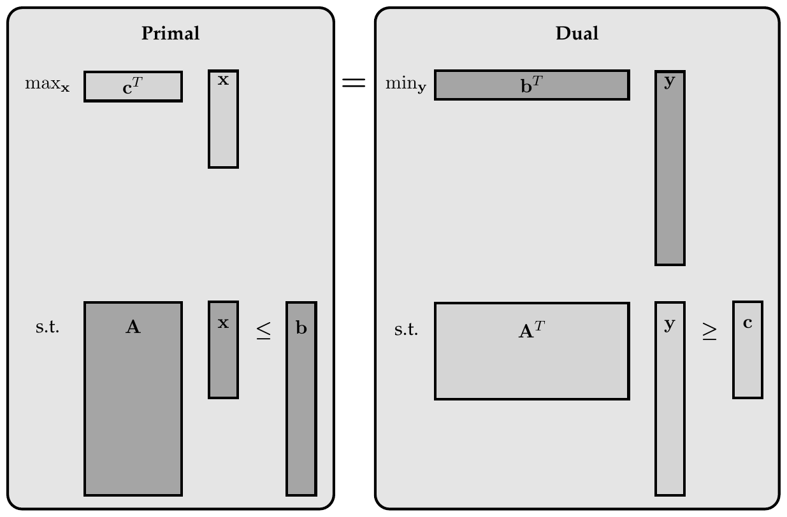

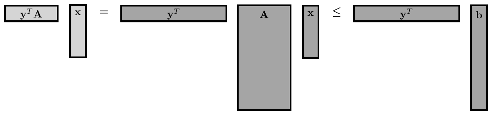

### E6.3 — Simple example (p. 224)

```
   (Primal)                     (Dual)
min 3x₁ + 5x₂        ⇐⇒      max 6y
x₁,x₂
 s.t. 2x₁ + x₂ = 6            s.t. 2y ≤ 3
      x₁, x₂ ≥ 0                    y ≤ 5
```

El óptimo dual `y* = 3/2` da la cota inferior `6y* = 9`, que coincide con el óptimo primal `(x₁*,x₂*) = (3,0)` y su costo 9. **Hay dualidad fuerte.**

### R6.20 — Dualidad para mínimos cuadrados con restricciones (pp. 225–226)

Con `min_x ½‖Ax−b‖₂²` s.t. `Cx = d` y `L(x,λ) = ½‖Ax−b‖₂² + λᵀ(Cx−d)`, la estacionariedad en `x` da

$$
\underbrace{(A^{T}A)}_{Q}x = \underbrace{A^{T}b - C^{T}\lambda}_{r(\lambda)} \ \Longrightarrow\ x^{*} = Q^{\dagger}r(\lambda),
$$

y expandiendo el Lagrangiano, `L(x,λ) = ½xᵀQx − r(λ)ᵀx + ½bᵀb − λᵀd`. En vez de sustituir a mano ("es un desastre"), el libro usa la identidad cuadrática

$$
\min_x\ \tfrac{1}{2}x^{T}Qx - r^{T}x = \begin{cases} -\tfrac{1}{2}\langle r, Q^{\dagger}r\rangle, & r\in\operatorname{range}(Q),\\ -\infty, & \text{en otro caso},\end{cases}
$$

de donde

$$
\phi(\lambda) = -\tfrac{1}{2}\langle r(\lambda), Q^{\dagger}r(\lambda)\rangle + \tfrac{1}{2}\|b\|^{2} - \lambda^{T}d,
$$

con la restricción de que `r(λ) ∈ range(Q) = range(Aᵀ)`; si `AᵀA` es invertible se reemplaza `Q†` por `Q⁻¹`. En forma de norma:

$$
\phi(\lambda) = -\tfrac{1}{2}\big\| \underbrace{((A^{T}A)^{\dagger})^{-1/2}(A^{T}b-C^{T}\lambda)}_{(Q^{\dagger})^{-1/2}r(\lambda)} \big\|_2^{2} + \tfrac{1}{2}\|b\|_2^{2}-\lambda^{T}d. \qquad (6.35)
$$

**El beneficio (numérico):** el sistema KKT primal (Eq. 4.48 del Cap. 4) es un sistema **indefinido** `(n+m)×(n+m)`; el dual (6.35) resuelve el sistema de **Schur complement** `m×m` **definido**:

$$
CQ^{\dagger}C^{T}\lambda = C(A^{T}A)^{-1}A^{T}b - d,
$$

y luego `x* = (AᵀA)⁻¹(Aᵀb − Cᵀλ*)`. Factorizar `Q†` o `(AᵀA)⁻¹` sigue requiriendo factorizar `A` (QR o SVD), pero **el dual es simétrico semidefinido positivo, preferible en álgebra lineal numérica**. Cuando `m ≪ n` (pocas restricciones, muchas variables) el punto de vista dual es **computacionalmente atractivo**; de hecho muchos solvers **ya** reducen el KKT primal a la forma de Schur complement: factorizan `A`, forman `C(AᵀA)⁻¹Cᵀ`, resuelven para `λ` y resuelven hacia atrás para `x`.

### R6.21 — Función conjugada de Fenchel (p. 226)

$$
f^{*}(y) = \sup_x \big(y^{T}x - f(x)\big). \qquad (6.36)
$$

Intuición del libro: `f*(y)` captura la **cota inferior afín más ajustada** de `f(x)` con pendiente `y`; se construye `f*` como el conjunto de **hiperplanos afines de soporte inferiores** de `f`. Es una generalización de la **transformada de Legendre** (§6.6): ambas relacionan una función con una representación dual basada en sus hiperplanos lineales de soporte.

### R6.22 — Biconjugada y teorema de Fenchel–Moreau (pp. 226–228)

$$
f^{**}(x) = \sup_y \big(x^{T}y - f^{*}(y)\big). \qquad (6.37)
$$

**Teorema de Fenchel–Moreau:** si `f` es **propia** (finita en al menos un punto y `> −∞` en todo `x`), **convexa** y **semicontinua inferiormente**, entonces

$$
f(x) = f^{**}(x) \qquad \forall x \in \operatorname{dom}(f). \qquad (6.38)
$$

Además, **si `f` es no convexa, `f**` es la envolvente convexa cerrada de `f`**.

*Nota 12:* "propia" = `f(x)<+∞` al menos en un `x` y `f(x)>−∞` para todo `x`. *Nota 13:* semicontinua inferiormente significa `lim inf_{x→x₀} f(x) ≥ f(x₀)` — la función no salta hacia abajo —, equivalente a que `epi(f)` sea cerrado; toda función continua lo es.

### E6.4 — Example: Convex Envelope of a Nonconvex Function (pp. 227–228)

Para `f(x) = min(x², |x|)` (mínimo puntual de dos funciones convexas, por tanto **no convexa**, y sin hiperplano de soporte único que la acote), la envolvente convexa —la mayor función convexa que queda por debajo de `f`— es

$$
f^{**}(x) = \begin{cases} x^{2} & |x|\le 0.5,\\ |x|-0.25 & |x|>0.5,\end{cases} \qquad (6.39)
$$

que es **la función de Huber**, ampliamente usada en estadística robusta. **Fig. 6.10 (p. 228)** muestra `f` y su envolvente. En general `f** ≤ f`, con igualdad **si y solo si** `f` es convexa y semicontinua inferiormente. Calcular `f*` y `f**` para este ejemplo queda como ejercicio (6–15).

**Fig. 6.9 (p. 227)** ilustra el conjugado de `f(x)=x²`: `f*(y) = ¼y²`, obtenido como la **intersección con el eje vertical de la recta tangente** de pendiente `y` (en `y=1` la recta de pendiente 1 corta el eje en `¼`).

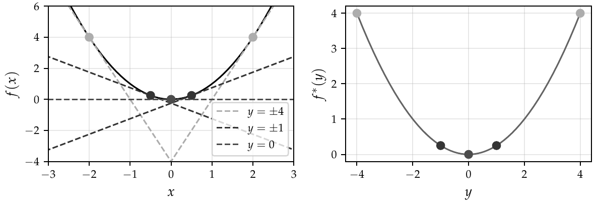

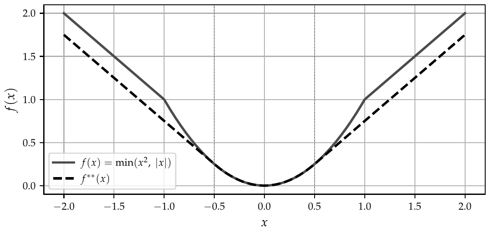

### R6.23 — Dualidad de Fenchel–Rockafellar (pp. 228–229)

Partiendo de la función dual (6.40) —cóncava por ser ínfimo puntual de afines en `(λ,µ)`—, si `f` y las restricciones son convexas el marco de Fenchel aplica.

**Solo igualdades** (`h(x)=Ax−b`, `g=0`):

$$
\phi(\lambda) = \inf_x\big(f(x)+\lambda^{T}(Ax-b)\big) = -\lambda^{T}b + \inf_x\big(f(x)+\lambda^{T}Ax\big), \qquad (6.41)
$$

que, usando `inf_x (f + λᵀAx) = −sup_x(xᵀ(−Aᵀλ) − f(x)) = −f*(−Aᵀλ)`, se reescribe como

$$
\phi(\lambda) = -\lambda^{T}b - f^{*}(-A^{T}\lambda). \qquad (6.42)
$$

**Con desigualdades convexas** `gⱼ(x) ≤ 0`:

$$
\phi(\lambda,\mu) = \inf_x\big(f(x)+\lambda^{T}(Ax-b)+\mu^{T}g(x)\big), \qquad \mu\ge0, \qquad (6.43)
$$

$$
\phi(\lambda,\mu) = -\lambda^{T}b + \inf_x\big(f(x)+\lambda^{T}Ax+\mu^{T}g(x)\big). \qquad (6.44)
$$

Definiendo

$$
\tilde f(x) := f(x)+\mu^{T}g(x), \qquad (6.45)
$$

que **sigue siendo convexa**, el dual queda

$$
\phi(\lambda,\mu) = -\lambda^{T}b - \tilde f^{*}(-A^{T}\lambda). \qquad (6.46)
$$

Es decir, **el dual tiene forma explícita en términos del conjugado del objetivo**.

### R6.24 — Interpretación geométrica: hiperplanos de soporte (pp. 229–230)

En el primal se busca el **conjunto de nivel más bajo** de `f` que corta la región factible `h(x)=0`. En el dual se busca, recorriendo `λ`, la **mejor cota inferior afín** (hiperplano de soporte) de `f` que respeta la restricción; **el `λ*` óptimo es la pendiente de ese hiperplano**.

Con igualdades afines, cada `λ` define una perturbación lineal `f(x) + λᵀ(Ax−b)`: **inclinar `f`** en la dirección `λᵀA`. Su ínfimo es la cota inferior. El par `(λ, φ(λ))` define un hiperplano de soporte del **epígrafo** de `f`, porque

$$
f(x) \ge -\lambda^{T}Ax + \phi(\lambda) + \lambda^{T}b
$$

es una cota afín **ajustada** en el `x` que minimiza para ese `λ` (suponiendo dualidad fuerte). Así, `λ` **parametriza una familia de subestimadores afines de `f`**, uno por dirección de perturbación — el conjunto de hiperplanos de soporte de `epi(f)`. El `λ*` óptimo es la pendiente del **más ajustado** de esos hiperplanos: el que queda por debajo de la gráfica, **la toca en el punto óptimo** `x*` y respeta `h(x)=0`.

### E6.5 — Example: Scalar Convex Problem (pp. 230–231)

$$
\min_x f(x)=(x-2)^{2}+1 \quad \text{s.t.} \quad h(x)=x-1=0 .
$$

El único punto factible es `x=1`, así que debe ser el óptimo; el ejemplo sirve por su geometría. Con `L(x,λ) = (x−2)²+1+λ(x−1)`:

$$
L(x,\lambda) = (x-2)^{2}+1+\lambda(x-1), \qquad (6.47)
$$

$$
\phi(\lambda) = \inf_x L(x,\lambda) = -\tfrac{1}{4}\lambda^{2}+\lambda+1, \qquad (6.48)
$$

que es **afín en `λ`** y satisface `φ(λ) ≤ f(x)` para todo `x` factible. Geométricamente, `φ(λ)` es la **intersección vertical de la recta más ajustada de pendiente `λ`** que queda bajo el epígrafo de `f`. El dual se maximiza en `λ* = 2`, que corresponde a `x* = 1` y `f(x*) = 2`. La condición KKT `f′(x*)+λ* = 0` da `λ* = −f′(x*)`; como `f′(1) = −2`, `λ* = 2`. La inclinación `λ(x−1)` **cancela exactamente la pendiente de `f` en `x=1`**, de modo que la función inclinada tiene su mínimo en el punto factible. La recta de soporte al epígrafo es `t = f(1)+f′(1)(x−1) = 2−2(x−1)`. **Fig. 6.11 (p. 231)** muestra la parábola, varias funciones inclinadas, la recta de soporte y `φ(λ)` — una demostración concreta de dualidad débil y fuerte.

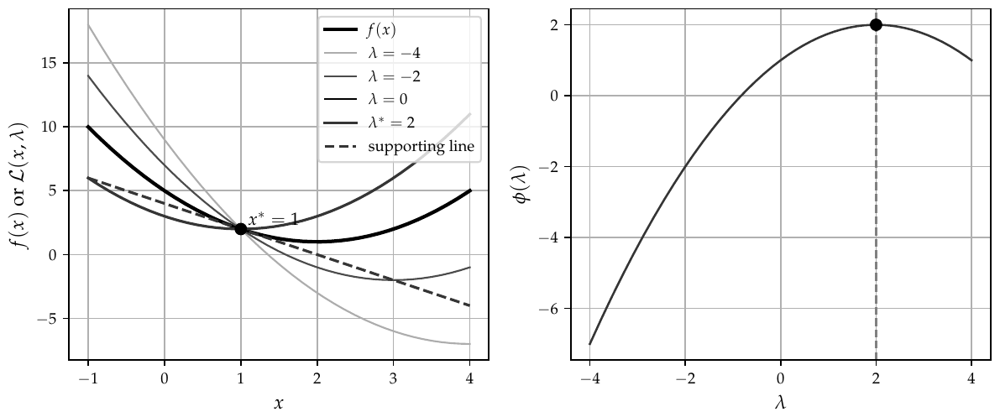

### R6.25 — Precios sombra y valor marginal en economía (p. 232)

Para el LP de maximización de beneficio de una firma que produce `n` bienes (beneficio `pⱼ` por unidad, recursos `Aᵢⱼ` por unidad de bien `j`, disponibilidad `rᵢ`):

$$
\max_{x\ge0} p^{T}x \quad \text{s.t.} \quad Ax\le r ,
$$

la función de valor `v(r)` es el beneficio máximo; los multiplicadores cumplen `µ*ⱼ = −∂v/∂rⱼ`. Así **`µ*ⱼ` mide cuánto aumenta el beneficio máximo si se dispone de una unidad más del recurso `j`**: si `µ*ⱼ = 0` el recurso **no es escaso**; si `µ*ⱼ > 0` es un **cuello de botella** con valor positivo. A `µ*ⱼ` se le llama **precio sombra** (beneficio marginal por unidad extra del recurso `j`).

### Panel 6.3: A Concrete Example of Marginal Value (p. 233)

> **Fábrica de cemento** con cemento regular (`x₁`, $1/kg) y especial (`x₂`, $2/kg). Una unidad de `x₁` usa 1 h de trabajo; una de `x₂`, 1 h de trabajo y 1 kg de material. Disponibles: 4 h de trabajo (`r₁`) y 2 kg de material (`r₂`).
>
> `max x₁+2x₂` s.t. `x₁+x₂ ≤ 4` (trabajo), `x₂ ≤ 2` (material), `x₁,x₂ ≥ 0`. Región factible: polígono de vértices `(0,0),(4,0),(2,2),(0,2)`; óptimo `(2,2)` con beneficio `v = 6`.
>
> **Función de valor.** Como `x₂` rinde más por hora de trabajo, se usa todo el material en `x₂` hasta el tope de trabajo y el trabajo restante se llena con `x₁`: `x₂*(r₁,r₂) = min{r₂,r₁}`, `x₁*(r₁,r₂) = r₁ − x₂*`. El beneficio máximo es la función **cóncava, lineal a trozos**
>
> `v(r₁,r₂) = r₁ + r₂` si `0 ≤ r₂ ≤ r₁`, y `v = 2r₁` si `r₂ ≥ r₁ ≥ 0`.
>
> **Precios sombra.** Lejos de `r₁=r₂`, `v` es diferenciable. Con `r₂<r₁`, `∇v = (1,1)ᵀ`, luego `µ*_trabajo = 1` y `µ*_material = 2`… *(el libro calcula aquí los dos casos y concluye: con `r₂<r₁` ambas restricciones son escasas y una hora extra de trabajo o un kg extra de material suben el beneficio en $1 cada uno — el óptimo pasa a `(3,2)` y `(1,3)` respectivamente, ambos con beneficio 7).* Cuando `r₂>r₁` el trabajo es el cuello de botella (valor $2 por hora) y el material extra **no tiene valor marginal**. Ilustra el **principio económico: solo las restricciones activas corresponden a recursos con valor marginal positivo**.

---

## 6.4  Interior Point Methods (pp. 234–238)

### Ideas principales

Los **IPM** recorren el **interior** de la región factible en lugar de su frontera. El simplex (Cap. 3) salta de vértice en vértice; los IPM **escalan a problemas de dimensión muy alta con fronteras complejas** y se generalizan a problemas convexos y no convexos más sofisticados. Encuentran soluciones que **satisfacen las KKT** — y por tanto son óptimas —; en problemas convexos el óptimo es global, con **complejidad polinomial**.

Principio básico: reemplazar el problema restringido por una **serie de subproblemas sin restricciones**, con una **barrera** (o penalización) que se vuelve infinita en la frontera. El libro presenta el enfoque **primal** con **barrera logarítmica**.

*Nota 17 (historia):* los IPM se descubrieron varias veces: Dikin en los 60 y Fiacco–McCormick en el contexto de métodos de penalización-barrera; se consideraron **imprácticos a gran escala** hasta el algoritmo primal-dual de **Karmarkar (1984)** para LP, competitivo con el simplex. En LP la convergencia es **lineal en la dimensión**, y en la práctica el número de iteraciones suele ser **independiente de la dimensión**. *Nota 18:* en la práctica se usan más los **primal-duales**, por convergencia más rápida y mejor estabilidad numérica, y porque **miden la brecha de dualidad**, lo que facilita monitorear el progreso y los criterios de parada.

### R6.26 — KKT perturbadas → barrera logarítmica (pp. 234–235)

Resolver (6.16) directamente suele ser difícil, así que se resuelve una **familia de problemas más simples que convergen** a la solución KKT. Para una restricción `g(x) ≤ 0`: las tres primeras condiciones KKT no cambian y la cuarta pasa de `µg(x)=0` a

$$
\mu g(x) = -t,
$$

con `t` un parámetro auxiliar que se relaja lentamente hacia `t=0`, recuperando entonces el sistema KKT original. Es más simple resolver esas ecuaciones perturbadas para `x*(t)` y luego **continuar** en `t`, usando `x*(t_{k−1})` como condición inicial para `x*(t_k)`. Este **continuation / homotopy** es una técnica útil más allá de la optimización.

Con `t ≠ 0` se despeja `µ` directamente de `x`:

$$
\mu = \frac{-t}{g(x)}, \qquad (6.49)
$$

y sustituyendo en la ecuación del gradiente:

$$
\nabla f(x) + \frac{-t}{g(x)}\nabla g(x) = 0. \qquad (6.50)
$$

Un poco de cálculo muestra que esto equivale a

$$
\nabla\big(f(x) - t\log(-g(x))\big) = 0, \qquad (6.51)
$$

es decir, al problema **sin restricciones**

$$
\min_x \ f(x)-t\log(-g(x)). \qquad (6.52)
$$

**Por qué funciona.** Una solución de (6.52) satisface la primera condición KKT y garantiza `g(x) ≤ 0` (porque `−g(x)` debe ser positivo para que el logaritmo sea finito), y (6.49) da `µ ≥ 0`: **todas las KKT modificadas se cumplen**. La función `−t log(−g(x))` es una **barrera**: suave, convexa, definida en el interior del conjunto factible, y que **crece mucho cerca de las fronteras**. **Fig. 6.12 (p. 235)** la dibuja para `g(x)=x` (izquierda, `Φ = −t log x`) y para `g(x)=x²−1` (derecha, `Φ = −t log(1−x²)`) con varios `t`.

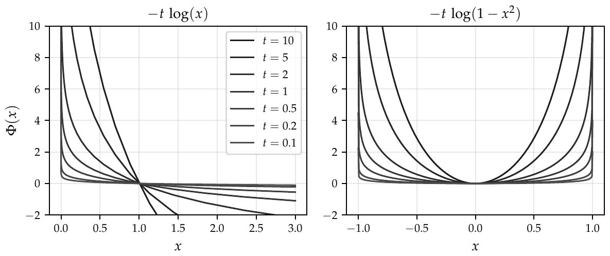

**Detalles prácticos** (p. 235): al ser un problema sin restricciones se usa **Newton**, que converge rápido con buena condición inicial. Con `t` pequeño la penalización es muy empinada en la frontera y **poco profunda en el resto**, así que Newton puede converger despacio; usar `x*(t_k)` como condición inicial para `t_{k+1}` acelera. Con `t` grande el objetivo se ve como `−log(−g(x))`, es decir minimizar `g(x)`; eso da `x*(∞)`, el **centro analítico** del conjunto factible, que sirve de inicialización para el primer `t`. La secuencia `x*(t_k)` es el **camino central**, siempre en el interior.

### R6.27 — Barrera compuesta para varias restricciones (p. 235)

Con `gⱼ(x) ≤ 0`, `j = 0,…,m`, se suma una barrera por restricción:

$$
\Phi(x) = -\sum_{j=0}^{m}\log\big(-g_j(x)\big). \qquad (6.53)
$$

### R6.28 — Método de barrera para programación lineal (pp. 236–238)

LP estándar:

$$
\min_x c^{T}x \quad \text{s.t.} \quad Ax\le b,\ \ x\ge0. \qquad (6.54a), (6.54b), (6.54c)
$$

La formulación con barrera reemplaza el problema por una secuencia de subproblemas sin restricciones:

$$
\min_x f_t(x) = \min_x \Big( c^{T}x - t\Big(\sum_{j=1}^{m}\log(b_j-a_j^{T}x) + \sum_{j=1}^{n}\log(x_j)\Big)\Big), \qquad (6.55)
$$

donde `t ≥ 0` se **decrece hacia cero** y `aⱼᵀx = bⱼ` es la fila `j` de `A`. Gradiente y Hessiano:

$$
\nabla f_t(x) = c + t\Big(\sum_{j=1}^{m}\frac{a_j}{b_j-a_j^{T}x} - \sum_{j=1}^{n}\frac{e_j}{x_j}\Big), \qquad (6.56a)
$$

$$
\nabla^{2}f_t(x) = t\Big(\sum_{j=1}^{m}\frac{a_j a_j^{T}}{(b_j-a_j^{T}x)^{2}} + \sum_{j=1}^{n}\frac{e_j e_j^{T}}{x_j^{2}}\Big), \qquad (6.56b)
$$

con `eⱼ` el vector unitario en la dirección `xⱼ`. Newton da la dirección `∇²f_t(x)Δx = −∇f_t(x)`; típicamente se elige el paso `α` por **búsqueda lineal para mantener la factibilidad** (`Ax < b`), y se actualiza `x ← x + αΔx`. Luego se actualiza la barrera, por ejemplo `t_{k+1} = 0.9 t_k`, y se continúa **hasta que la brecha de dualidad y los residuos de restricción caen bajo tolerancias prefijadas**.

**Ejemplo en Python.** El libro resuelve el LP de la §3.1 con `scipy.optimize.linprog(..., method='highs-ipm')`, metiendo la no negatividad en las dos primeras filas de `Ax ≤ b`. Y luego **implementa su propia barrera** (primal, no primal-dual):

```python
def phi(x):
    return -np.sum(np.log(b - A @ x))

def grad_phi(x):
    return A.T @ (1 / (b - A @ x))

def hess_phi(x):
    vals = 1 / (b - A @ x)
    return A.T @ np.diag(vals**2) @ A
```

con **Código 6.1** repitiendo `t` pasos de Newton, reduciendo el paso `s` a la mitad mientras `A(x+sΔx) ≥ b`, y multiplicando `t` por `mu=10` hasta que `n/t < tol` (nota: el código multiplica la barrera por `1/t` y lleva `t → ∞` en vez de `t → 0`, para coincidir con la literatura). **Fig. 6.13 (p. 238)** muestra el camino central: en el LP (izquierda) y en un QP (derecha) el recorrido alcanza el óptimo en muy pocas iteraciones; en el QP la trayectoria **se pega rápido a la frontera y luego la bordea despacio**, lo que ilustra la **poca profundidad del paisaje del objetivo con barrera logarítmica** en algunos problemas, que hace lento a Newton.

*Nota 19:* en la práctica, las implementaciones modernas para LP/convexos a gran escala **suelen superar al simplex** en problemas grandes o dispersos; pero para LP pequeños o medianos, o con estructura especial, un **simplex optimizado sigue siendo competitivo**.

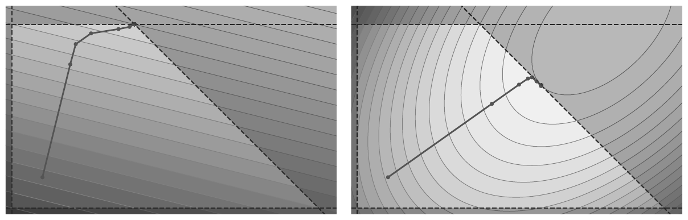

### R6.29 — Barrera para mínimos cuadrados con restricciones (p. 238)

Para `min_x ½‖Ax−b‖²` s.t. `Cx ≤ d`, el Hessiano es `AᵀA + t∇²Φ(x)`: **cada iteración resuelve un sistema de Newton que incluye el término cuadrático `AᵀA` y las contribuciones diagonales de la barrera**. Es especialmente potente en alta dimensión combinado con álgebra lineal **dispersa**.

---

## 6.5  Alternating Direction Method of Multipliers (ADMM) (pp. 239–244)

### Ideas principales

ADMM es un **método de splitting**: resuelve problemas convexos **descomponiéndolos en subproblemas más pequeños y manejables**, en especial cuando el objetivo es **suma de dos funciones individualmente fáciles de minimizar**. Combina la **descomponibilidad del dual ascent** con la **robustez del método de los multiplicadores**. Usos citados: PCA robusto, inferencia MAP, decodificación de LP, modelos gráficos, control con realimentación dispersa. Está emparentado con métodos previos de splitting de operadores y esquemas de penalización-dualidad, y ha inspirado implementaciones eficientes y resultados de convergencia.

Hay **dos formulaciones, equivalentes**: la forma **consenso** y la **compuesta**.

### R6.30 — Forma consenso y forma compuesta (pp. 239–240)

**Consenso:**

$$
\min_{x,z} f(x)+g(z) \quad \text{s.t.} \quad Ax+Bz=c,
$$

adecuada para **dividir entre `x` y `z`** y para computación distribuida cuando `f` y `g` son separables. Usa el **Lagrangiano aumentado**

$$
L_\rho(x,z,\lambda) = f(x)+g(z)+\lambda^{T}(Ax+Bz-c)+\frac{\rho}{2}\|Ax+Bz-c\|^{2}.
$$

**Compuesta** (caso especial estructurado):

$$
\min_x f(x)+g(Ax),
$$

con la sustitución `z = Ax`, que lo lleva a

$$
\min_{x,z} f(x)+g(z) \quad \text{s.t.} \quad Ax-z=0,
$$

es decir, la forma consenso con **`B = −I`, `c = 0`**. Es **más fácil de aplicar** a LASSO, denoising por variación total y compressed sensing.

**Por qué introducir `z`.** Desacopla el problema, lo hace **menos rígido** y más fácil de distribuir. Si `g` es no suave o difícil de minimizar en composición, minimizar `f(x)+g(Ax)` directamente puede ser duro; con `z` se **alterna**: minimizar `f(x)` con una penalización cuadrática y luego minimizar `g(z)` por separado, **por ejemplo con operadores proximales conocidos**, repitiendo hasta converger. La restricción `Ax=z` se impone **suavemente** vía la variable dual y la penalización cuadrática.

### R6.31 — ADMM es primal-dual (p. 240)

ADMM es un **caso especial del método del Lagrangiano aumentado**, que a su vez es primal-dual: se forma el Lagrangiano aumentado respecto de `Ax+Bz=c` y se **alternan** las actualizaciones — primero se minimiza en las variables primales `(x,z)`, luego se hace **ascenso de gradiente en la dual** `λ`. Esto difiere del dual ascent estándar, que puede converger despacio o ser inestable: **ADMM puede verse como un dual ascent con regularización proximal**, que **amortigua** las actualizaciones duales con una penalización para estabilizar y garantizar convergencia. Es una aplicación del **algoritmo de Douglas–Rachford** al problema dual.

Para `min f(x)+g(z)` s.t. `x=z`, las iteraciones son

$$
\begin{aligned}
x^{k+1} &= \arg\min_x \Big( f(x) + \frac{\rho}{2}\|x-z^{k}+u^{k}\|^{2} \Big),\\
z^{k+1} &= \arg\min_z \Big( g(z) + \frac{\rho}{2}\|x^{k+1}-z+u^{k}\|^{2} \Big),\\
u^{k+1} &= u^{k} + x^{k+1}-z^{k+1},
\end{aligned}
$$

donde `u` es la **variable dual escalada** (el multiplicador de Lagrange) y `ρ > 0` el **parámetro de penalización**; el esquema se generaliza a múltiples restricciones. En pseudocódigo:

```
initialize x, z, u        # primal variables and scaled dual variable
repeat until convergence:
    x := prox_f( -z - u , 1/rho )
    z := prox_g( -x - u , 1/rho )
    u := u + x + z        # dual variable update
```

Los proximales suelen ser **simples de derivar y ejecutar**; para `f(x)=‖x‖₁` el proximal es el **soft thresholding**:

```python
def prox_l1(x, lam, rho):
    return np.sign(x) * np.maximum(np.abs(x) - lam/rho, 0)
```

### E6.6 — Code Example: LASSO (pp. 241–242)

Para

$$
\min_x \ \|Ax-b\|_2^{2}+\lambda\|x\|_1 \qquad (6.57)
$$

se introduce `z` para el término `λ‖·‖₁` y un multiplicador `u` para imponer `z = x`, y se resuelve

$$
\min_{x,z}\ \|Ax-b\|_2^{2}+\lambda\|z\|_1+\frac{\rho}{2}\|x-z\|_2^{2} \qquad (6.58)
$$

usando el proximal del término no suave (soft thresholding). Con

$$
f(x)=\tfrac{1}{2}\|Ax-b\|_2^{2}=\tfrac{1}{2}x^{T}Ax-(A^{T}b)^{T}x+b^{T}b, \qquad g(z)=\|z\|_1 \qquad (6.59a), (6.59b)
$$

las actualizaciones son **cerradas**:

$$
\begin{aligned}
x^{k+1} &= (A^{T}A+\rho I)^{-1}\big(A^{T}b+\rho(z^{k}-u^{k})\big) &\qquad (6.60a)\\
z^{k+1} &= S_{\lambda/\rho}(x^{k+1}+u^{k}) &\qquad (6.60b)\\
u^{k+1} &= u^{k}+x^{k+1}-z^{k+1}, &\qquad (6.60c)
\end{aligned}
$$

donde `S` es el **operador de encogimiento** `S_τ(x) = sign(x)max(|x|−τ,0)`. En forma proximal:

$$
x^{k+1} = \arg\min_x \Big(f(x)+\frac{\rho}{2}\|x-z^{k}+u^{k}\|_2^{2}\Big) = \mathrm{prox}_{f,\rho}(z^{k}-u^{k}) \qquad (6.61a)
$$

$$
z^{k+1} = \arg\min_z \Big(\lambda g(z)+\frac{\rho}{2}\|x^{k+1}-z+u^{k}\|_2^{2}\Big) = \mathrm{prox}_{\lambda g,\rho}(x^{k+1}+u^{k}). \qquad (6.61b)
$$

El código del libro precomputa `AtA`, `Atb` y `LHS = AtA + rho*I` (el `lambda` de Python define `linsolve`), y **comprueba convergencia con residuo primal `‖x−z‖` y dual `ρ‖z−z_old‖`**, devolviendo `z` como solución final (`z ≈ x`).

### R6.32 — RPCA: PCA robusto mediante ADMM (pp. 242–244)

La regresión por mínimos cuadrados es muy **sensible a outliers y datos corruptos** (Cap. 4), y **PCA sufre lo mismo** (Fig. 6.14). Candès et al. propusieron **robust PCA (RPCA)**, que descompone la matriz de datos en una **matriz de bajo rango `L`** y una **matriz dispersa `S`** con outliers y datos corruptos:

$$
X = L + S. \qquad (6.62)
$$

Las componentes principales de `L` son **robustas a los outliers de `S`**. Aplicaciones: videovigilancia (el fondo está en `L`, los objetos en movimiento en `S`), reconocimiento facial (las eigenfaces en `L`; sombras y oclusiones en `S`), procesamiento de lenguaje natural / LSI, y problemas de ranking (el premio Netflix de matrix completion: matriz de usuarios × películas, dispersa, con las entradas faltantes a rellenar).

**Fig. 6.15 (p. 243)** muestra el ejemplo clásico: con una biblioteca de caras se construye una distribución estadística robusta de rostros y se puede **"restar" una oclusión**, como un bigote postizo, revelando los rasgos más probables debajo.

Matemáticamente se quiere

$$
\min_{L,S}\ \operatorname{rank}(L)+\|S\|_0 \quad \text{s.t.} \quad L+S=X, \qquad (6.63)
$$

pero **ni `rank(L)` ni `‖S‖₀` son convexos**. Como en compressed sensing, se resuelve con alta probabilidad mediante la **relajación convexa**

$$
\min_{L,S}\ \|L\|_{*}+\lambda\|S\|_1 \quad \text{s.t.} \quad L+S=X, \qquad (6.64)
$$

donde `‖·‖_*` es la **norma nuclear** (suma de valores singulares), que hace de proxy del rango. La solución de (6.64) converge a la de (6.63) con alta probabilidad si **`λ = 1/√(max(n,m))`** con `X ∈ ℝⁿˣᵐ`, y si **`L` no es dispersa y `S` no es de bajo rango**.

El problema convexo (6.64) se llama **principal component pursuit (PCP)** y se resuelve con el **método del Lagrangiano aumentado (ALM)**:

$$
L(L,S,Y) = \|L\|_{*}+\lambda\|S\|_1+\langle Y,\ X-L-S\rangle+\frac{\mu}{2}\|X-L-S\|_F^{2}. \qquad (6.65)
$$

Resuelto de forma general: minimizar en `L_k` y `S_k`, actualizar `Y_{k+1} = Y_k + μ(X−L_k−S_k)` e iterar. Pero **para este sistema, ADMM da un procedimiento simple**. Se construyen dos operadores:

- **Encogimiento** `shrink(X,tau) = sign(X) max(|X|−tau, 0)`.
- **Umbralización de valores singulares (SVT)** `SVT_τ(X) = U S_τ(Σ) V*`.

Y el bucle:

```python
def RPCA(X):
    n1,n2 = X.shape
    mu = n1*n2/(4*np.sum(np.abs(X)))
    lambd = 1/np.sqrt(np.maximum(n1,n2))
    thresh = 10**(-7) * np.linalg.norm(X)
    # ... inicializar S, Y, L a ceros ...
    while (np.linalg.norm(X-L-S) > thresh) and (count < 1000):
        L = SVT(X-S+(1/mu)*Y, 1/mu)
        S = shrink(X-L+(1/mu)*Y, lambd/mu)
        Y = Y + mu*(X-L-S)
        count += 1
    return L,S
```

Se demuestra sobre datos de eigenfaces con `X = faces[:,:nfaces[0]]; L,S = RPCA(X)`.

*Nota 21:* la comunidad suele elegir la **relajación convexa** por sus garantías, pero también es posible resolver el problema **no convexo** (6.63) directamente con **SR3** (§5.1).

### Panel 6.4: Robust Processing of Scientific Data (p. 244)

> Los métodos robustos también sirven para **quitar outliers y rellenar inclusiones en campos de velocidad experimental de fluidos**. PCA (basada en SVD) ya se usa ampliamente para extraer **estructuras coherentes** de datos de fluidos. Los campos se adquieren por **PIV (particle image velocimetry)**: una lámina láser ilumina partículas neutras que siguen el flujo y cámaras rápidas calculan los campos de velocidad por flujo óptico. Los campos se reordenan en vectores `xⱼ` en `t_k = kΔt`; los **snapshots** pueden tener millones o miles de millones de componentes (un píxel cada uno). RPCA separa las **estructuras coherentes de bajo rango en `L`** de los **outliers y oclusiones dispersos en `S`**: `[x₁ … x_m] = [x̃₁ … x̃_m] + [s₁ … s_m]`, es decir `X = L + S`. El resultado es un **denoising y limpieza robustos** sin eliminar las estructuras coherentes clave.

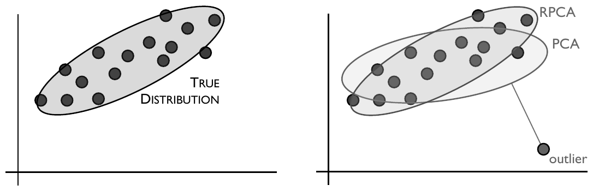


---

## 6.6  Calculus of Variations and the Euler–Lagrange Equations (pp. 245–259)

### Ideas principales

El **cálculo de variaciones** maximiza o minimiza **funcionales**, es decir mapeos de un espacio de funciones a los reales. Ejemplo: optimizar la forma de un ala para maximizar sustentación y minimizar resistencia, donde la forma es una **función** a optimizar bajo restricciones estructurales, de tamaño, de peso. A diferencia de la optimización convencional, donde las incógnitas son vectores de dimensión finita, aquí se optimiza sobre **espacios infinito-dimensionales de funciones**. Ese marco sostiene la teoría de control óptimo, la optimización con restricciones de EDP y el machine learning.

**Historia (p. 245):** el campo se remonta al **problema de la braquistócrona de Johann Bernoulli** a fines del siglo XVII; Euler y Lagrange lo desarrollaron en el XVIII, incluidas la ecuación de Euler–Lagrange y las derivadas funcionales; con el tiempo se amplió a espacios de Sobolev y Banach.

**Áreas donde hoy es vital:**

- **Física y mecánica:** los principios de acción son centrales en mecánica clásica, relatividad general y teoría cuántica de campos.
- **Optimización con EDP (Cap. 8):** optimizar una forma geométrica sujeta a física expresada como EDP — aletas de refrigeración en un intercambiador, el ala de un avión comercial.
- **Control óptimo (Cap. 9):** el principio del máximo de Pontryagin, el filtro de Kalman y la programación dinámica tienen raíces variacionales.
- **Machine learning (Cap. 10):** muchas formulaciones son variacionales; las redes profundas aproximan funcionales (deep operator networks, neural operators).

### R6.33 — Funcional y ecuación de Euler–Lagrange (p. 246)

Un funcional `J` toma una función `y(x)` y devuelve un real:

$$
J[y] = \int_a^b F\big(y(x), y'(x), x\big)\,dx, \qquad (6.66)
$$

donde `F` es escalar y depende de `y`, de su derivada y de la variable independiente. El problema variacional es hallar `y*(x)` que **extremice** (minimice o maximice) `J[y]` sujeto a condiciones de frontera u otras restricciones. En el caso más simple, sin restricciones, la condición es la **ecuación de Euler–Lagrange**:

$$
\frac{\partial F}{\partial y} - \frac{d}{dx}\left(\frac{\partial F}{\partial y'}\right) = 0, \qquad (6.67)
$$

que es el **análogo continuo de igualar el gradiente a cero**.

### R6.34 — Interpretación mecánica y principio de mínima acción (p. 246)

Se reemplaza `F` por el **Lagrangiano** `L(q(t), q̇(t), t)` en **coordenadas generalizadas** `q(t) ∈ ℝⁿ`. Para un péndulo simple, `q = (θ, θ̇)ᵀ` (Fig. 6.16). La variable independiente es el tiempo y `q̇ = dq/dt`. El funcional se llama **integral de acción**:

$$
A[q] = \int_{t_0}^{t_1} L(q(t),\dot q(t),t)\,dt. \qquad (6.68)
$$

El Lagrangiano suele escribirse como **diferencia entre energía cinética y potencial**: `L = T − V`. El **principio de mínima acción** afirma que, entre todas las trayectorias posibles entre dos extremos fijos del espacio de configuración, la trayectoria física es la que hace **estacionaria** la acción. Las **ecuaciones de Euler–Lagrange** son entonces

$$
\frac{\partial L}{\partial q_j} - \frac{d}{dt}\left(\frac{\partial L}{\partial \dot q_j}\right) = 0, \qquad (6.69)
$$

condiciones **necesarias** para la solución del problema variacional, igual que `∇_x f(x)=0` lo es para un mínimo sin restricciones.

**Fig. 6.16 (p. 247)** muestra dos péndulos con longitud constante, cuyo movimiento está restringido a un círculo; las ecuaciones son **mucho más fáciles** en coordenadas intrínsecas `q = (θ, θ̇)ᵀ`, que manejan la restricción naturalmente, que en `(x,y)`; la ventaja crece en el péndulo doble.

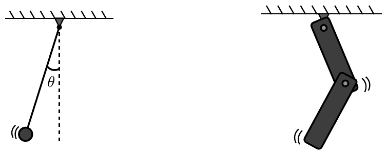

### R6.35 — Derivación: la primera variación se anula (pp. 247–248)

La idea: si `q(t)` extremiza `A`, entonces `A` debe ser **insensible a perturbaciones infinitesimales** de `q`, igual que `∇f(x*)=0` hace que variaciones infinitesimales de `x*` no cambien el objetivo. La derivada de `A` respecto de variaciones infinitesimales es la **primera variación `δA`**. El principio de mínima acción exige

$$
\delta A = 0, \qquad (6.70)
$$

donde `δA` es la primera variación de `A` frente a variaciones de `q(t)` **que fijan los extremos** `q(t₀)` y `q(t₁)`. Se considera la familia de curvas

$$
q_\epsilon(t) = q(t)+\epsilon\eta(t), \qquad (6.71)
$$

con `η(t)` suave y `η(t₀)=η(t₁)=0` (extremos fijos), y

$$
\delta A = \left.\frac{d}{d\epsilon}A[q_\epsilon]\right|_{\epsilon=0} = \left.\frac{d}{d\epsilon}\int_{t_0}^{t_1}L(q_\epsilon,\dot q_\epsilon,t)\,dt\right|_{\epsilon=0}. \qquad (6.72)
$$

Calculando explícitamente:

$$
\frac{d}{d\epsilon}\int_{t_0}^{t_1} L(q+\epsilon\eta,\dot q+\epsilon\dot\eta,t)\,dt = \int_{t_0}^{t_1}\left(\frac{\partial L}{\partial q}\eta+\frac{\partial L}{\partial\dot q}\dot\eta\right)dt \qquad (6.73)
$$

(no hay término por dependencia temporal porque `dt/dε = 0`), evaluado en `ε=0`:

$$
\delta A = \int_{t_0}^{t_1}\left(\frac{\partial L}{\partial q}(q,\dot q,t)\,\eta(t)+\frac{\partial L}{\partial\dot q}(q,\dot q,t)\,\dot\eta(t)\right)dt \qquad (6.74)
$$

y en forma coordenada:

$$
\delta A = \int_{t_0}^{t_1}\sum_{j=1}^{n}\left(\frac{\partial L}{\partial q_j}\eta_j+\frac{\partial L}{\partial\dot q_j}\dot\eta_j\right)dt. \qquad (6.75)
$$

Se **integra por partes** el segundo grupo:

$$
\int_{t_0}^{t_1}\frac{\partial L}{\partial\dot q_j}\dot\eta_j\,dt = \left[\frac{\partial L}{\partial\dot q_j}\eta_j\right]_{t_0}^{t_1} - \int_{t_0}^{t_1}\frac{d}{dt}\left(\frac{\partial L}{\partial\dot q_j}\right)\eta_j\,dt, \qquad (6.76)
$$

y el **término de frontera se anula** porque `η(t₀)=η(t₁)=0`. Sustituyendo:

$$
\delta A = \int_{t_0}^{t_1}\left(\frac{\partial L}{\partial q_j}-\frac{d}{dt}\frac{\partial L}{\partial\dot q_j}\right)\eta_j\,dt. \qquad (6.77)
$$

Como la integral debe anularse **para toda variación `η(t)`**, el integrando debe ser cero **punto a punto**, lo que da las ecuaciones de Euler–Lagrange

$$
\frac{\partial L}{\partial q_j}-\frac{d}{dt}\left(\frac{\partial L}{\partial\dot q_j}\right)=0. \qquad (6.78)
$$

**Son condición necesaria** para que `q` extremice `A[q]` con extremos fijos. Modificarlas para extremos **no fijos** queda como ejercicio (6–28). Este punto de vista **liga la mecánica con una clase más amplia de problemas variacionales**; las restricciones se tratan **o** metiéndolas en el Lagrangiano con multiplicadores **o** restringiendo el conjunto de curvas admisibles.

### R6.36 — Identidad de Beltrami (p. 251)

Si `L = L(y,y′)` **no depende explícitamente de `x`**, se puede usar la forma simplificada

$$
L(y,y') - y'\frac{\partial L}{\partial y'} = \text{constante}.
$$

En el caso de la braquistócrona, con `L(y,y′) = √(1+y′²)/√y` y `∂L/∂y′ = (1/√y)·y′/√(1+y′²)`:

$$
L - y'\frac{\partial L}{\partial y'} = \frac{\sqrt{1+y'^{2}}}{\sqrt{y}} - y'\frac{1}{\sqrt{y}}\frac{y'}{\sqrt{1+y'^{2}}} = \frac{1}{\sqrt{y}\sqrt{1+y'^{2}}} = \text{constante}.
$$

Tomando la constante como `1/(2a)`:

$$
\frac{1}{\sqrt{y}\sqrt{1+y'^{2}}} = \frac{1}{2a} \ \Longrightarrow\ \sqrt{1+y'^{2}} = 2a\sqrt{y}.
$$

### R6.37 — Problema de la braquistócrona → la cicloide (pp. 248–251)

Se busca la curva `y(x)` (con `y` medido **hacia abajo** desde arriba) que **minimiza el tiempo total** que tarda una cuenta sin fricción en deslizar bajo gravedad uniforme de `(0,0)` a `(x₁,y₁)`. Aunque el enunciado es simple, **desafió a las mejores mentes de la época**.

**Intuición:** la recta es el camino más corto, pero **curvar un poco por debajo** hace que la partícula viaje más rápido al inicio, gane momento y llegue antes (Fig. 6.17). Lo óptimo es una **cicloide**.

**Planteamiento.** Partiendo del reposo en `y=0`, la rapidez depende de la caída: `v = √(2gy)`. El elemento de arco es `ds = √(1+y′²)dx` (pues `ds² = dx²+dy²`). El tiempo de un arco infinitesimal es `dT = ds/v = √(1+y′²)dx / √(2gy)`, luego

$$
T[y(\cdot)] = \int_0^{x_1}\frac{\sqrt{1+y'^{2}}}{\sqrt{2gy}}\,dx = \frac{1}{\sqrt{2g}}\int_0^{x_1}F(y,y')\,dx, \qquad F(y,y') = \frac{\sqrt{1+y'^{2}}}{\sqrt{y}} .
$$

Es decir `L(x,y,y′) = √(1+y′²)/√y`, y hay que resolver `d/dx(∂L/∂y′) − ∂L/∂y = 0`. Como `L` **no depende de `x`**, se usa Beltrami (R6.36): `√(1+y′²) = 2a√y`, de donde

$$
1+y'^{2} = 4a^{2}y \ \Longrightarrow\ y'^{2} = 4a^{2}y-1, \qquad y' = \sqrt{4a^{2}y-1}.
$$

Ecuación de primer orden resoluble por separación de variables; el enfoque estándar es **parametrizar por el ángulo de un círculo que rueda**:

$$
y(t) = a(1-\cos t), \qquad x(t) = \frac{a}{2}(t-\sin t).
$$

Las constantes `a` y el extremo final quedan fijados por las condiciones de frontera. La curva `(x(t), y(t))` es una **cicloide**, el extremal de tiempo mínimo, que coincide con la solución clásica.

**Verificación numérica (pp. 251–253).** Se prueban variaciones pequeñas `q_ε(t) = q(t)+εη` y se visualiza el **conjunto de trayectorias cercanas** y sus tiempos de viaje (Figs. 6.19 y 6.20): el histograma de tiempos de llegada muestra que **la cicloide es efectivamente la curva de menor tiempo**.

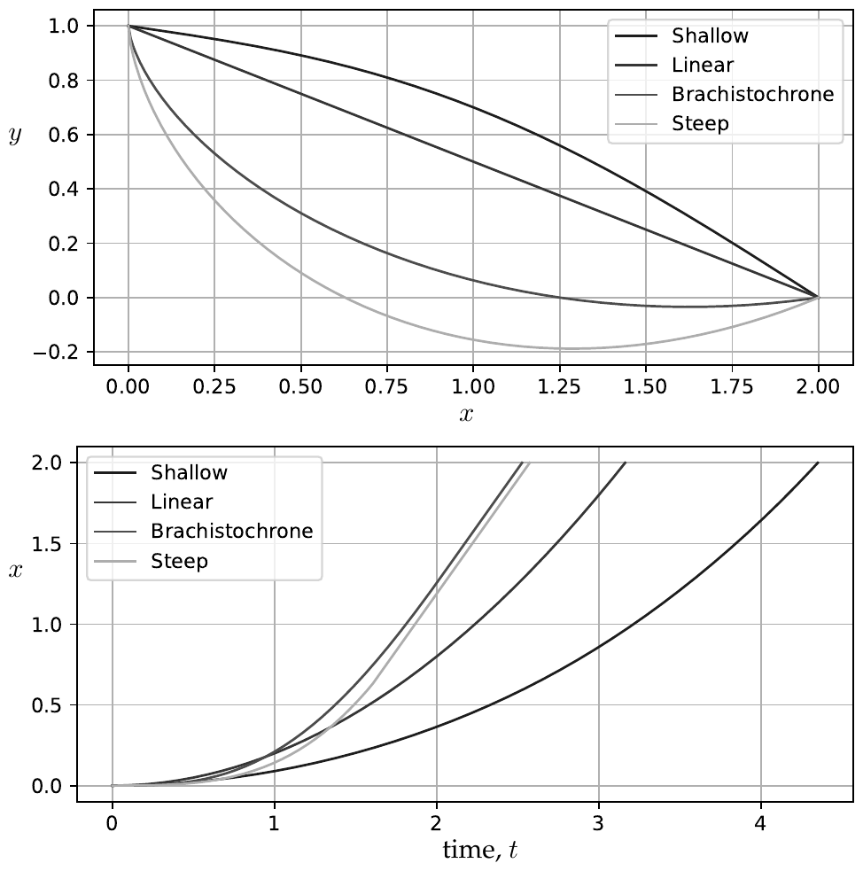

*Figura 6.17 (p. 249):* varias curvas candidatas —"Shallow", "Linear", "Brachistochrone" (roja) y "Steep"— y, abajo, la posición `x` frente al tiempo: la cicloide alcanza el extremo `x=2` en el menor tiempo.

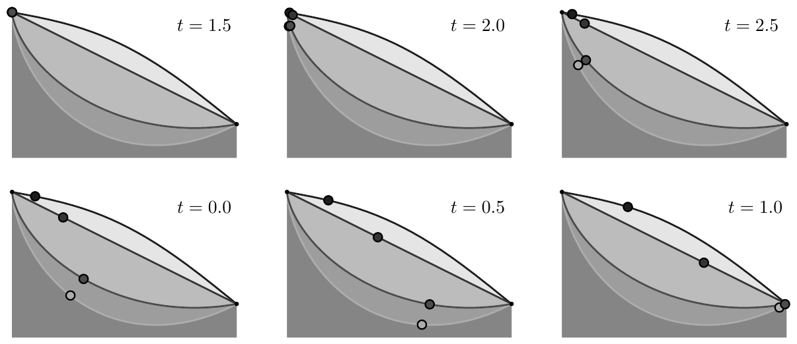

*Figura 6.18 (p. 250):* instantáneas de las partículas bajando cada una de las cuatro rampas de la Fig. 6.17; la partícula roja sobre la cicloide óptima llega primero.

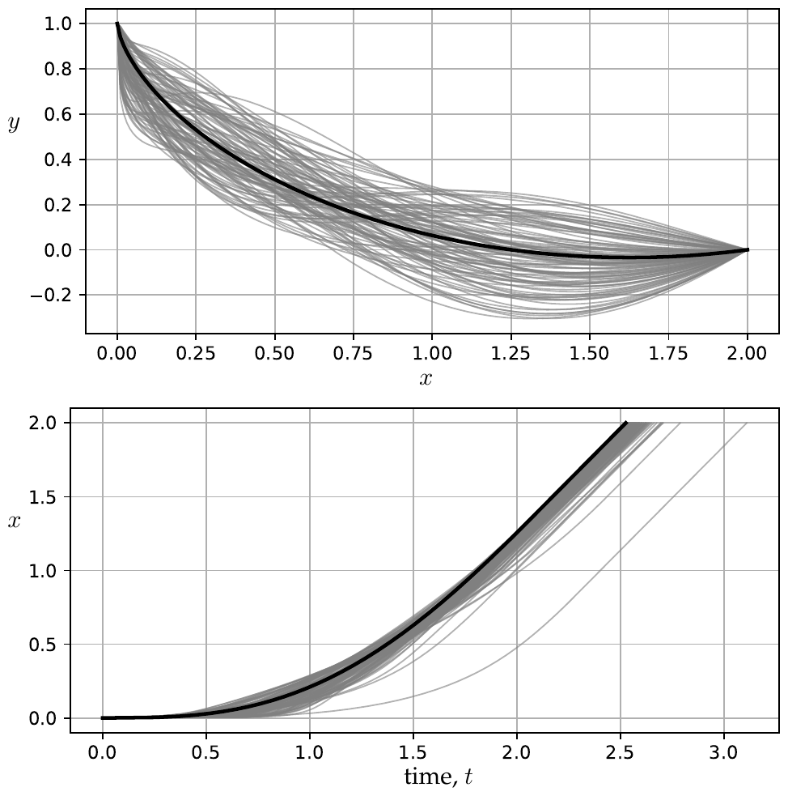

*Figura 6.19 (p. 252):* variaciones `q_ε` de la cicloide óptima (gris) y su posición `x` frente al tiempo; entre todas, la cicloide tarda menos en llegar a `(2,0)`.

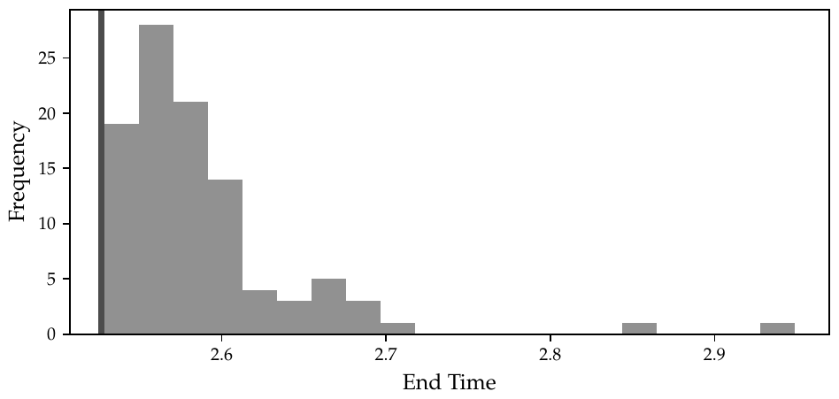

*Figura 6.20 (p. 253):* histograma del tiempo final para alcanzar la meta; la cicloide óptima (roja) está por debajo del conjunto de variaciones (azul).

*Nota 22 del libro:* Bernoulli planteó el problema como reto abierto; se cuenta que Newton, ya retirado de la matemática, anotó la solución esa misma tarde al volver del trabajo; aunque la envió anónima, Bernoulli la reconoció al leerla: *"conocí al león por su garra"*.

### R6.38 — Problema de la tautócrona → la misma cicloide (pp. 251–255)

Planteado por Huygens en el siglo XVII: se busca la curva por la que una cuenta sin fricción llega **al punto más bajo en el mismo tiempo, sin importar desde dónde se suelte**. Se asume reposo inicial en altura `y=0` y deslizamiento por `y(x)` con `y` hacia abajo. La rapidez es `v = √(2gy)` y el arco `ds = √(1+y′²)dx`, así que el tiempo desde `x` hasta el fondo `x*` es

$$
T[x] = \int_x^{x_*}\frac{\sqrt{1+y'^{2}}}{\sqrt{2gy}}\,dx .
$$

**Condición de tautocronía:** `T[x]` debe ser **constante para todo `x`**. Esto solo puede ocurrir si el integrando es el diferencial exacto de una función que crece linealmente con el arco o con un parámetro `t` tal que `T = t* − t`. La forma clásica de imponerlo es **parametrizar por el tiempo**, `x = x(t)`, `y = y(t)`, con llegada al fondo en `t = t*`:

$$
dt = \frac{ds}{v} = \frac{\sqrt{\dot x^{2}+\dot y^{2}}}{\sqrt{2gy}}\,dt \ \Longrightarrow\ \frac{\sqrt{\dot x^{2}+\dot y^{2}}}{\sqrt{2gy}} = 1 \ \Longrightarrow\ \dot x^{2}+\dot y^{2} = 2gy .
$$

Esta ecuación diferencial describe una partícula en un campo gravitatorio central. Reconociendo la solución como cicloide, se elige la parametrización estándar `x(t)=a(t−sin t)`, `y(t)=a(1−cos t)`; entonces `ẋ = a(1−cos t)`, `ẏ = a sin t`, y

$$
\dot x^{2}+\dot y^{2} = a^{2}(1-\cos t)^{2}+a^{2}\sin^{2}t = 2a^{2}(1-\cos t) = 2a^{2}y(t),
$$

de modo que, como `y(t) = a(1−cos t)`, se tiene `ẋ²+ẏ² = 2a²y(t)`, y la condición `ẋ²+ẏ² = 2gy` **se satisface exactamente cuando `a² = g`**. **La solución es de nuevo una cicloide**, la misma curva que resuelve la braquistócrona: es la **única curva que minimiza el tiempo de descenso y a la vez iguala el tiempo desde cualquier punto de partida**. **Fig. 6.21 (p. 254)** muestra cuatro trayectorias que parten de puntos distintos y llegan al fondo (`x=1`) **al mismo tiempo** (`t=1`).

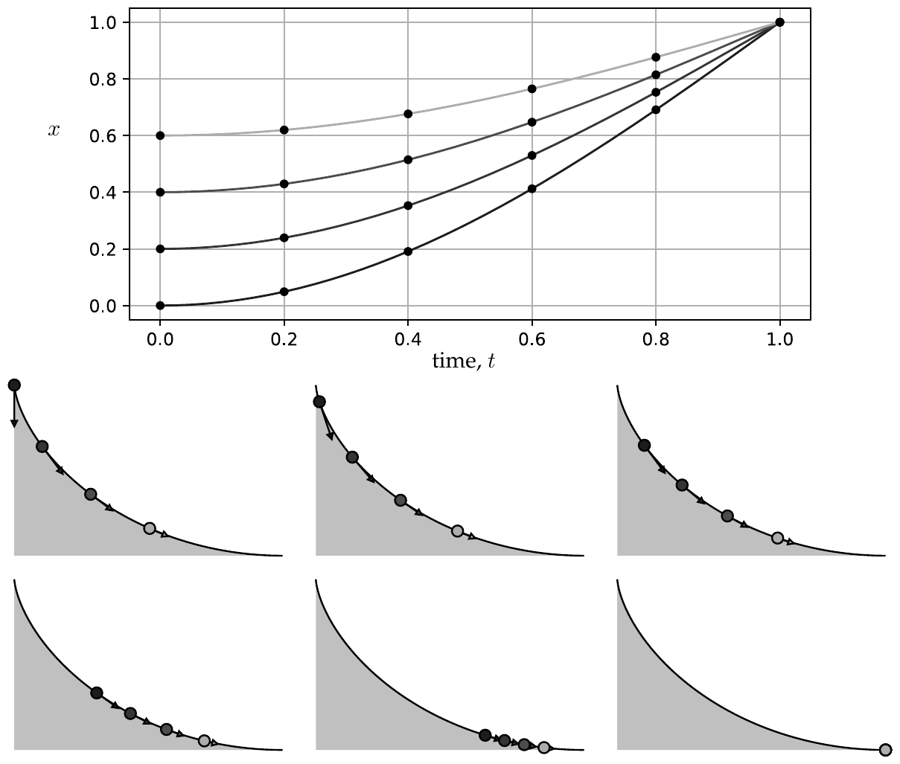

*Figura 6.21 (p. 254):* cuatro trayectorias que parten de puntos distintos de la cicloide y llegan al fondo en el mismo instante; abajo, instantáneas de esas trayectorias en varios tiempos (puntos negros en el panel superior). Modificada de Wikimedia Commons (código original de Claudio Rocchini).

*Nota 23:* Huygens construyó un péndulo con **restricción cicloidal** para garantizar movimiento isócrono, un paso mayor en el diseño de relojes precisos.

### E6.7 — Example: Circle Maximizes Area for a Fixed Perimeter (pp. 255–256)

Problema **isoperimétrico**: maximizar el área `A` encerrada por una curva de perímetro `L` fijo. A diferencia de la braquistócrona o las geodésicas, aquí hay **un funcional a maximizar y una restricción** (perímetro fijo): se introduce un **multiplicador de Lagrange** y se aplica Euler–Lagrange al funcional combinado.

Se parametriza en polares `[r(θ),θ]` con `θ ∈ [0,2π]`, de modo que `(x,y) = (r cos θ, r sin θ)`, y

$$
L[r] = \int_0^{2\pi}\sqrt{r(\theta)^{2}+\dot r(\theta)^{2}}\,d\theta, \qquad A[r] = \frac{1}{2}\int_0^{2\pi}r(\theta)^{2}\,d\theta,
$$

con `ṙ = dr/dθ`. Se considera

$$
\Phi[r] = \int_0^{2\pi}\Big[\tfrac{1}{2}r^{2}-\lambda\sqrt{r^{2}+\dot r^{2}}\Big]d\theta + \lambda L_0,
$$

con `L₀` el perímetro prescrito e integrando `L(r,ṙ) = ½r² − λ√(r²+ṙ²)`. La ecuación de Euler–Lagrange es

$$
\frac{d}{d\theta}\left(-\lambda\frac{\dot r}{\sqrt{r^{2}+\dot r^{2}}}\right)-\left(r-\lambda\frac{r}{\sqrt{r^{2}+\dot r^{2}}}\right)=0 .
$$

Un radio **constante** `r(θ) ≡ R` la satisface (con `λ = R`). La restricción de longitud da `R = L₀/(2π)` y el área encerrada `πR²`, **máxima entre todas las curvas de perímetro `L₀`**. Por tanto la solución estacionaria es **un círculo**, que **maximiza de forma única** el área para un perímetro dado.

### R6.39 — Transformada de Legendre y el Hamiltoniano como forma dual (p. 256)

Para conectar con la imagen hamiltoniana se hace la **transformada de Legendre** del Lagrangiano. Para una coordenada `qⱼ` se define el **momento**

$$
p_j = \frac{\partial L}{\partial \dot q_j},
$$

y el **Hamiltoniano**

$$
H(q,p,t) = p\dot q - L(q,\dot q,t),
$$

con `q̇` visto como función de `(q,p)` al invertir `p = ∂L/∂q̇`. En coordenadas,

$$
H(q_1,\dots,q_n,p_1,\dots,p_n,t) = \sum_{j=1}^{n}p_j\dot q_j - L(q,\dot q,t).
$$

La estacionariedad de la acción equivale al **sistema canónico de Hamilton**:

$$
\dot q_j = \frac{\partial H}{\partial p_j}, \qquad \dot p_j = -\frac{\partial H}{\partial q_j}.
$$

Desde el punto de vista variacional se pueden tratar `(q,p)` como variables independientes e imponer la **estructura simpléctica** `ω = Σ dqⱼ ∧ dpⱼ`, y leer las ecuaciones de Hamilton como la afirmación de que `H` es constante a lo largo de las soluciones si no depende explícitamente del tiempo. **El Hamiltoniano es así una forma dual del Lagrangiano**: la función de energía surge de una transformada de Legendre que convierte velocidades en momentos.

*Nota 25:* lo **simpléctico** es la estructura geométrica que codifica cómo se emparejan posiciones y momentos; el producto cuña `∧` indica un elemento de área orientado `dqⱼ∧dpⱼ` en el plano `(qⱼ,pⱼ)`; en la práctica `ω` es el "libro de contabilidad" que asegura que las ecuaciones de Hamilton **conservan volumen en el espacio de fases**.

**Restricciones en el formalismo hamiltoniano.** Con restricciones `h(q)=0` (y posiblemente `h(q,p)=0`) hay que llevarlas al marco hamiltoniano: identificar las **restricciones primarias** en el espacio de fases e incorporarlas con **Dirac–Bergmann** o con multiplicadores de Lagrange más simples. El efecto final es que el Hamiltoniano se **aumenta con `µᵀh(q,p)`**, o se restringe la dinámica a una **subvariedad de restricción** del espacio de fases. En ambos casos se preserva el principio de acción estacionaria, ahora en el espacio `(q,p)` sujeto a esas restricciones.

### R6.40 — Relación con el conjugado de Fenchel (p. 257)

La transformada de Legendre se aplica a funciones **suaves y convexas** y mapea `f(x)` a `f*(y) = sup_x(xy − f(x))` con `y = ∇f(x)`. El **conjugado de Fenchel** la extiende a cualquier función convexa propia, incluidas las **no diferenciables** o las que toman `+∞`. Ambas describen el **subestimador lineal más ajustado** de `f` en una pendiente dada y son **involutivas** bajo regularidad: `f** = f`. En optimización, el conjugado de Fenchel **sustenta la teoría de dualidad**; en física, la transformada de Legendre conecta variables duales (energía ↔ entropía, Lagrangiano ↔ Hamiltoniano). **La fórmula es idéntica, pero Legendre exige diferenciabilidad y convexidad en todo el dominio**, mientras que Fenchel admite `+∞` (para codificar restricciones) y funciones no diferenciables como normas o funciones indicadoras.

### E6.8 — Quadratic Function (p. 257)

Con `f(x) = ½x²`:

$$
f^{*}(y) = \sup_{x\in\mathbb{R}}\Big(xy-\tfrac{1}{2}x^{2}\Big), \qquad (6.79)
$$

y anulando la derivada, el maximizador es `x = y`, luego

$$
f^{*}(y) = y^{2}-\tfrac{1}{2}y^{2} = \tfrac{1}{2}y^{2}. \qquad (6.80)
$$

Aquí **la transformada de Legendre y el conjugado de Fenchel coinciden**, porque `f` es convexa y diferenciable en todas partes.

### R6.41 — KKT y dualidad en dimensión infinita (p. 257)

El problema infinito-dimensional se plantea como

$$
\min\ J[y] \quad \text{s.t.} \quad y\in Y,\ \ g_j[y]\ge 0,\ j=1,\dots,m,
$$

con `Y` un espacio de funciones admisibles y restricciones que pueden ser integrales. Las KKT **son análogas al caso finito-dimensional**: estacionariedad vía una **condición de derivada funcional**, análoga a Euler–Lagrange; factibilidad primal; factibilidad dual (`µⱼ ≥ 0`); holgura complementaria `µⱼgⱼ[y]=0`; y posiblemente **condiciones de frontera o de transversalidad**. Son los análogos infinito-dimensionales de las KKT convexas finitas.

**Dos estrategias de solución:**

- **Métodos indirectos:** se aplica formalmente Euler–Lagrange o KKT y se obtienen **ecuaciones diferenciales** que se resuelven analítica o numéricamente.
- **Métodos directos:** se **discretiza** el espacio de funciones (elementos finitos, diferencias finitas) y se resuelve el problema finito-dimensional grande con herramientas estándar: punto interior o SQP.

**Flujo de trabajo típico en optimización con EDP:** representar `y(x)` con **pocos parámetros** (p. ej. polinomios por tramos), aproximar `J[y]` y las restricciones por sumatorias o cuadraturas, y resolver el problema finito resultante con iteraciones de gradiente o Newton. Es popular porque ya existen solvers que manejan sistemas grandes y **dispersos**. Alternativamente se puede resolver el **sistema variacional (KKT) a nivel continuo y discretizar después**: la ventaja es una expresión más precisa de condiciones como las **ecuaciones adjuntas**; la desventaja, mayor complejidad de implementación y análisis.

**Restricciones como condiciones adicionales.** En muchos sistemas mecánicos hay restricciones **holonómicas** `φ(q)=0`, que se incorporan al Lagrangiano por multiplicadores o por reducción. Con `L′ = L + λφ(q)`, la variación respecto de `λ` da `φ(q)=0` y la variación respecto de `q` da Euler–Lagrange **con un término adicional `λ ∂φ/∂q`**. Alternativamente se interpreta la restricción como **restricción del espacio de curvas admisibles** `q(t)`, tomando la variación solo entre curvas con `φ(q(t)) ≡ 0`: la restricción se satisface en cada instante y Euler–Lagrange **incorpora las fuerzas de restricción**, señaladas típicamente por un multiplicador.

### R6.42 — Tipos de derivadas: total, funcional, Gâteaux, Fréchet (pp. 258–259)

**Derivada total.** Para `f : ℝⁿ → ℝ`, `Df(x) = ∇f(x) = [∂f/∂x₁, …, ∂f/∂xₙ]ᵀ`, con

$$
f(x+\delta) = f(x)+\nabla f(x)^{T}\delta + o(\|\delta\|).
$$

*Nota 26:* `o(‖δ‖)` significa que el resto **desaparece más rápido que linealmente** cuando `‖δ‖ → 0`, que es la condición que define diferenciabilidad; `O(‖δ‖)` solo garantiza que el error está **acotado** por un múltiplo constante de `‖δ‖` cerca de cero. Para expansiones de primer orden precisas, la notación correcta es **little-o**.

**Derivada funcional.** Para un funcional `A[q]` que mapea una función a un escalar, `δA/δq(t)` generaliza el gradiente a espacios infinito-dimensionales:

$$
\delta A[q;\eta] := \left.\frac{d}{d\epsilon}A[q+\epsilon\eta]\right|_{\epsilon=0},
$$

y cuando `A` es una integral,

$$
\delta A[q;\eta] = \int_{t_0}^{t_1}\frac{\delta A}{\delta q(t)}\cdot\eta(t)\,dt .
$$

Esto **define `δA/δq(t)`** como la función (o distribución) que hace de gradiente en el producto interno con cualquier variación admisible `η(t)` (demostrarlo es el ejercicio 6–36). Las ecuaciones de Euler–Lagrange salen de **anular la derivada funcional** bajo variaciones admisibles.

**Derivada de Gâteaux.** Para `A : X → ℝ` sobre un espacio normado, en la dirección `η ∈ X`:

$$
Df(q;\eta) := \lim_{\epsilon\to0}\frac{A(q+\epsilon\eta)-A(q)}{\epsilon}.
$$

Generaliza la **derivada direccional** y **puede existir aunque `A` no sea diferenciable en el sentido más fuerte de Fréchet**. Si el límite existe para todo `η`, `A` es Gâteaux-diferenciable en `q`.

**Derivada de Fréchet.** Versión **más fuerte y rigurosa**. `A` es Fréchet-diferenciable en `q` si existe un **operador lineal acotado** `L : X → ℝ` con

$$
\lim_{\|\eta\|\to0}\frac{|A(q+\eta)-A(q)-L(\eta)|}{\|\eta\|} = 0,
$$

y se escribe `DA(q)[η] = L(η)`. **Si es Fréchet-diferenciable, entonces es Gâteaux-diferenciable, pero el recíproco no siempre vale.** Formalmente se usan derivadas de Fréchet en espacios de Banach (p. ej. Sobolev `W^{1,2}`) para tratar problemas complejos. En los ejercicios (6–38, 6–39) se exploran un caso donde ambas coinciden y otro donde **difieren**.

*Síntesis del libro:* en la práctica **Gâteaux es la más fácil de calcular y la más débil**, y **Fréchet la más exigente** (garantiza propiedades más fuertes, como continuidad). Con estas definiciones también se definen derivadas direccionales, extendiendo la noción finito-dimensional a dimensión infinita.

---

## Suggested Reading (pp. 260)

**Textos**

1. *Constrained Optimization and Lagrange Multiplier Methods*, D. P. Bertsekas, 2014.
2. *Conjugate Duality and Optimization*, R. T. Rockafellar, 1974.
3. *Conjugate Duality in Convex Optimization*, R. I. Bot, 2009.
4. *Primal-Dual Interior-Point Methods*, S. J. Wright, 1997.
5. *Introduction to Mechanics and Symmetry*, J. E. Marsden y T. S. Ratiu, 2009.
6. *Variational Analysis*, R. T. Rockafellar y R. J. B. Wets, 1998.

**Artículos y revisiones**

1. *Lagrange multipliers and optimality*, R. T. Rockafellar, SIAM Review, 1993.
2. *Duality in nonconvex optimization*, J. F. Toland, J. Math. Anal. Appl., 1978.
3. *Playing with duality: An overview of recent primal–dual approaches for solving large-scale optimization problems*, N. Komodakis y J.-Ch. Pesquet, IEEE Signal Processing Magazine, 2015.
4. *Interior-point methods*, F. A. Potra y S. J. Wright, J. Comput. Appl. Math., 2005.
5. *Distributed optimization and statistical learning via the alternating direction method of multipliers*, S. Boyd, N. Parikh, E. Chu, B. Peleato y J. Eckstein, Foundations and Trends in Machine Learning, 2011.
6. *Robust principal component analysis?*, E. J. Candès, X. Li, Y. Ma y J. Wright, Journal of the ACM, 2011.
7. *Discrete mechanics and optimal control*, O. Junge, J. E. Marsden y S. Ober-Blöbaum, IFAC Proceedings Volumes, 2005.

---

## Homework (pp. 261–267)

**6–1.** Resolver `min (x−2)²+(y+1)²` s.t. `x²+y² = 4`; hallar el multiplicador e interpretar geométricamente la solución.

**6–2.** Verificar que (6.9) da una solución donde el gradiente del objetivo es normal a la restricción.

**6–3.** Para `min f(x)` s.t. `gᵢ(x) ≥ 0`, `i = 1,2` en `ℝ²`: listar las KKT con `µ₁, µ₂` y discutir holgura complementaria y estacionariedad con palabras propias.

**6–4.** Verificar que se cumplen las condiciones de regularidad del problema de mínimos cuadrados con restricciones de caja (§6.2).

**6–5.** Punto de silla con igualdades para `min x₁²+x₂²` s.t. `x₁+x₂=1`: (1) resolver por KKT — forma `L(x,λ)`, gradientes en `x` y `λ`, resolver para `(x*,λ*)`; (2) verificar la propiedad de punto de silla `L(x*,λ) ≤ L(x*,λ*) ∀λ` y `L(x,λ*) ≥ L(x*,λ*)` para todo `x` factible; (3) graficar `L(x,λ*)` sobre la recta `x₁+x₂=1` y `L(x*,λ)` en `λ`.

**6–6.** Caso sutil: `min 3x` s.t. `x ≤ 3`, `x ≥ −1`. Resolver por KKT; verificar la propiedad de punto de silla; mostrar que `∇_{x,µ₁,µ₂}L` **no es cero** en el óptimo y explicar por qué eso no contradice la interpretación de silla; graficar y explicar por qué el Lagrangiano restringido **no tiene gradiente nulo** con desigualdades; resumir la diferencia con la interpretación habitual de punto de silla.

**6–7.** Lagrangiano y función dual para `min x₁+x₂` s.t. `x₁²+x₂² ≤ 25`, `x₁+x₂ ≥ 2`, `x₁,x₂ ≥ 0`; escribir el dual explícito, discutir dualidad fuerte vs. débil y resolver ambos.

**6–8.** Dual del LP con igualdades `min cᵀx` s.t. `Ax=b`: escribir Lagrangiano, función dual y programa dual; resolver un ejemplo concreto y también por punto interior.

**6–9.** Mostrar que `f(x) = 0` si `x=0`, `1` si `x≠0` **no es semicontinua inferiormente**.

**6–10.** Mostrar que la función dual (6.20) es **siempre cóncava**, incluso si el primal es no convexo, por ser ínfimo puntual de funciones afines en `(λ,µ)`: explicar por qué es ese ínfimo (mostrando que el Lagrangiano aumentado es afín en `λ,µ`) y demostrar que el ínfimo puntual de afines es cóncavo.

**6–11.** Probar que `φ(λ,µ)` en (6.44) es siempre cóncava.

**6–12.** Completar los detalles de (6.48): calcular el ínfimo en `x`, obtener `x*(λ)` y sustituir para llegar a `φ(λ) = −¼λ²+λ+1`.

**6–13.** Extender la interpretación geométrica de la dualidad a desigualdades `g(x) ≤ 0` con `f` convexa y s.c.i., `g` vector de convexas, `x*` óptimo y `µ* ≥ 0`: (1) mostrar que las restricciones activas determinan una **cara** de `∂C` y que cada `∇gⱼ(x*)` define una normal **entrante** a `C`; (2) mostrar que `Σ_{activas} µ*ⱼ∇gⱼ(x*)` es **combinación cónica** (coeficientes no negativos) de las normales activas; (3, opcional) que la **envoltura cónica** de un conjunto de vectores es convexa; (4) que esa suma define la **normal a un hiperplano de soporte** de `C` en `x*`; (5) concluir con la estacionariedad KKT que `∇f(x*)` está en el span de las normales y qué implica sobre las direcciones de descenso factibles; (6) mostrar que **no existe dirección de descenso factible** en `x*` y que cualquier `d` con `∇f(x*)ᵀd < 0` viola alguna restricción (optimalidad local).

**6–14.** Aplicar lo anterior a `min x₁²+x₂²` s.t. `x₁+x₂−1 ≤ 0`, `−x₁,−x₂ ≤ 0`: (1) región factible; (2) `x*` y restricciones activas; (3) gradientes activos como normales entrantes; (4) verificar estacionariedad y visualizar el **balance de fuerzas**; (5) visualizar el hiperplano de soporte.

**6–15.** Verificar que la envolvente convexa de `f(x)=min(x²,|x|)` es `f**(x)` de (6.39) (Fig. 6.10); calcular `f*` y `f**` y confirmar que ambas son convexas.

**6–16.** Mostrar que la solución del problema (6.52) satisface la primera condición KKT.

**6–17.** Mostrar que el gradiente y el Hessiano del objetivo con barrera logarítmica del LP, (6.55), son las expresiones de (6.56).

**6–18.** Modificar el Código 6.1 para un QP con las mismas restricciones lineales: `f(x) = ½xᵀQx+cᵀx` con `Q = [[2,−1],[−1,2]]` y `c = x₀ᵀQ` para `x₀ = (40,30)`; el camino está en la Fig. 6.13 (derecha). Mostrar a mano que el mínimo analítico de `f` está en `x = x₀`.

**6–19.** Resolver el problema de mínimos cuadrados con caja (6.17) por punto interior y graficar el camino central para distintos parámetros del IPM.

**6–20.** Para (6.17), deducir `µⱼ = t/(xⱼ−ℓⱼ)` y `νⱼ = t/(uⱼ−xⱼ)`.

**6–21.** Resolver (6.17) con gradiente proyectado para varios pasos `γ` y comparar con la solución por IPM.

**6–22.** Resolver el LASSO del ejercicio 5–1 con el código ADMM del §6.5.

**6–23.** Sistema `Ax ≈ b` con `x ∈ ℝ¹⁰` de **exactamente 2 elementos no nulos**: generar `A ∈ ℝ¹⁰⁰ˣ¹⁰` aleatoria, `b` combinación de exactamente 2 columnas de `A`, añadir **1% de ruido** a `b` y resolver con ADMM-LASSO.

**6–24.** Comparar ADMM-LASSO con **SR3, ISTA y FISTA**: objetivo vs. iteraciones y dispersidad resultante; comentar fortalezas y debilidades relativas.

**6–25.** Denoising por **variación total 1D**: `min ½‖x−y‖₂²+λ‖Dx‖₁` con `D ∈ ℝ^{(n−1)×n}` el operador de primera diferencia. Derivar ADMM con splitting `Dx=z` y mostrar el sistema lineal `(I+ρDᵀD)x = y+ρDᵀ(z−u)` y `z = soft(Dx+u, λ/ρ)`; implementar con solvers FFT o bandados y explorar `λ`.

**6–26.** QP con caja por ADMM frente a gradiente proyectado: `min ½xᵀQx+cᵀx` s.t. `ℓ ≤ x ≤ u`, `Q > 0`, con splitting `x=z` y proyección `Π_{[ℓ,u]}(·)`; comparar con gradiente proyectado de paso fijo óptimo `1/L`, `L = ‖Q‖₂`.

**6–27.** Masa en un plano sin fricción restringida a la curva `h(x,y)=0`: escribir las ecuaciones de movimiento con multiplicadores y comparar con las leyes de Newton para movimiento restringido; dar el caso de la parábola `h(x,y) = y−x² = 0`.

**6–28.** Modificar Euler–Lagrange para **extremos no fijos**.

**6–29.** Deducir (6.73) expandiendo el Lagrangiano dentro de la integral en potencias de `ε` y derivando respecto de `ε` en cero.

**6–30.** Mostrar que la **recta** es el camino más corto entre dos puntos `A` y `B` definiendo un funcional y verificando Euler–Lagrange.

**6–31.** Deducir la **identidad de Beltrami**: si `L = L(y,y′)` no depende de `x`, entonces `L(y,y′) − y′∂L/∂y′ = constante`.

**6–32.** Sustituir la solución cicloide de la braquistócrona en Euler–Lagrange y verificar que es **localmente extremal**.

**6–33.** Análogamente, mostrar que la cicloide también resuelve la **tautócrona** satisfaciendo Euler–Lagrange.

**6–34.** Deducir la fórmula del **arco máximo** como geodésica en la superficie de una esfera (camino más corto entre dos puntos de una superficie curva).

**6–35.** Péndulo simple con tres enfoques canónicos: (1) leyes de Newton en `(x,y)` con restricciones como multiplicadores; (2) Euler–Lagrange en coordenadas angulares `(θ, θ̇)`; (3) ecuaciones de Hamilton en coordenadas conjugadas `(q,p)` con `q=θ`. Comparar y discutir cómo se satisface la restricción en cada uno.

**6–36.** Mostrar que `δA[q;η] := d/dε A[q+εη]|_{ε=0} = ∫ (δA/δq(t))·η(t) dt` cuando `A` es una integral como (6.66): expandir a primer orden `A[q+εη] = A[q] + ε∫B(η)dt + O(ε²)` y extraer el integrando del término lineal.

**6–37.** Calcular la derivada funcional de `A[q] = ∫_{t₀}^{t₁}(½‖q̇(t)‖² − V(q(t)))dt`: con `q_ε = q+εη`, obtener `δA = ∫(−∇V(q(t))·η(t) + q̇(t)·η̇(t))dt`, integrar por partes el segundo término con extremos fijos e igualar a cero para llegar a la forma simple de Euler–Lagrange de una partícula en un pozo de potencial `V(q)`.

**6–38.** Caso donde **Gâteaux y Fréchet coinciden**: `F[q] = ∫₀¹q(t)²dt` con `q ∈ L²[0,1]`, `q_ε = q+εη`: (1) mostrar `δF[q;η] = 2∫₀¹q(t)η(t)dt`; (2) verificar que es **lineal y continua** en `η`; (3) concluir que la derivada de Fréchet existe y **coincide** con la de Gâteaux; (4) mostrar que la derivada funcional existe en sentido distribucional con `δF/δq(t) = 2q(t)`.

**6–39.** Caso donde **difieren**: `F[q] = (∫₀¹|q(t)|dt)²` con `q ∈ L¹[0,1]`, `q_ε = q+εη` para cualquier `η ∈ L¹[0,1]`: (1) mostrar que `F` está bien definida y es finita para todo `q ∈ L¹`; (2) calcular la derivada de Gâteaux en `q=0` en la dirección `η`; (3) mostrar que es **cero para toda dirección**, `δF[0;η]=0`; (4) argumentar por qué esa derivada **no es lineal ni continua** en `η` en ningún entorno de `q=0`; (5) concluir que la derivada de Fréchet **no existe** en `q=0`; (6) discutir si existe una derivada funcional y qué significaría.

---

## Verificación de completitud

### Tabla de conteos

| Elemento | En el fuente | En este documento | Verificado |
|---|---|---|---|
| Ecuaciones numeradas del libro | 6.1–6.80 (continuas, con sub-etiquetas a–d) | todas las numeradas | ✔ mismas etiquetas, con su número original |
| Figuras | 21 (6.1–6.21) | 21 | ✔ las 21 presentes en `images/` |
| Paneles | 4 (6.1–6.4) | 4 | ✔ reproducidos en texto |
| Ejercicios | 39 (6–1 … 6–39) | 39 | ✔ serie contigua, ninguno falta |
| Secciones | 6 (§6.1–§6.6) | 6 | ✔ |
| Resultados numerados por nosotros (R6.x) | — | 42 | ✔ serie contigua R6.1–R6.42 |
| Ejemplos numerados por nosotros (E6.x) | — | 8 | ✔ E6.1–E6.8, serie contigua |
| Listados de código | IPM LP (Código 6.1), ADMM-LASSO, RPCA, barrera (`phi`, `grad_phi`, `hess_phi`), `prox_l1` | 6 bloques | ✔ verbatim |

### Estructura de las ecuaciones por sección

| Sección | Páginas | Ecuaciones |
|---|---|---|
| 6.1 Lagrange Multipliers | 205–213 | 6.1–6.12 |
| 6.2 KKT | 214–219 | 6.13–6.18 |
| 6.3 Duality | 220–233 | 6.19–6.48 |
| 6.4 Interior Point Methods | 234–238 | 6.49–6.56 |
| 6.5 ADMM | 239–244 | 6.57–6.65 |
| 6.6 Calculus of Variations | 245–259 | 6.66–6.80 |

### Qué se dejó fuera del fuente (explícito)

- Encabezados de página (*running heads*): "CHAPTER 6. CONSTRAINTS AND DUALITY", "6.1. LAGRANGE MULTIPLIERS", etc.
- Pies de página con el aviso de copyright, repetido en cada página.
- Numeración de página de los pies.
- Los **ejes y marcas de las figuras** no se transcriben como texto: van en los recortes PNG de `images/`.
- El fragmento de **código RPCA** que en el PDF se interrumpe por el salto de página 243→244 (el cuerpo del bucle) se reproduce completo, tomando la continuación de la p. 245.

### Anomalías del propio libro (reportadas, no corregidas)

- **Panel 6.3** (p. 233): el libro anuncia `µ*_trabajo = 1` y `µ*_material = 2` para `r₂ < r₁`, pero el texto continúa diciendo que "cada unidad extra de trabajo aumenta el beneficio en $1" y que "cada unidad extra de material también aumenta el beneficio en $1" (óptimos `(3,2)` y `(1,3)`, ambos con 7). Es una **inconsistencia interna del original**: con `∇v = (1,1)ᵀ` los dos precios sombra son 1, y el "$2" que aparece en el enunciado no cuadra con el valor `v = r₁+r₂` de la rama `r₂<r₁`. Se reproduce el texto y se marca la tensión en vez de "arreglarla".
- **§6.5, pseudocódigo** (p. 240): el comentario de las tres líneas usa `x := prox_f(-z - u, 1/rho)` mientras las ecuaciones desplegadas son `x^{k+1} = argmin [f(x) + (ρ/2)‖x − z^k + u^k‖²]`. Los signos del comentario y de la ecuación **no corresponden** (el de la ecuación es el correcto para la forma `x−z+u`); se conserva el pseudocódigo tal cual, porque es lo que el libro imprime.
- **§6.4, barrera** (p. 238): el libro dice "as `t → 0`, this barrier becomes infinite" — la frase es ambigua (la barrera crece al acercarse a la frontera, no al decrecer `t`; lo que ocurre con `t → 0` es que **desaparece** el efecto de la barrera). Se transcribe la idea sin el giro confuso.

### Verificación de la regla de páginas

La regla (el entero en la línea que empieza con `\x0c` da la página del libro texto que sigue) se validó en 9 pasajes: apertura del capítulo (203), las seis aperturas de sección (205, 214, 220, 234, 239, 245), *Suggested Reading* (260), *Homework* (261) y el último ejercicio (267 = página PDF 279, inmediatamente antes de la p. 280 donde abre el Capítulo 7). **En ningún pasaje resultó corrida en uno**, y el desplazamiento PDF → libro (+12) es el mismo del Capítulo 5.
